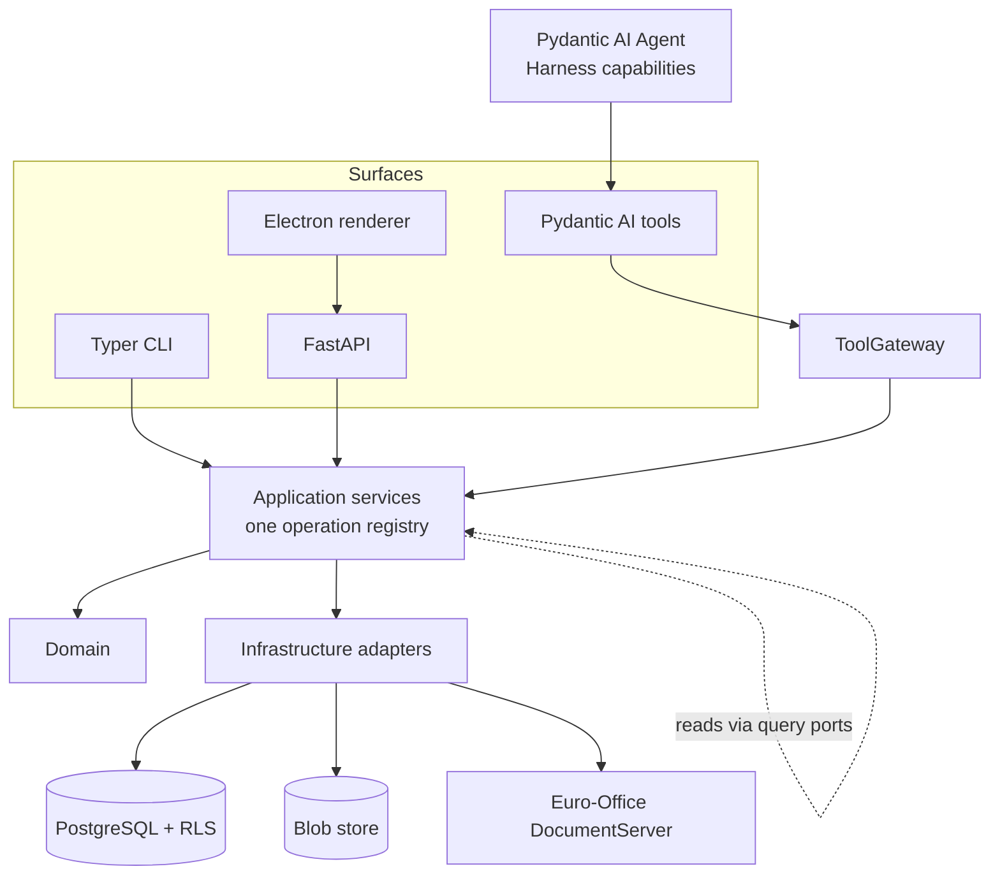

# MavrykX — Engineering enforcement audit

**Status:** approved · **Version:** 1 · **Date:** 2026-11-26

Approved. Every rule is a check with a negative fixture; prose is not the gate.

The objective is a small, repository-level framework that makes recurring agent mistakes hard to
introduce and easy to detect. Enforcement is executable: lint, types, architecture checks and tests.
Markdown may explain a rule; it may never be the check.

---

## 1. Stack and pins

The complete stack, with the pin that owns each runtime, is in
[`repo-scaffold.md`](./repo-scaffold.md) §1. The rules that matter here:

- `pydantic-ai-harness==0.75.0` is the only declared agent-runtime pin. It requires
  `pydantic-ai-slim==2.75.0`; `pydantic-ai` and `pydantic-graph` are never declared separately.
- Extras are part of the pin: `coder`, `codemode`, `skills`, `dynamic-workflow`, `pgtask`, `logfire`.
- Python is `>=3.14,<3.15` with `uv.lock`; PostgreSQL is `17.12`; Electron 45.5.0 carries its own
  Node ABI, separate from the build Node 26.13.1.
- Euro-Office is `9.3.8`, both DesktopEditors and DocumentServer.

The lockfile is the evidence. A prose version that disagrees with the lock is a defect.

---

## 2. Existing controls

| Control | Decision | Reason |
|---|---|---|
| `docs/v1/` as the five-document design set | **Keep** | One owner per truth |
| `AGENTS.md` laws | **Keep**, as rationale | Not enforcement; points at checks |
| SQL appendix + RLS negative test | **Keep and extend** | Proven isolation; becomes a CI job |
| Table-ownership rule | **Extend** | Becomes `tools/ownership.py` |
| Layering rules in `01` §6 | **Extend** | Become import-linter and dependency-cruiser contracts |
| “Prose does not enforce” | **Replace with checks** | This audit |
| Hand-written architecture review | **Keep** | Human judgement, not a gate |

There is no Spec Kit pipeline. The repository uses the Matt Pocock flow and GitHub Issues for specs,
tickets and implementation; there is no `specs/` tree.

There are no lint, type, test or CI configurations yet. Nothing exists to retain beyond the design
documents and the SQL appendix.

---

## 3. Missing controls

- No code, lockfile, package manifests or tool configuration.
- No operation registry, so “CLI, HTTP and tool call the same operation” is untested.
- No table-ownership manifest or generated schema.
- No comment policy check; no Markdown policy check.
- No negative fixtures, so every rule is unproven.
- No harness-neutral command and no CI gate.
- No type framework for identities, states or approvals.

---

## 4. Boundary map

Rules: surfaces import application only; application imports domain and ports; infrastructure sits
behind ports; the renderer imports the preload surface only; the agent imports tools, never a
repository.

---

## 5. Rule catalogue

Five facts per rule: the problem, where it applies, how it is enforced, the correct alternative, and
the test that proves the rule works. All tests are negative: they introduce the forbidden pattern
and assert a failure that names the rule.

### A. Code quality

| ID | Problem | Applies to | Enforced by | Correct alternative | Proof |
|---|---|---|---|---|---|
| A1 | `Any`, implicit `any`, unchecked casts | Python, TS | mypy strict; tsc strict; `no-explicit-any` | Typed model or `unknown` + narrowing | Fixture with `Any` and `as` fails |
| A2 | Swallowed errors, floating promises | Python, TS | ruff `BLE`,`TRY`; eslint `no-floating-promises` | Propagate or handle with context | Fixture with empty `except` / unawaited call fails |
| A3 | Routine comments | Production TS and Python | `tools/comments.py`; custom ESLint rule | Rename, extract, or write a test | Fixture with `// increment` fails; licence header passes |
| A4 | Unapproved dynamic execution | Python | ruff `S102`,`S307`; import ban | Typed call or declared adapter | Fixture with `eval(` fails |
| A5 | Timers as a workaround | TS, Python | ESLint `no-restricted-globals`; ruff custom | Deterministic event or awaited signal | Fixture with `setTimeout` in a service fails |
| A6 | Unapproved or vulnerable dependency | Python, npm | `pip-audit`, `npm audit`, dependency allowlist | Add through review and pin | A dependency outside the allowlist fails |

### B. Architecture

| ID | Problem | Applies to | Enforced by | Correct alternative | Proof |
|---|---|---|---|---|---|
| B1 | Domain imports infrastructure | `domain/`, `modules/*/domain` | import-linter layers | Define a port; implement it outside | Fixture importing SQLAlchemy fails |
| B2 | Interface computes a decision | `interfaces/` | import-linter independence + operation parity | Put it in the service | Fixture with a branch in a route fails |
| B3 | Operation implemented twice | CLI, HTTP, tools | `tools/operations.py` parity | One registry entry, three adapters | Route with no registry entry fails |
| B4 | Renderer reaches Node or DB | `apps/desktop/src/renderer` | dependency-cruiser + preload allowlist | Add a preload method | Fixture importing `node:fs` fails |
| B5 | Module writes another’s table | `modules/` | ownership manifest + SQL grants | Call the owner’s service/port | Fixture with a foreign `INSERT` fails |
| B6 | Cycle or god file | Whole repo | import-linter; dependency-cruiser; size check | Split at a seam | Fixture with a cycle fails |
| B7 | Court-specific branch in core | `domain/`, `application/` | `tools/court_leak.py` | Adapter data in `forum_adapters` | Fixture naming a court fails |
| B8 | Two owners for one table | Schema | `tools/ownership.py` | One owner per table | Manifest with two owners fails |

### C. Documents and comments

| ID | Problem | Applies to | Enforced by | Correct alternative | Proof |
|---|---|---|---|---|---|
| C1 | Unapproved Markdown | Repository | `tools/markdown_policy.py` | Update the owner, or add an allowlist entry with a reason | New file not in the manifest fails |
| C2 | `FINAL`/`V2`/temporary report | Filenames, headings | same script | Rename to the owner | `FINAL-architecture.md` fails |
| C3 | Duplicate design authority | `docs/` | manifest + duplicate-title check | Point at the owner | Second architecture doc fails |
| C4 | Prose-only rule | `AGENTS.md` | review checklist + rule ID in the check | Add a check, cite its ID | Rule without a check fails the audit script |

### D. Authority and permissions

| ID | Problem | Applies to | Enforced by | Correct alternative | Proof |
|---|---|---|---|---|---|
| D1 | Caller supplies authority | Application services | `MatterScope` constructor; type test | Boundary constructs the scope | Fixture passing a scope from a tool fails |
| D2 | Agent surface offers a human-only action | Tool catalog | allowlist + operation metadata | Mark human-only; do not register a tool | Fixture registering `approve` as a tool fails |
| D3 | Two copies of an allowlist | Capabilities | generated subset + drift test | Declare once; derive subsets | Hand-edited copy fails |
| D4 | Unreadable policy allows | Policy loader | deny-by-default test | Fail closed with a visible error | Corrupt policy fixture returns deny |

### E. Records and operations

| ID | Problem | Applies to | Enforced by | Correct alternative | Proof |
|---|---|---|---|---|---|
| E1 | Untyped reference | Domain, schema | typed IDs; FK + owner validation | Reference the owner’s ID type | Free-text `matter` field fails |
| E2 | Overwrite instead of supersede | Documents, rules | immutability test | Insert a new version | `UPDATE` on a version fails |
| E3 | Write without audit | Services | integration test on the audit chain | Append the event in the transaction | Service write without an event fails |
| E4 | Unknown returns closest match | Resolvers | result type `Unresolved` | Return `Unresolved(missing=...)` | Fixture returning a guess fails |
| E5 | Non-idempotent command | Operations | registry metadata + replay test | Accept an idempotency key | Double invoke creates twice |
| E6 | Contract drift | API, tools, CLI | `tools/contracts_drift.py` | Generate from one source | Hand-edited generated file fails |
| E7 | Docs disagree with code | Docs | version table vs lock; route vs docs | Fix code or doc in the same change | Mismatched pin fails |
| E8 | Model and migration drift | Schema | `alembic check` | Change the model and add a revision in one commit | A model field without a revision fails |

---

## 6. Lint and type-check rules

### Python

- `ruff` with `E,F,I,B,UP,SIM,ARG,PTH,TRY,BLE,RUF,S` and a project rule ID prefix.
- `mypy --strict` with `disallow_any_explicit`, `disallow_untyped_defs`, `warn_unreachable`.
- `import-linter` layers: domain → application → infrastructure → interfaces; independence per
  module; forbidden imports of FastAPI, SQLAlchemy, Pydantic AI and Electron in domain.
- `pip-audit` for known dependency vulnerabilities and `npm audit` for the JS tree. Ruff `S` covers the common code-pattern checks Bandit would find, so Bandit is not a separate tool.

### TypeScript

- `tsc --noEmit` with `strict`, `noUncheckedIndexedAccess`, `exactOptionalPropertyTypes`,
  `noImplicitOverride`, `noFallthroughCasesInSwitch`.
- Pin TypeScript **6.0.3**: `typescript-eslint` 8.74 supports `<6.1.0`, so TypeScript 7 breaks
  type-aware linting. Use ESLint 10 with `eslint-plugin-import-x`.
- Pin `@types/node` **24.19.4** to match Electron's Node 24.22.3; the 26 types belong to build
  scripts, not the main process.
- ESLint with `@typescript-eslint` strict, `no-explicit-any`, `no-floating-promises`,
  `no-misused-promises`, `import-x/no-cycle`.
- `dependency-cruiser` for renderer isolation and cross-module imports.

---

## 7. Custom lint and validation scripts

Each script is one rule, under 200 lines, with a `--rule` mode and a stable message that names the
rule and the fix.

| Script | Rule | Input |
|---|---|---|
| `tools/markdown_policy.py` | C1–C3 | `git diff --name-status` against the base branch |
| `tools/comments.py` | A3 | Python `ast`; ESLint custom rule uses parsed comments |
| `tools/ownership.py` | B5, B8 | schema + manifest |
| `tools/operations.py` | B2, B3, D2 | registry + Typer/FastAPI/tool introspection |
| `tools/court_leak.py` | B7 | AST over domain/application + adapter allowlist |
| `tools/contracts_drift.py` | E6 | generated files and their source hashes |
| `tools/docs_agree.py` | E7 | pinned table vs `uv.lock`/`package-lock.json` |
| `tools/schema.py` | E8 | baseline digest, migration head and live RLS invariants |
| `alembic check` | E8 | SQLAlchemy metadata vs migration head, from the first model |
| `tools/negative.py` | all | fixtures under `tests/negative/` |

No script may auto-delete or rewrite a document. A failure reports the path and the required action.

---

## 8. Tooling configuration

- `pyproject.toml` owns ruff, mypy, pytest, import-linter and the project metadata.
- `eslint.config.js` and `tsconfig.json` are the only TypeScript authorities.
- `.dependency-cruiser.js` owns the renderer and layer rules.
- `tools/verify.py` is the only entry point; CI and agents call it, never the individual tools.
- `tests/negative/` is part of the test suite, not a separate project.
- Hooks call `python -m tools.verify --staged`; they are convenience only.

---

## 9. Type framework

Distinct types, not one universal model.

- **Identity:** `MatterId`, `PartyId`, `ProceedingId`, `ForumId`, `DocumentId`,
  `DocumentVersionId`, `TaskId`, `RunId`, `ApprovalId`, `AuditEventId`. Each is a frozen
  `RootModel[UUID]`, so a `MatterId` cannot be passed where a `ForumId` is expected.
- **States:** `OcrState`, `VerificationState`, `DraftState`, `ApprovalState`, `GateState`,
  `RunState` as `Literal` unions. Invalid transitions are unrepresentable.
- **Classification:** a discriminated union by `kind` (`Subject`, `Forum`, `Jurisdiction`,
  `PracticeArea`, `ProceedingType`, `Relief`, `ImpugnedDecision`, `Stage`) with evidence and
  confirmation state on each member.
- **Rules:** `ProceduralRule` with `valid_from`, `valid_to`, `source_id`, `snapshot_hash`,
  `reviewer_id`, `status`. A rule without a source is not constructible.
- **Proposals and approvals:** `AgentProposal` carries `base_version`, `run_id`, `changes`,
  `status`. `ApprovalGrant` carries `actor`, `role`, `subject_hash`, `revision`, `expires_at`,
  `single_use`. An approval without a subject hash is not constructible.
- **Untrusted input:** every boundary model is `strict=True`; `model_construct` is banned outside
  tests; unknown fields fail.

No shared `Entity` interface. Each module owns its DTOs and its invariants.

---

## 10. Agent and Git enforcement

- **One command:** `python -m tools.verify`. OpenCode, Codex, Claude Code and a terminal run the
  same command. `AGENTS.md` mentions it; the check is the gate.
- **Hooks are optional.** Pre-commit runs `--fast`; pre-push runs `--fast`; neither is trusted.
- **CI is required.** The protected branch requires `--full`. A local bypass cannot merge.
- **Rule IDs in messages.** Every failure says `R3: extract the decision to the service`.
- **No agent-specific config** is required for enforcement. An agent that never reads `AGENTS.md`
  still fails the same checks.
- **No auto-fix for policy rules.** Ruff and ESLint may fix formatting; Markdown, comments and
  boundaries only report.

---

## 11. Verification pipeline

| Stage | Command | Budget | Contents |
|---|---|---|---|
| Fast (edit loop) | `python -m tools.verify --fast` | < 30 s | Markdown policy, ruff, mypy on changed, eslint, tsc, boundaries, ownership, operations |
| Full (PR) | `python -m tools.verify --full` | < 10 min | Fast + unit, hypothesis, integration, `alembic check`, `pip-audit` + `npm audit`, contract drift, negative suite, Electron E2E |
| Release | `--full --release` | < 20 min | Full + schema from empty, RLS negative, packaged smoke test |

Fast checks run where they cannot be skipped: CI on every push, and a required check on the merge
queue. Hooks are a courtesy.

---

## 12. Negative-test plan

Each rule has a fixture that must fail, and the test asserts the failure names the rule.

| Fixture | Expected |
|---|---|
| `tests/negative/any_type.py` | mypy error `A1` |
| `tests/negative/empty_except.py` | ruff `A2` |
| `tests/negative/routine_comment.ts` | custom rule `A3` |
| `tests/negative/domain_sqlalchemy.py` | import-linter `B1` |
| `tests/negative/route_decision.py` | operations check `B2` |
| `tests/negative/route_without_registry.py` | parity `B3` |
| `tests/negative/renderer_fs.ts` | dependency-cruiser `B4` |
| `tests/negative/cross_module_insert.sql` | ownership `B5` |
| `tests/negative/cycle_a.py` | import-linter `B6` |
| `tests/negative/court_branch.py` | court leak `B7` |
| `tests/negative/two_owners.json` | ownership `B8` |
| `tests/negative/FINAL-arch.md` | markdown policy `C2` |
| `tests/negative/tool_approve.py` | human-only check `D2` |
| `tests/negative/corrupt_policy.json` | deny test `D4` |
| `tests/negative/free_text_ref.py` | type check `E1` |
| `tests/negative/version_update.sql` | immutability `E2` |
| `tests/negative/drift_contract.ts` | drift `E6` |

A rule is accepted only when its negative test fails for the right reason and passes when the
fixture is corrected.

---

## 13. Phased implementation

| Phase | Work | Exit |
|---|---|---|
| P0 | `pyproject.toml`, `uv.lock`, `package.json`, `tools/verify.py` skeleton | `--fast` runs and exits 0 on an empty tree |
| P1 | import-linter, dependency-cruiser, renderer isolation | B1, B4, B6 negative tests pass |
| P2 | Markdown policy and comment checks | C1–C3, A3 fail their fixtures |
| P3 | Operation registry and three adapters for one operation | B2, B3, D2 pass |
| P4 | Type framework and generated contracts | E1, E6 pass |
| P5 | Permissions, audit, idempotency | D1, D4, E2, E3, E5 pass |
| P6 | CI required check; hooks optional | A pull request cannot merge red |
| P7 | Docs alignment: versions, modes, ownership | E7 passes |

Each phase is a small change with its negative test. No phase refactors unrelated code.

---

## 14. Risks and trade-offs

- **The framework becomes a product.** Keep each check under 200 lines and one rule; no plugin
  system, no config language.
- **Comment linting is the hardest rule.** Start with `//` and `#` in production paths only, an
  allowlist for licences and directives, and a clear fix message. Expect false positives; make the
  allowlist explicit, never silent.
- **Court-name detection is heuristic.** Use an adapter allowlist and a curated list of court names;
  report, do not auto-fix.
- **Generated contracts add a build step.** One generator per contract, a hash check, no manual
  edits.
- **False confidence.** A check that passes because its config exists is not a check; the negative
  suite is the proof.
- **Performance.** Fast checks must stay under 30 seconds or agents will skip them. Run mypy on
  changed files in fast mode; full mode on everything.
- **Windows.** Scripts are Python, not shell; paths are handled with `pathlib`; CRLF is normalised.
- **Bypass.** Hooks can be skipped; CI cannot. The required check is the only guarantee.
- **Duplication of tools.** One owner per rule: ruff for Python style, ESLint for TS, import-linter
  for Python layers, dependency-cruiser for TS layers, and nothing else for the same concern.
- **TypeScript is ahead of its lint toolchain.** 7.0.2 is current, but `typescript-eslint` 8.74
  supports `<6.1.0`. Pin 6.0.3 and revisit when the toolchain catches up; do not silently drop
  type-aware rules to chase the compiler.
