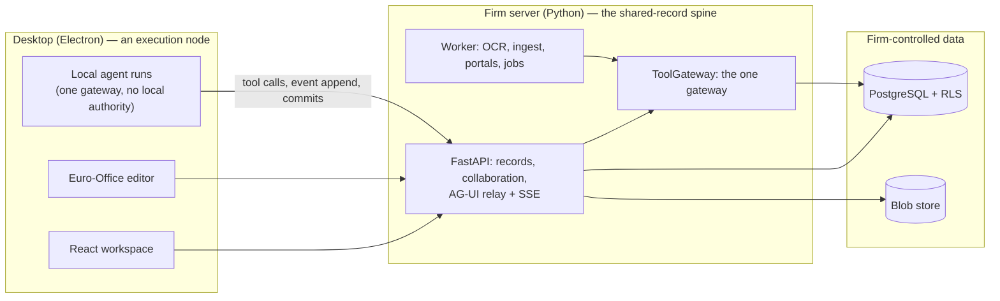

# Maverick — architecture

**Status:** current · **Date:** 2026-11-26
**Product & agent:** Maverick · **Deployment:** self-hosted per firm

This repository contains the Maverick architecture and no application code. It is a design, not a claim that the product exists.

---

## What Maverick is

A self-hosted **Legal Factory** — **the harness is the product** (FD-17). One agentic factory floor where a lawyer's instruction becomes staged, verified legal work: intake, research, drafting, checking, approval, filing, hearing, next steps — with a human at every irreversible gate.

Maverick is **one agent** with **bundled capabilities**. It is not a chat box, and chat is not where legal work is stored. The matter workspace — matters, proceedings, documents, facts, evidence, authorities, decisions and approvals — is the **record substrate** the factory works in: it exists so the factory's work is matter-bound, verifiable and defensible.

The **server is the shared-record spine** — collaboration and records, Clio-shaped. The **factory floor runs where the lawyer is**: an advocate's interactive run executes on their own machine, every tool call crossing the live session to the server's one gateway, against a disposable sha256 file cache, committing through the api (RD-53). Execution is stateless; the record never is.

---

## The design in one diagram

**One authority for legal records:** the application services.
**One authority for the agent:** the harness.
**One authority for documents:** the document control service.
**One authority for a date:** the record that owns it; calendars are views.
**One authority for the record:** the server — execution is local, truth is not.

---

## Read in this order

| Doc | Owns |
|---|---|
| [01-decisions.md](01-decisions.md) | The decision register — read it before changing anything |
| [02-domain-model.md](02-domain-model.md) | Entities, ownership, lifecycles, ERDs, invariants |
| [03-application-and-agent.md](03-application-and-agent.md) | Process shape, the stateless execution plane, one agent, the Harness composition, AG-UI |
| [04-data-documents-security.md](04-data-documents-security.md) | PostgreSQL, isolation, the document pipeline, the guideline pipeline, the security model |
| [05-deployment-and-testing.md](05-deployment-and-testing.md) | Deployment shapes, bundled Postgres, the remote service, the test programme, evals, the build order, scope |
| [06-workflows-and-collaboration.md](06-workflows-and-collaboration.md) | The shared room, submissions, hearings and preparation, prior art, the key flows |
| [07-sources.md](07-sources.md) | Prior art and official documentation, with status |
| [08-ui-and-product-experience.md](08-ui-and-product-experience.md) | Navigation, Today, the matter workspace, the dock, the review inbox |
| [schema/0001_core.sql](schema/0001_core.sql) | Core DDL appendix (validation, not the starting point) |

---

## The non-negotiables

| Law | What it means |
|---|---|
| **One writer per truth** | Every table has one owning module; the agent never writes it directly |
| **Matter is the boundary** | Every legal row carries `matter_id`; access is explicit; walls deny |
| **A label is not a record** | Positions, evidence assessments, exhibit numbers and registry events are append-only attributed rows; status columns are derived summaries |
| **Friction only at the irreversible** | Step-up on commit, filing-ready, send, grant and delete; tracked changes get batch review; a gate is never weakened for speed |
| **One agent authority** | One system prompt and one scope; capabilities are bundles; delegation is tools of the one agent, not peers |
| **The Harness is the floor** | Skills, planning, memory, sub-agents, compaction, persistence, guardrails, budgets and tracing come from the Pydantic AI Harness, composed by the LegalHarness |
| **Maverick is the control plane** | Legal records, matter scope, document control, deterministic checks, human approval and audit stay in Maverick |
| **Stateless execution, one record** | Runs execute on the advocate's node; every tool call crosses the live session to the one gateway; access is standing until revoked; commits, approvals and audit are server transactions; the file cache is derived, never canonical |
| **Documents are records** | The server owns identity, versions, hashes, approvals and commit; the editor owns pixels |
| **Unknown is a result** | A stale rule or unverified citation says `unconfirmed`; it never says `passed` |
| **No fabricated authority** | Only deterministic checks may verify a citation; a model may only propose one |
| **No conflict-check subsystem** | The matter-open gate records client and scope; screening is the firm's own professional process |
| **Prose does not enforce** | Boundaries, isolation, catalog parity and bundle evals are CI checks |

---

## What is fixed, what is recommended, what is unknown

**Fixed by the owner (FD):** Electron; Python + Pydantic; Pydantic AI; a Maverick-owned harness; PostgreSQL; one agent; self-hosted per firm, no multi-tenant SaaS; a separate remote connection service; human approval for important legal actions; DOCX/PDF is the work product and chat is not a legal record; the firm admin is the first lawyer onboarded; notes-first matters; per-matter folders; nestable interim applications; Indian forums only; the app is the harness; the product is named Maverick.

**Recommended (RD, binding once accepted):** Pydantic Validation v2 for application contracts; the Pydantic AI Harness as the factory floor with a legal capability pack; server-first deployment with stateless local execution; one Postgres with RLS; a modular monolith; FastAPI/SQLAlchemy; AG-UI as the agent→UI protocol with `@ag-ui/client` in the renderer; a data-driven rule and playbook engine with a fetch-verify-version-resolve ingestion pipeline; tool contracts as catalog entries with MCP only for external integrations; DBOS only behind an interface; Postgres FTS + pgvector; Euro-Office behind a narrow adapter; RBAC + ABAC + walls; a legal audit separate from execution traces; encrypted backups with dry-run restore; one baseline schema with a forward-only migration runner before pilot data.

**Unknown until tested:** solo install time and size; the Euro-Office tracked-change round trip; Harness 0.x stability in the legal pack; recovery across restarts; retrieval latency at firm scale; sub-agent merge correctness; bundle instruction conflicts; cost per matter; relay behaviour on real networks; the AG-UI approval-interrupt round-trip on a real matter run; stateless execution across nodes. The full list with proofs is in [05](05-deployment-and-testing.md) §2.9.

---

## Conditions before implementation

1. A clean Windows install of server + database + desktop in under 15 minutes and under 1.5 GB.
2. A real DOCX with tracked changes survives a round trip through Euro-Office, Word and LibreOffice — the builder is the sole mutation engine and `docx-core` verifies without mutating.
3. RLS negative tests exist for every retrieval path before the first legal table is written.
4. A capability catalog and a table-ownership manifest exist before the second module.
5. One reference pack exists as **data** and one real matter runs on it.
6. A design-partner lawyer and a golden set are committed.

If 1–3 fail, change the deployment or the editor. Do not add features.

---

## How to use this with an engineer or a coding agent

1. Read the decision register before changing anything.
2. Every new capability needs a catalog entry, a bundle and an eval.
3. Every new table needs `matter_id`, an RLS policy, an owner and a negative test.
4. Every new service write calls the audit append.
5. Run the structural suite; a green unit suite is not enough.
