# Maverick — Domain model

**Status:** current · **Date:** 2026-11-26
**This file owns:** the concepts, their ownership, relationships, lifecycles, the work-type tests, and the matter working cycle.

---

## 1. The ontology in one page

Maverick records **legal work**, not conversation. Seven kinds of record, each with one owner:

| Kind | The question it answers | Examples |
|---|---|---|
| **People and access** | Who is involved, and who may see what | firm, user, contact, client, matter_member, ethical_wall |
| **The engagement** | What we were instructed to do, for whom, before which forum | matter, proceeding, proceeding_application, forum, hearing, order |
| **The work product** | What we produced, in which version, from which sources | document, version, blob, anchor, folder, template, filing |
| **The knowledge** | What the law says, what we found, what we rely on | source, authority, citation, rule, skill, playbook |
| **The work** | What must be done, by whom, by when, and what was decided | task, deadline, appointment, decision, approval, gate |
| **The execution** | What the agent did, with what context, at what cost | conversation, message, bundle, playbook_run, step_run, agent_run, context_package |
| **The record** | What changed, who authorised it | audit_event |

Three rules hold the model together:

1. **One writer per concept.** A table is written by exactly one application service. Other modules read through a query port.
2. **A label is not a record.** A status string never replaces a dated, attributed record. "Approved" is an approval row with a hash; "cleared" is a gate row with a snapshot.
3. **The matter is the unit of confidentiality.** Every legal row carries `matter_id`, even when it could be derived. This is deliberate denormalisation for isolation and index performance.

The record layer is the **substrate** the Legal Factory works in: the app is the harness, and these records are what make the factory's work matter-bound, verifiable and defensible.

---

## 2. Entity catalogue

Legend: **Owner** = the only module allowed to write the table. Everything in this catalogue is in scope; what is deliberately excluded is in §10.

### 2.1 Firm, users and access

| Entity | What it represents | Why it exists | Owner |
|---|---|---|---|
| `firm` | The installation's organisation. One row; a solo practice is a firm of one | Holds name, defaults, retention and model policy | Identity |
| `user` | A human login identity | Authentication, audit actor, assignee | Identity |
| `membership` | A member's firm role | `admin`, `lawyer`, `staff`; the first member onboarded is the admin | Identity |
| `matter_member` | Explicit access grant of a user on a matter | The only way to see a matter; `lead`, `editor`, `viewer`, `approver` | Access |
| `ethical_wall` | Explicit deny of a user on a matter | Walls deny, always | Access |
| `reuse_grant` | Permission to reuse a record from another matter | Cross-matter reuse is explicit and traceable | Access |
| `device` | A registered desktop device | Node registration, remote sessions, revocation | Identity |
| `session` | A server-side login session | Revocation, audit, device binding | Identity |

**Why `client` is not a `user`.** A client is a person or company we act for; a user is someone who logs in. Conflating them is a common and dangerous shortcut.

**Onboarding.** One firm per installation. The installer generates a one-time setup token; the first account created with it becomes the firm's **admin** — usually the first lawyer. That one account is a complete firm: every function works solo. The admin invites later members as `lawyer` or `staff`; the token is removed after first run.

### 2.2 People, clients and parties

| Entity | What it represents | Why it exists | Owner |
|---|---|---|---|
| `contact` | A person or organisation in the firm's address book; email, phone, address and registration number are columns on the contact | One deduplicated people graph | Contacts |
| `client` | A contact in the role of client | Engagement status and KYC state | Clients |
| `matter_party` | A contact/client in a role within a matter | `client`, `opposing`, `co_party`, `witness`, `expert`, `counsel`, `authority`; with `side` | Matter |

**The people graph.** `contact` is the only place a person exists. `client` and `matter_party` are roles. A firm-level contact can be a client in one matter and an opposing party in another; that is legally meaningful and must be representable.

### 2.3 The engagement

| Entity | What it represents | Why it exists | Owner |
|---|---|---|---|
| `matter` | The engagement: scope, status, lead lawyer; the client is optional at intake | The unit of confidentiality and work; may be opened with notes alone | Matter |
| `matter_relation` | A link between matters | Appeal from, related, consolidated, cross-reference | Matter |
| `proceeding` | One case before one forum; registry identity (case/diary/CNR numbers, bench) is carried as append-only `registry_event` rows — a transferred or renumbered case is the same proceeding | A matter can have a suit, an appeal, an execution and a parallel complaint | Proceedings |
| `registry_event` | An append-only event on a proceeding's registry identity: registered, transferred, renumbered, bench changed | A transfer is not a new proceeding and a renumbering is not a new case; the identity is the proceeding, the numbers are events | Proceedings |
| `proceeding_application` | An application inside the engagement — bail, stay, injunction, restoration, or a child of another application | Its own lifecycle; nests as a tree; inherits context unless it blocks inheritance; archives once decided | Proceedings |
| `forum` | A court, tribunal, authority or arbitral seat; hierarchical; alternative names and codes are `aliases` on the row | Jurisdiction, rules, filing targets | Courts |
| `hearing` | A dated occurrence in a proceeding | The date the forum gives; the outcome it records | Proceedings |
| `order` | A written or dictated result | Directions, next date, operative text; may exist without a hearing | Proceedings |
| `note` | A matter-scoped note; the matter's scratchpad | Human context that is not a document; a matter may start with nothing but notes | Matter |

**Matter vs proceeding.** A matter is *the engagement*. A proceeding is *a legal process before a forum*. One matter may have no proceeding (an opinion), one (a suit), or many (suit → first appeal → SLP → review). An appeal does not create a new client engagement, and a matter cannot have one "case number".

**Hearing vs order.** A hearing is a scheduled event; an order is a result. A court may pass an order without a hearing, and a hearing may produce no order (adjournment). They are separate records with a nullable link.

**Matters start as notes.** A matter may be opened with a title and a note alone — no client, no proceeding, no document. It lives in `intake` until the matter-open gate is cleared (the gate asks for client and scope, never for a document), and it may stay there indefinitely.

**The application tree.** An application may sit at three places, and nest:

| Parent | When | Example |
|---|---|---|
| The **matter** | Pre-forum: no case number exists yet | An RTI application, a pre-litigation tribunal filing |
| A **proceeding** | The normal case | Bail in the criminal proceeding; stay in the suit |
| Another **application** | A child proceeding | Clarification or modification of bail conditions; recall of an order passed on an application |

**Context inheritance.** A child inherits its ancestors' context — the matter spine always, the proceeding's stage and past orders, the parent application's subject — unless a row sets `inherit_context = false`, which blocks inheritance **for its subtree** and carries a `context_note` recording why. A blocked or independent application declares its own context requirements; the assembler records the block in the context manifest. Inheritance is composition *inside one matter*; it is never access across matters, and `MatterScope` still bounds every read.

**The bail case, and why it is not a sub-matter.** In a criminal matter, a bail application is entirely separate work; once decided, it should stop occupying the matter's working context. The archive solves this: a decided application leaves the assembled spine and the active lists while remaining queryable forever with its order and its filing. A **sub-matter is rejected** (§10): a bail application is the same engagement, the same client and the same confidentiality unit — a nested matter would create a second billing and confidentiality boundary with ambiguous access. The tree gives the nesting; the archive gives the decay; no second matter exists.

**Tree storage: adjacency list + recursive CTE.** `parent_application_id` with a recursive CTE, a depth cap of 6, a same-matter guard, a denormalised `proceeding_id` maintained along the chain, and an immutable parent link — an INSERT cannot create a cycle (the parent must already exist) and an UPDATE cannot re-parent, so no cycle can ever form. Rejected alternatives:

| Option | Why rejected |
|---|---|
| **ltree** | A path string duplicates ids into a second key that RLS does not govern naturally; re-parenting rewrites every descendant path; an extension dependency for a tree that is at most seven levels deep |
| **Closure table** | A second table to secure, back up and keep consistent with every write, bought to answer a query a depth-≤-6 recursive CTE answers in one indexed scan |

### 2.4 Work, dates and decisions

| Entity | What it represents | Why it exists | Owner |
|---|---|---|---|
| `task` | A unit of assignable work, optionally private, optionally linked to documents | Who does what, by when; the only owner of a task's due date | Work |
| `deadline` | A legal time limit with a basis | Limitation, statutory period, order direction; must show its computation | Work |
| `appointment` | A meeting, call or conference | Not a hearing, not a task | Work |
| `decision` | A human legal choice, with options and rationale; a decision may be attributed to a **contact** as well as a user — a client's instruction or sign-off is a record too (`decided_by_contact_id`) | The lawyer's — and where relevant the client's — authority, recorded | Decisions |
| `approval` | Permission to proceed on a specific artefact/version | The gate for one operation; binds subject + hash | Approvals |
| `gate` | A block on a state transition until a duty is discharged | Matter open, document approve, filing ready, rule publish, access grant, deletion | Approvals |

**Task vs deadline.** A task is work ("file the reply"). A deadline is a legal time limit ("limitation expires 12 March"). A task may be done late with no legal consequence; a deadline missed is a legal event. A calendar is a read-only union of hearings, deadlines, tasks and appointments — never a table.

**Decision vs approval vs gate.**

- A **decision** is *what the lawyer chose*: accept this fact, select this argument, file this document.
- An **approval** is *permission for one operation on one artefact/version*: commit this revision, send this email, file this set.
- A **gate** is *a block until a duty is discharged*: the matter cannot open until client and scope are recorded; the document cannot be filed until verification passes and a human signs.

They are separate because they fail differently. A decision can be revisited; an approval goes stale when the content changes; a gate reopens when its evidence changes.

### 2.5 Documents and filings

| Entity | What it represents | Why it exists | Owner |
|---|---|---|---|
| `document` | The legal identity of a work product | Title, type, status, current version, confidentiality, folder | Documents |
| `folder` | A folder within one matter | Every matter has its own folder tree; default folders come from `document_type` | Documents |
| `document_version` | One immutable version | Hash, blob, base version, author, source; an agent-generated version names the task or decision that authorised it (I26) | Documents |
| `blob` | Content-addressed bytes | One copy per distinct content; tamper evidence | Storage |
| `document_anchor` | A stable location inside a version | Paragraph/table id, ordinal, text hash; precise citation and edit | Documents |
| `document_text` | Derived, rebuildable text for one version | OCR and extraction input; its `text_hash` is the pin every extraction records (RD-61) | Documents |
| `document_relation` | A relation between documents | Exhibit, annexure, attachment, supersedes, translation | Documents |
| `document_type` | Configurable type | `pleading`, `application`, `affidavit`, `evidence`, `memo`, `opinion`, `contract`, `notice`, `correspondence`, `order`, `other`; firm-editable | Configuration |
| `template` | A DOCX template + variable schema | Firm style and repeatable output | Drafting |
| `annotation` | A comment on a version at an anchor | Review; resolve; no silent edits | Documents |
| `filing` | A submission to a forum | Date, status, acknowledgment, defects, response; references the task or decision that authorised it (I26) | Filing |
| `filing_item` | A document version inside a filing | Main/annexure/affidavit/fee receipt | Filing |
| `verification_run` | Checks against one exact subject hash | Evidence for readiness; never a claim | Verification |
| `retrieval_packet` | A signed, scoped, redacted context bundle for an external recipient | Share context without sharing the database | Knowledge |

**Document vs version.** The document is the identity the lawyer talks about ("the plaint"). The version is the immutable bytes. Editing never mutates a version; it creates a new one with `base_version_id` and a hash. The current version is a pointer, not an overwrite.

**Why a separate blob.** Two identical documents share one blob. A re-import of the same PDF does not duplicate storage. A hash mismatch on read is detectable. Deletion is reference-counted and blocked by legal hold.

**Matter folders.** Every matter has its own folder tree (`folder`): a root seeded from `document_type` defaults, user-created subfolders, and one folder per document. The folder is the arrangement the lawyer sees in the matter's Files view and the layout an export or a per-matter backup writes to disk — and it is also the layout of a node's disposable file cache. The bytes stay in the content-addressed blob store — a folder is metadata, never a second copy of the bytes, and a document can only sit in a folder of its own matter (I23).

### 2.6 Knowledge, research and evidence

| Entity | What it represents | Why it exists | Owner |
|---|---|---|---|
| `source` | Where a legal artefact came from | URL, publisher, retrieval time, content hash, licence | Knowledge |
| `authority` | A source of law | Statute, judgment, rule, notification, circular; identity and status | Knowledge |
| `authority_version` | A version of an authority | Amendments, effective dates, text hash | Knowledge |
| `citation` | A use of an authority in a document version | Pinpoint, quote, verification status; `source_text_hash` pins the text it was proposed from | Verification |
| `research_query` | A research question in a matter | Scope, asker, status | Research |
| `research_result` | A candidate authority for a question | Proposition, quote, relevance, human decision | Research |
| `fact` | An asserted proposition | What the case says happened; `source_text_hash` pins the text an extraction came from | Facts |
| `fact_position` | An append-only, attributed position on a fact (party/advocate/court, basis, supersession) | `fact.status` is a derived summary — court > advocate > party; positions supersede, never overwrite | Facts |
| `evidence` | A thing offered to prove a fact | Document, testimony, object, electronic record; custody | Evidence |
| `evidence_status` | An attributed event on one of three independent axes: **authenticity**, **admissibility**, **inclusion** | "Authentic but inadmissible, and included anyway" is representable; a court finding is an event referencing the order id; `evidence.status` is derived | Evidence |
| `exhibit` | The use of an evidence record in a proceeding: number, as-filed role, marked-on, status | The number is assigned by the **advocate at marking** — a use, not a property of the thing; one document can be Exhibit P-1 in the suit and R-3 in the appeal | Proceedings |
| `fact_evidence` | A link | Supports, contradicts, contextual | Facts |
| `issue` | A question the matter must answer | Framing, burden, standard | Analysis |
| `argument` | A proposition on an issue | Selected/rejected, with rationale | Analysis |
| `argument_authority` | An authority used by an argument | Supports, distinguishes, contra | Analysis |

**Fact vs evidence.** A fact is a proposition ("the notice was served on 3 May"). Evidence is a thing offered ("the postal receipt, exhibit P-4"). One fact can rest on several pieces of evidence; one document can support several facts. A status field cannot answer "what proves this?" — a question a court asks.

**Authority vs citation.** An authority is the law itself (with a canonical identity). A citation is a *use* of it in a specific document at a specific pinpoint, with a specific quote. The same judgment can be cited correctly in one draft and misquoted in another; only the citation record can tell you which.

### 2.7 Rules, skills and playbooks

| Entity | What it represents | Why it exists | Owner |
|---|---|---|---|
| `rule_instrument` | A source of binding requirements — Act, court rules, practice direction, e-filing manual, notification; dates, status, and the instrument it supersedes | Jurisdiction-scoped format law, versioned by effective dates | Rules |
| `format_rule` | One resolvable requirement | Page, margin, font, spacing, section order, verification clause, PDF/A, bookmarks, size | Rules |
| `rule_snapshot` | One fetched, content-addressed snapshot of an official rule source | Change detection by hash; the evidence a verified rule stands on | Rules |
| `skill` | A named body of know-how; each version is a row with content, schemas, permitted tools, checks, approval points, tests and hash | Identity and history in one table | Capabilities |
| `playbook` | A named process; each version is a row with steps, gates, roles, scope and hash | Steps are data | Capabilities |
| `playbook_run` | One execution of a playbook version on a matter | Durable legal process state | Workflow |
| `step_run` | One step in a run | Status, assignee, inputs/outputs, approval | Workflow |

**Skill vs playbook.** A skill answers "how do I do X well?" (instructions, context, tools, checks). A playbook answers "in what order, with which gates, does this kind of work proceed?" A skill can be used inside several playbooks. Neither is code; both are versioned rows with a hash and a verifier. Publishing a new version inserts a row and pins `key@version`; a run pins the exact row it used.

**No hardcoded workflow.** The engine interprets the `steps` of the playbook version a run pins; it does not contain an `if SLP` branch. A step names a capability, a skill, a human gate or an automated check. The content of a reference pack is data, not code. A playbook is optional — a matter can be worked directly, step by step, and still be complete (§7).

### 2.8 Execution and audit

| Entity | What it represents | Why it exists | Owner |
|---|---|---|---|
| `bundle` | A named capability package | Identity across versions; one owner | Capabilities |
| `bundle_version` | Instructions + tools + sub-agent tools + evals + hash | The unit of capability, ownership and evaluation | Capabilities |
| `conversation` | A chat thread bound to one matter and one creating user; `private` or visible to the matter's members | Prevents cross-matter context bleed; shared rooms are still one matter's | Harness |
| `message` | One attributed turn in a conversation — author user or author run, in sequence | Live, attributed shared chat; execution state, never a legal record | Harness |
| `agent_run` | One Maverick execution, primary or sub-agent | Scope, model, budget, status, parent, totals | Harness |
| `agent_event` | One step inside a run | Model turn, tool call, result, error, tokens, cost | Harness |
| `context_package` | The exact context given to a run | Reproducibility; inclusion/exclusion manifest | Harness |
| `run_bundle` | Which bundle versions a run selected | Provenance; leave-one-out eval | Harness |
| `egress_policy` | Allowlisted destinations per capability/provider | Deny-by-default network | Policy |
| `audit_event` | An append-only legal/security event | Hash-chained record of who did what | Audit |

**Why execution records are not the legal audit.** A prompt is not a legal fact. A model's reasoning is not evidence. The audit records decisions, approvals, filings and changes, with hashes. The execution trace records how the work was produced, for debugging and evaluation. They have different retention and different readers. Both are attributable: every message, run and event carries its user, matter and node.

---

## 3. Relationships

### 3.1 Matter, people and proceedings

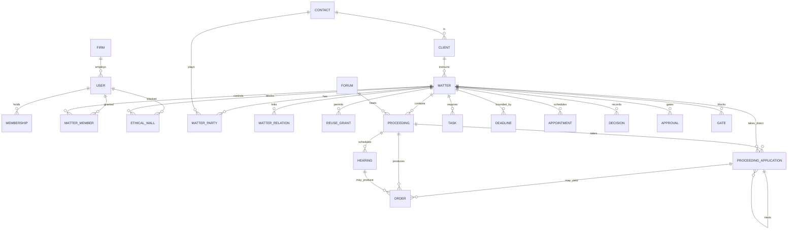

### 3.2 Documents, knowledge and execution

```mermaid
erDiagram
  MATTER ||--o{ DOCUMENT : owns
  MATTER ||--o{ FOLDER : arranges
  FOLDER ||--o{ DOCUMENT : holds
  DOCUMENT ||--o{ DOCUMENT_VERSION : has
  DOCUMENT_VERSION ||--|| BLOB : stored_as
  DOCUMENT_VERSION ||--o{ DOCUMENT_ANCHOR : locates
  DOCUMENT_VERSION ||--o{ ANNOTATION : reviewed_by
  DOCUMENT ||--o{ DOCUMENT_RELATION : relates
  DOCUMENT_TYPE ||--o{ DOCUMENT : types
  TEMPLATE ||--o{ DOCUMENT : seeds
  TASK ||--o{ TASK_DOCUMENT : attaches
  DOCUMENT ||--o{ TASK_DOCUMENT : attached_to

  MATTER ||--o{ FILING : files
  FILING ||--o{ FILING_ITEM : contains
  DOCUMENT ||--o{ FILING_ITEM : included_as
  DOCUMENT_VERSION ||--o{ VERIFICATION_RUN : checked_by

  SOURCE ||--o{ AUTHORITY : evidences
  AUTHORITY ||--o{ AUTHORITY_VERSION : versions
  AUTHORITY ||--o{ CITATION : cited_as
  DOCUMENT_VERSION ||--o{ CITATION : contains
  MATTER ||--o{ RESEARCH_QUERY : asks
  RESEARCH_QUERY ||--o{ RESEARCH_RESULT : finds
  AUTHORITY ||--o{ RESEARCH_RESULT : candidate

  MATTER ||--o{ FACT : asserts
  MATTER ||--o{ EVIDENCE : offers
  FACT ||--o{ FACT_POSITION : positioned_by
  EVIDENCE ||--o{ EVIDENCE_STATUS : assessed_on
  PROCEEDING ||--o{ EXHIBIT : numbers
  EVIDENCE ||--o{ EXHIBIT : used_as
  PROCEEDING ||--o{ REGISTRY_EVENT : registry_history
  FACT ||--o{ FACT_EVIDENCE : supported_by
  EVIDENCE ||--o{ FACT_EVIDENCE : supports
  DOCUMENT ||--o{ EVIDENCE : is

  MATTER ||--o{ CONVERSATION : scopes
  CONVERSATION ||--o{ MESSAGE : carries
  CONVERSATION ||--o{ AGENT_RUN : groups
  MATTER ||--o{ PLAYBOOK_RUN : runs
  PLAYBOOK ||--o{ PLAYBOOK_RUN : defines
  PLAYBOOK_RUN ||--o{ STEP_RUN : contains
  STEP_RUN ||--o{ AGENT_RUN : executes
  AGENT_RUN ||--o{ AGENT_RUN : spawns
  AGENT_RUN ||--o{ AGENT_EVENT : traces
  AGENT_RUN ||--o{ RUN_BUNDLE : selects
  BUNDLE_VERSION ||--o{ RUN_BUNDLE : selected
  AGENT_RUN ||--o{ CONTEXT_PACKAGE : given
  MATTER ||--o{ AUDIT_EVENT : records
```

---

## 4. Lifecycles

### 4.1 Matter

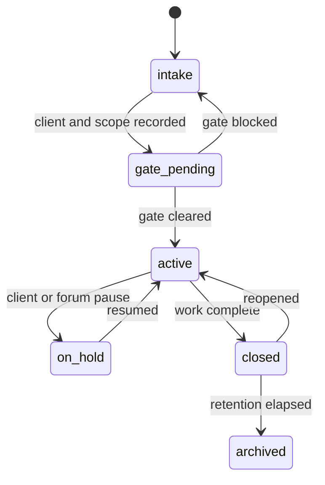

Rules: no `active` without a cleared `gate(kind=matter_open)` — the gate asks for client and scope, never for a document. A matter may live in `intake` with notes only, indefinitely. Closing requires no open critical deadline; archiving requires no legal hold.

### 4.2 Proceeding

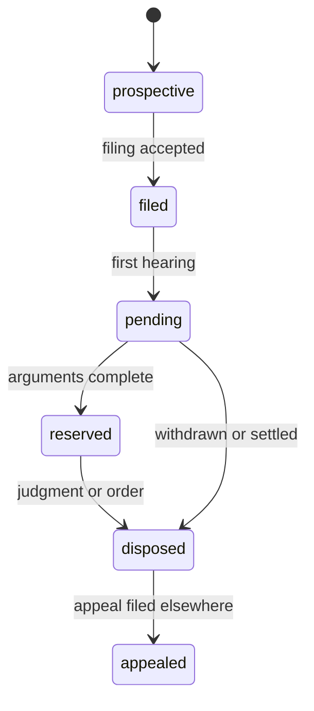

The stage ("evidence", "arguments") is configuration (`stage_key`), not a database enum. **Registry identity is evented, not mutated:** `registry_event` rows record registration, transfer, renumbering and bench changes; a transferred case keeps its proceeding identity, its history and its applications. A new proceeding is a new legal process — an appeal — never a transfer.

### 4.2a Proceeding application

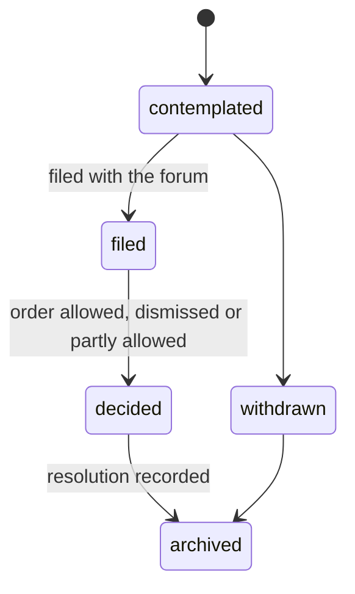

A decided or withdrawn application is **archived**: it leaves the active list and the assembled spine while the record stays queryable forever; archiving is a status, never a deletion. The lifecycle applies at every depth of the tree, and each row archives on its own resolution — archiving a parent never archives its children.

### 4.3 Document

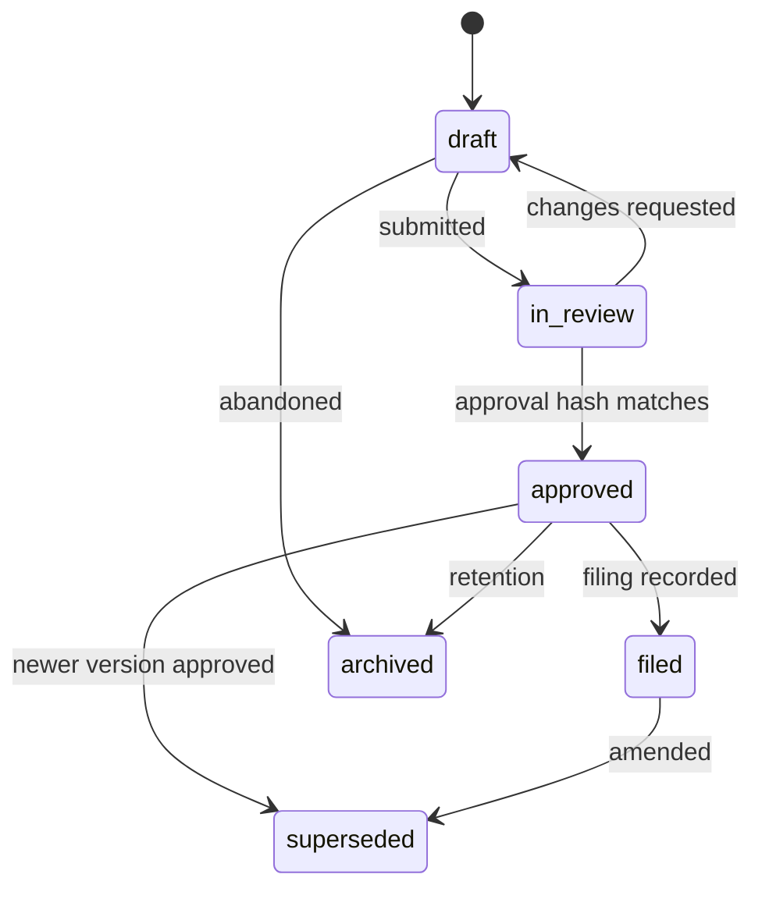

Rule: `approved` requires an `approval` row whose `subject_hash` equals the version's hash. If the version changes, the approval is stale and the state returns to `in_review`.

### 4.4 Gate

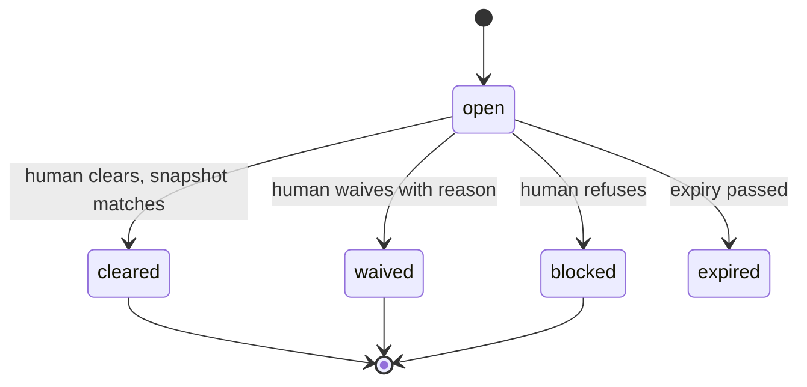

A cleared or waived gate whose evidence changes reopens as a new gate.

### 4.5 Approval

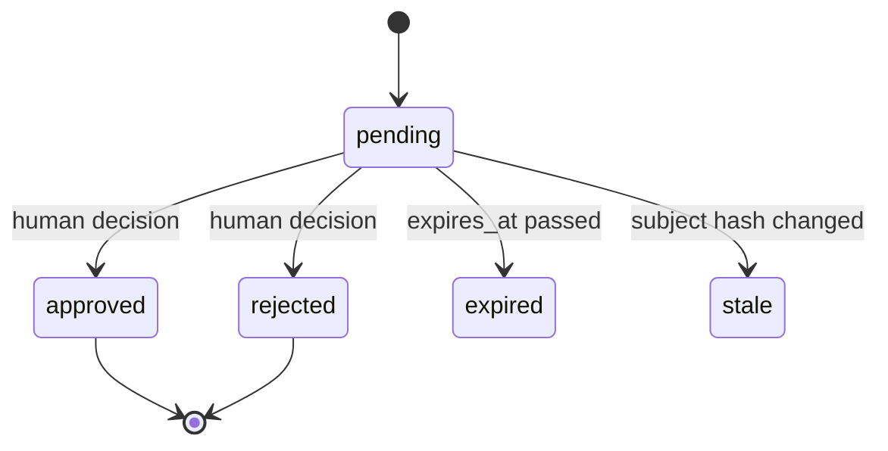

### 4.6 Playbook run and step run

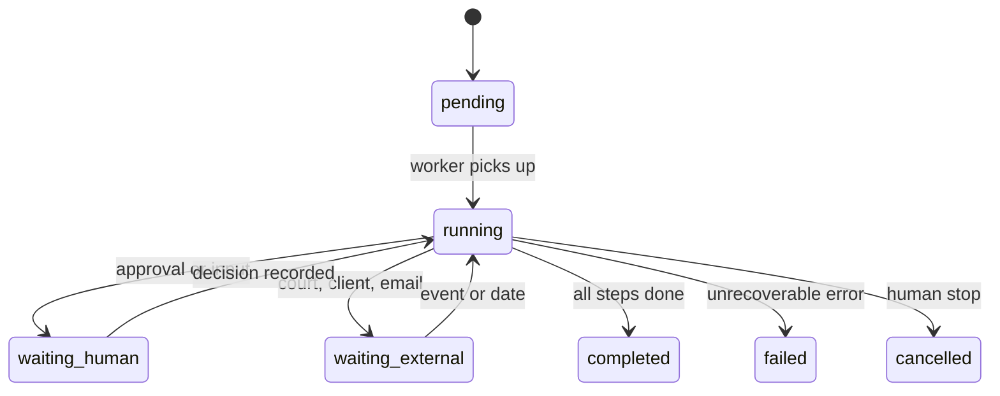

`waiting_external` is a row plus a trigger (date or event), not a running process. This is how legal work survives for months without a workflow engine holding a thread.

### 4.7 Agent run

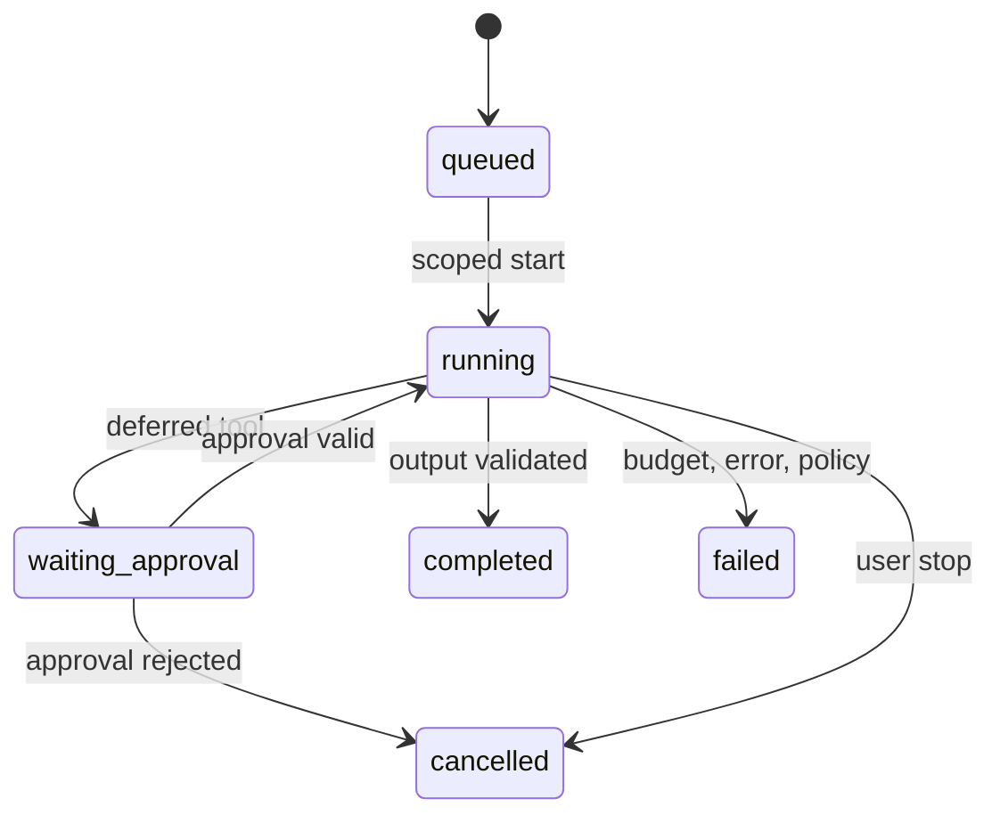

### 4.8 Citation

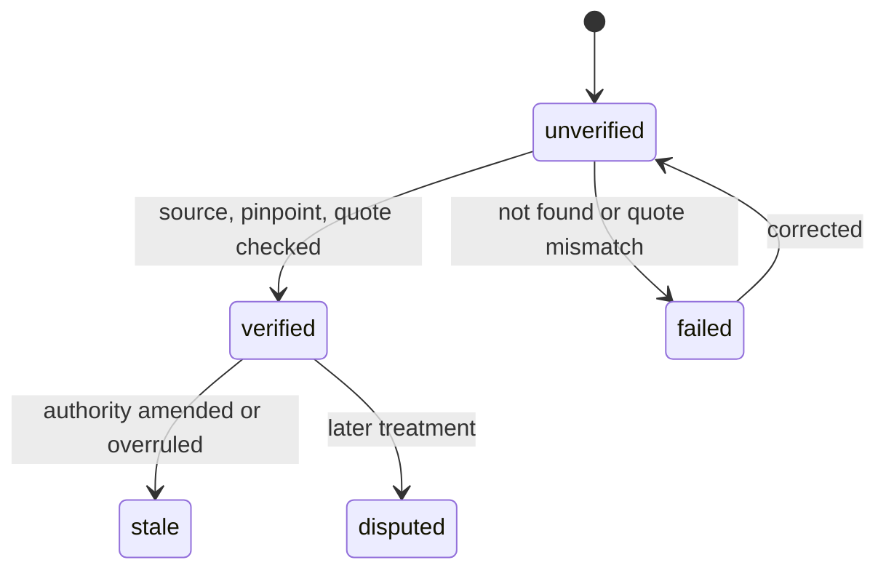

A citation is never "verified" by a model's assertion. It is verified by a deterministic lookup plus a verbatim quote comparison. Model review is an additional signal.

---

## 5. The contested calls

| # | Call | Why | What it prevents |
|---|---|---|---|
| 1 | Matter ≠ proceeding | Engagement vs legal process | One case number for a matter with four proceedings |
| 2 | Proceeding ≠ hearing | Case vs dated occurrence | A hearing with no case, or a case with one date |
| 3 | Hearing ≠ order | Event vs result | Orders lost when no hearing occurred |
| 4 | Task ≠ deadline | Work vs legal time limit | A missed limitation hidden inside a to-do |
| 5 | Fact ≠ evidence | Proposition vs thing offered | "Proved" with no source |
| 6 | Document ≠ version | Identity vs bytes | Silent overwrite; approvals that outlive their content |
| 7 | Authority ≠ citation | Law vs use of law | A judgment marked "verified" while a quote inside it is wrong |
| 8 | Contact ≠ client ≠ party | Person vs role | Duplicate people; failed deduplication |
| 9 | Skill ≠ playbook | Know-how vs process | A skill that silently becomes a workflow |
| 10 | Decision ≠ approval ≠ gate | Choice vs permission vs duty | "Approved" with no record of what or why |
| 11 | Agent run ≠ audit | Execution vs legal record | Prompts in the legal record; no facts in the audit |
| 12 | No `action` entity | Split into decision, task, step and run | Five meanings, no owner |
| 13 | No `assignment` entity | Task + step_run already cover it | A second unit of work |
| 14 | No `case` / sub-matter | The application tree covers nesting | Nested matters with ambiguous access |
| 15 | No `litigation_family` | A read model over matter_relation | A duplicate hierarchy |
| 16 | No per-matter database | One Postgres, `matter_id` + RLS | Multi-user and remote access impossible |
| 17 | No graph database | Link tables + recursive CTE | A second store with its own permissions |
| 18 | No calendar table | Union of hearing, deadline, task, appointment | Four competing date authorities |
| 19 | An application nests; a proceeding only when the forum assigns its own case number | Interim work gets a lifecycle and an archive, without a third hierarchy level | Every application buried as a bare filing |
| 20 | No conflict-check subsystem | The matter-open gate records client and scope; screening remains the firm's own professional process | Building a product the owner did not ask for |
| 21 | A folder arranges; it does not store | The blob store is the only copy of the bytes | A second copy of every document on disk |
| 22 | The application tree is adjacency + recursive CTE, not ltree or a closure table | Shallow (≤ 6), RLS-friendly, cycle-free by construction | Path-string permissions; a second relationship table to secure |
| 23 | No CRDT, no last-write-wins | Commits are new versions against a base hash; a moved base is rejected | Two versions of a pleading, one silently lost |
| 24 | Positions, evidence assessments, exhibit numbers and registry identity are **append-only attributed records; status columns are derived summaries** | A label is not a record (our first law); one status cannot hold "authentic but inadmissible, and included"; an exhibit number is a use, not a property; a transfer is a registry event, not a new proceeding | Mutating statuses as the record; `exhibit_no` on evidence; a new proceeding row for a transferred case |

---

## 6. Tested against different kinds of legal work

The model must not be litigation-shaped. This table is the test.

| Work type | Matter | Proceeding? | Core artefacts | What proves the model |
|---|---|---|---|---|
| **Litigation (suit)** | Yes | Yes | Plaint, written statement, evidence, order, decree | Hearing/order split; fact/evidence split |
| **Appeal / SLP** | Same matter or a linked matter | Yes (new) | Petition, grounds, judgment under appeal | Proceeding linked to the prior order; matter_relation |
| **Advisory opinion** | Yes | No | Memo, authorities, advice letter | Optional proceeding; research/citation path |
| **Quick query / note-first capture** | Yes | No | Notes, research rows, a recorded answer | Matter opened with notes alone |
| **Contract / transaction** | Yes | No | Draft, redline, execution version, closing checklist | Version lineage; approvals |
| **Administrative application (RTI, licence)** | Yes | Yes | Application, reply, order, appeal | A matter-direct application before any case number |
| **Arbitration** | Yes | Yes | Statement of claim, defence, award | Proceeding + order; hearing |
| **Internal investigation / compliance** | Yes | No | Report, evidence, chronology | Evidence/fact; no forum required |
| **Legal notice / pre-litigation** | Yes | No (until filed) | Notice, reply, correspondence | Matter active before proceeding |
| **Hearing preparation** | Yes | Yes | Brief, chronology, list of dates, cross-examination notes | Task/playbook; document types |
| **Filing** | Yes | Yes | Filing set, acknowledgment, defect memo | Filing separate from document |

**Conclusion.** The model is not litigation-only because `proceeding` is optional, `forum` is generic and `matter` is the engagement.

---

## 7. The matter working cycle

Not every matter produces a document at the end. A matter is a container for legal work, and its outcome varies with the work:

| Work | The cycle | The end product |
|---|---|---|
| Litigation / filing | Import → facts → research → draft → verify → approve → file → next step | A filed document set |
| Hearing preparation | Read the record → compile brief, chronology, list of dates, compilation → argue → record the order | A hearing brief and a marked record |
| Research / advisory | Question → research → verify citations → write | A memo or opinion — a document, but nothing is filed |
| Query ("chat with documents") | Attach → ask → cite → answer | A recorded note or research row; often no document at all |
| Transaction | Draft → redline → approve → execute | An executed contract |

Three rules hold for every kind:

1. **A document is one outcome, not the definition of done.** A matter that ends in research notes, a memo or a recorded answer is complete. Chat alone is never the record — an answer is saved as a note, a research row or a memo.
2. **The record is the product.** Whatever the outcome, it is a row: `note`, `research_query`/`research_result`, a memo `document`, or a filing.
3. **The cycle is data.** Steps name capabilities, skills, playbooks and gates; the reference configuration (a document type and a forum) is **data**, replaceable without code. A playbook is optional — a matter can be worked directly, step by step, and still be complete.

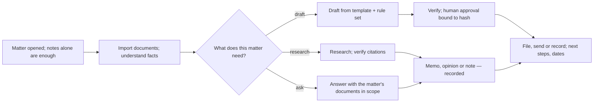

**What ships with it.** One `document_type`, one `rule_instrument` set, one `template`, one `skill` and one `playbook`, all as data. A second forum, document type or work kind must be addable without a code change; if it is not, the generic-engine claim has failed.

**Matter now.** Every matter screen reads one derived model — `matter_now` — assembled from the record: current step, next hearing, next deadline with its basis, open approvals, unconfirmed facts, stale extractions and unresolved review items. It is rebuildable and never canonical; a stale read model is a bug, not a record.

---

## 8. Temporal model

Three clocks must never be confused:

| Clock | Meaning | Columns |
|---|---|---|
| **Legal time** | When something happened, or when a rule was in force | `occurred_at`, `effective_from`, `effective_to`, `due_at` |
| **Knowledge time** | When the firm learned or recorded it | `recorded_at`, `retrieved_at`, `verified_at` |
| **System time** | When the row was created or changed | `created_at`, `updated_at` |

**Why it matters.** "The law on the date of the order" is not "the law today". A rule current now may not have been in force when the pleading was filed. Every resolution query takes a date.

---

## 9. Invariants (each has a test)

| # | Invariant | Test |
|---|---|---|
| I1 | Every legal row has a `matter_id` that resolves to a matter the actor may access | RLS negative test per table |
| I2 | A document version is immutable; an update creates a new row | Trigger rejects UPDATE of content columns |
| I3 | A citation points to a document version + anchor and an authority version | FK + anchor existence test |
| I4 | An approval's `subject_hash` equals the subject's current hash | Approval check rejects a changed subject |
| I5 | A `filed` document has an approved version and a filing record | State transition test |
| I6 | A deadline has a basis, or is explicitly `manual` with a reason | Constraint + test |
| I7 | A proceeding belongs to exactly one matter and one forum | FK + unique test |
| I8 | A hearing belongs to a proceeding; an order belongs to a proceeding | FK test |
| I9 | Fact/evidence links never cross matters | Trigger + test |
| I10 | Cross-matter reuse requires a `reuse_grant` | Repository test |
| I11 | An agent run has a scope, a context package and a budget | Run creation test |
| I12 | The audit chain verifies from genesis to head | `verify_audit()` test |
| I13 | A rule has a source, an effective date and a verifier | Constraint + publication test |
| I14 | A skill/bundle version hash matches its content | Hash test on load |
| I15 | No hard delete while a legal hold exists | Delete path test |
| I16 | A calendar entry is derived; no table owns a date twice | Schema test: no calendar table |
| I17 | The same contact is not duplicated by name alone | Dedupe test on import |
| I18 | A check on a stale rule reports `unconfirmed`, never `passed` | Rule resolution test |
| I19 | A conversation's matter and creating user never change; a cross-matter message is rejected before the model | Conversation binding test |
| I20 | A gated transition is refused while a gate is open or its snapshot hash is stale | Gate test per kind |
| I21 | `ready_to_file` requires a verification run whose subject hash equals the current version | Readiness test |
| I22 | Egress is denied unless the capability declares an allowlisted destination | Egress policy test |
| I23 | A document sits only in a folder of its own matter | Folder move test |
| I24 | An application's parent (when set) exists, sits in the same matter, is shallower than 6, and is immutable after insert; the denormalised proceeding link matches the parent chain | Trigger + negative tests (schema probes 6–9) |
| I25 | The context assembler includes ancestor context unless a row in the chain blocks inheritance; archived applications are excluded from the spine unless the task targets them | Context manifest + assembly test |
| I26 | Every agent-drafted document and every filing set references the task or decision that authorised it | Authorisation-reference test |
| I27 | Every derived extraction pins the `document_text` hash it was built from; a text re-run marks derived extractions stale into the review queue | Extraction-provenance + invalidation test |
| I28 | An exhibit's evidence and proceeding belong to the same matter; a registry event's proceeding belongs to the matter on the row | Trigger + cross-matter negative test |

---

## 10. What is deliberately not an entity

| Not an entity | Why | Where it lives |
|---|---|---|
| Calendar | A view over four date owners | Query + UI |
| Dashboard | A view | Query |
| "Matter health" | A computed score with no agreed definition | Later, if a definition is agreed |
| Permission | Grant rows + audit, not a permission object per resource | `matter_member`, `ethical_wall`, `reuse_grant` |
| Chat thread | Execution state, not a legal record | `conversation` / `message` / `agent_run` |
| Tag / label | A label is not a record | `document_type`, `matter_relation` where needed |
| Folder tree (firm-wide) | The matter folder is the model | `folder` scoped to one matter |
| Sub-matter | An application is the same engagement, client and confidentiality unit | `proceeding_application` tree + archive |
| Conflict-check subsystem | The matter-open gate records client and scope; screening is the firm's own process | `gate(kind=matter_open)` |
| Teams | Grants and walls are per user; teams arrive when a firm's size demands them | `matter_member`, `ethical_wall` |
| Litigation family | A read model | `matter_relation` query |
| Judge profile | Forbidden | — |
| Outcome prediction | Forbidden | — |

---

## 11. What would falsify this model

1. A real matter cannot be represented without a new top-level entity.
2. A proceeding needs its own client or engagement (it does not).
3. A document needs two identities at once (a draft and a filed copy are different documents, not versions); then `document` needs a `role` dimension.
4. A fact cannot be linked to evidence without a third table.
5. A rule cannot be resolved by scope + date without a court-specific branch.
6. A calendar view cannot be built from the four date owners.
7. An approval needs to survive a content change (it must not).
8. A reference pack cannot be added without a code change.
9. A nestable application cannot be represented without a sub-matter.

---

*Next: [03-application-and-agent.md](03-application-and-agent.md).*
