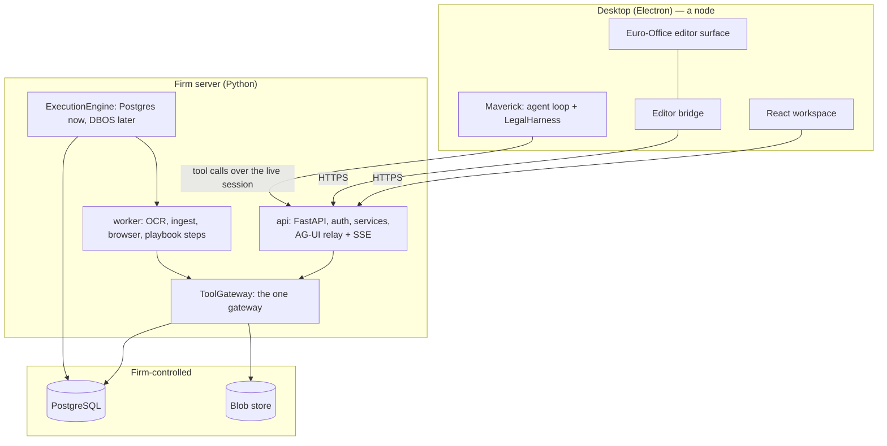
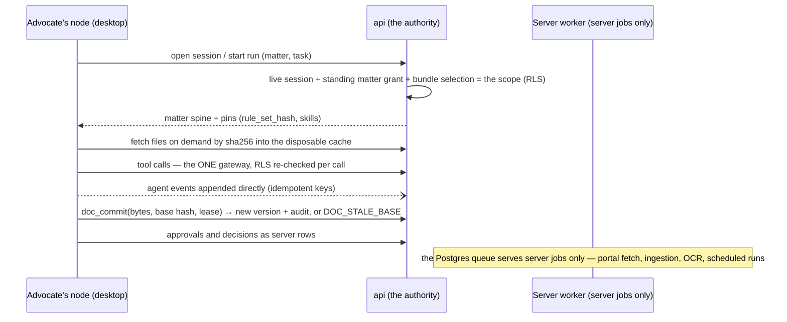
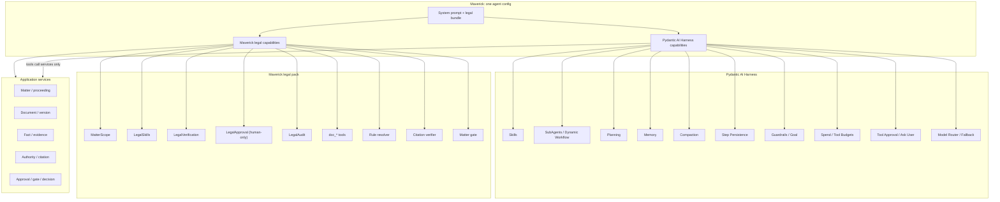
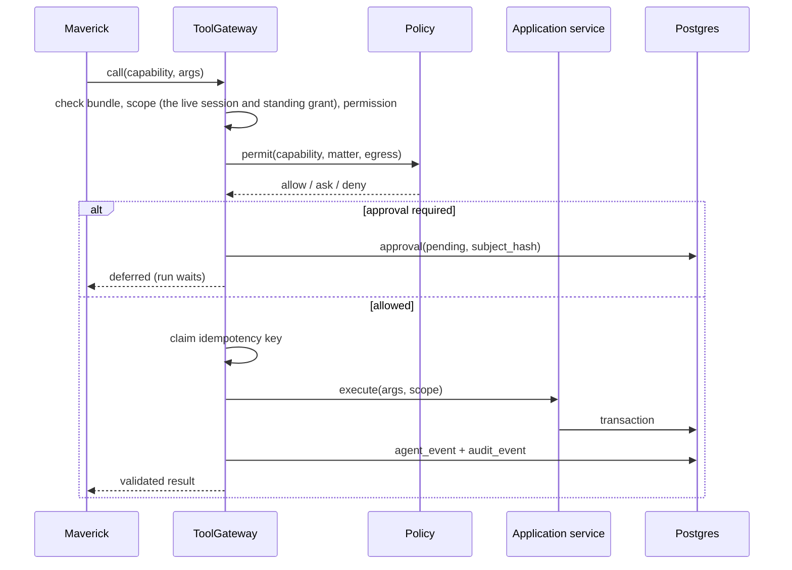

# Maverick — Application and agent

**Status:** current · **Date:** 2026-11-26
**This file owns:** the process shape, the stateless execution plane, the module boundaries, the single-agent architecture, the Harness composition, and the agent-to-UI wire.

---

## 1. The shape

Maverick is a **modular monolith** with two server process roles and one desktop client. There is no microservice, no message broker and no second database.



| Process | Runs | May write | May not |
|---|---|---|---|
| `api` | FastAPI, sessions, services, AG-UI relay, SSE channels | Legal records through services | Bypass a service |
| `gateway` | The single `ToolGateway`: scope, permission, execution, idempotency and audit for every tool call, from a node or a server job | Through services only | Hold authority or state of its own |
| `worker` | OCR, ingestion, browser automation, playbook steps, scheduled runs | Through services | Serve user requests |
| `desktop` (node) | React, Euro-Office editor, stateless execution: the agent loop and the LegalHarness run locally, every tool call over the live session to the one gateway | Local editor temp files and the disposable file cache | Write server records except through the API |
| `agent` | The Pydantic AI loop inside a live session | Nothing directly; only tools | Touch the database or filesystem |

**Why the agent is not its own service.** It has no authority of its own. It is a library call inside a scoped run. A separate service would add a network boundary and a second place to enforce permissions, with no benefit at this scale.

### 1a. Process boundaries: containment by process, budget by runtime (RD-52)

Processes are for crash containment and concurrency control — cheap and encouraged, inside the counted runtimes (RD-51). Runtimes are what the budget counts; a new runtime re-passes the packaging gate. The boundary map:

| Component | Process | Why it lives there |
|---|---|---|
| OS integration: windows, file dialogs, printing, device key, auto-update, tray | **Electron main** | Only the shell can do OS integration; one thin process |
| React workspace | Renderer process | Chromium isolates it from main by construction |
| Euro-Office editor surface (vendored web-apps + sdkjs) | **Its own renderer process** (sandboxed webview) | Crash isolation for free; vendored content, never authority (RD-17) |
| Agent document engine | **Managed Chromium-class builder process** | The official sdkjs Document Builder, proven in a hidden Electron window **and in headless Chromium** (VD-18) — the host follows the shape: the desktop's shipped Electron binary, or the server's headless Chromium, the same binary family the worker uses for portal automation; loopback RPC with a token, per-request timeouts and cancellation, crash log and restart limit; `docx-core` remains the deterministic read/verify path |
| x2t conversions | **Per-conversion subprocess** | Native binary; crash-tolerant; timeout per job; cleared temp folder per run |
| OCR | **Per-job subprocess of the worker** | A 400-page bad scan cannot take the worker down |
| HTTP API, AG-UI relay, SSE channels | `api` process | The only process serving users |
| Playbook steps, ingestion, browser automation, scheduled runs | `worker` process (server) | Durable, resumable, off the request path |

Two rules govern the map. **No Node service exists anywhere** — the builder process is a Chromium-class child, spawned through a subprocess seam so tests can substitute Node's `child_process`; and **no editor server** (RD-49). A component moves across a process boundary only for containment, latency or recovery — never because it feels like a module.

### 1b. Where runs execute: stateless execution, one authoritative record (RD-53)

Two planes, one product. The **record plane** is the firm server: PostgreSQL with RLS, the blob store, the api, and the **single `ToolGateway`**. The **execution plane** is wherever the lawyer sits: the desktop runs the same Python code — the agent loop, the model call, the builder, x2t, OCR, portal browsers — with **no local authority and nothing to reconcile**. The common case, advocates on different matters, has **zero coordination**: the server sees tool calls and append traffic, never a second copy of the truth.



| Concern | Mechanism |
|---|---|
| Authorisation | **Standing, not per-run.** A `matter_member` grant persists until revoked or a wall is raised; the live session plus that grant plus the bundle selection **is** the scope, re-checked by RLS on every call — so revocation is immediate, because nothing is cached on the desktop to outlive it |
| Agent logs | Attributed events append directly to the firm-wide execution log (user, matter, run, seq) — queryable log extraction. The legal audit chain is untouched by the append (RD-29) |
| The duplicated folder | A **disposable cache**: files fetched on demand by sha256, derived, deletable, **never canonical and never a permission** |
| Concurrent writers | Advocates on **different matters: no coordination exists.** Same matter, different documents: none until commit. Same matter, same document: the lease plus the base-version hash — a moved base is `DOC_STALE_BASE`, and the second writer is handed the current text |
| Commits, approvals, decisions | Always server transactions: base hash, lease, audit. The node produces bytes and proposals; only the server mints versions, approvals and facts |
| Engine host | Follows the node: the desktop's Electron binary locally; headless Chromium on the server |
| Offline | **Out of scope** (OQ-8): execution is local, records are server transactions. If the link drops mid-run, the run suspends — the cache stays readable, uncertain tool effects are marked, and Step Persistence resumes on reconnect. With the server unreachable, no new runs start and no commits are accepted — the record never diverges |

---

## 2. Modules and the one owner of each truth

| Module | Owns (writes) | Reads through | Public interface |
|---|---|---|---|
| `identity` | firm, user, membership, session, device | — | `IdentityService` |
| `access` | matter_member, ethical_wall, reuse_grant | identity, matter | `AccessService` |
| `contacts` | contact, client | — | `ContactsService` |
| `matter` | matter, matter_party, matter_relation, note | contacts, access | `MatterService` |
| `courts` | forum | — | `CourtDirectory` |
| `proceedings` | proceeding, proceeding_application, hearing, order | matter, courts, documents | `ProceedingsService` |
| `work` | task, task_document, deadline, appointment | matter, proceedings | `WorkService` |
| `documents` | folder, document, document_version, document_anchor, document_relation, annotation | storage, matter | `DocumentService` |
| `storage` | blob | — | `BlobStore` |
| `drafting` | template, render jobs | documents, rules | `DraftingService` |
| `filing` | filing, filing_item | documents, proceedings | `FilingService` |
| `knowledge` | source, authority, authority_version, retrieval_packet | — | `KnowledgeService` |
| `research` | research_query, research_result | knowledge, documents | `ResearchService` |
| `facts` | fact, evidence, fact_evidence | documents, matter | `FactsService` |
| `rules` | rule_instrument, format_rule, rule_snapshot | source | `RuleService` |
| `capabilities` | bundle, bundle_version, skill, playbook | — | `BundleRegistry` |
| `workflow` | playbook_run, step_run | capabilities, work | `PlaybookRunner` |
| `harness` | conversation, message, agent_run, agent_event, context_package, run_bundle | capabilities, access, documents, facts | `RunService` |
| `approvals` | approval, gate, decision | access, matter | `ApprovalService` |
| `verification` | verification_run, citation checks | knowledge, rules, documents | `Verifier` |
| `policy` | egress_policy | capabilities | `EgressPolicy` |
| `audit` | audit_event | all (append only) | `AuditLog` |
| `notifications` | outbox, delivery state | work, proceedings | `Notifier` |

**Boundary rules, enforced in CI:**

1. No cross-module table access. A module reads another's data through its service or a read model.
2. No cycles. The import graph is a DAG.
3. The agent package may import only the harness, capabilities and tool interfaces. It may not import a module's repository.
4. A table belongs to exactly one module; the ownership manifest is generated and checked.
5. A service write emits an audit event. A service read of a matter requires a `MatterScope`.

---

## 3. Contracts

| Contract | Owner | Generated from | Drift check |
|---|---|---|---|
| HTTP API | `api` | FastAPI + Pydantic | OpenAPI diff + generated TypeScript client |
| Tool contract | `capabilities` | Capability catalog | Tool ↔ catalog parity |
| Agent output | Each capability | Pydantic output model | Schema validation on every result |
| Events to UI | `harness` | AG-UI event schema + our custom events | Event fixture test |
| Database | Each module | SQLAlchemy models + baseline schema | Baseline-vs-model check; forward-only migration runner before pilot data |

**One contract source.** A capability appears once in the catalog; the catalog generates the Pydantic AI tool, the OpenAPI operation, the UI action, the permission list, the docs and the test skeleton. A capability that exists in two places is a defect.

**Where MCP sits (RD-44).** Internal capabilities are in-process typed contracts through the `ToolGateway` — one call, one transaction, one audit path. MCP is the interface for **external** integrations through the Harness's MCP capability — reviewed, allowlisted, untrusted until verified — and an optional read-only MCP facade can expose Maverick capabilities to a firm's own tooling later. Every internal tool as an MCP server is rejected: it would put a wire boundary and a serialisation hop on every call, and a process in every firm install against the packaging budget.

---

## 4. Frontend and desktop

| Layer | Choice | Responsibility |
|---|---|---|
| Shell | Electron + electron-vite + electron-builder | Window, file dialogs, printing, auto-update, device key, editor host |
| UI | React 19 + TypeScript + Vite + TanStack Router/Query + Tailwind + shadcn/ui | Workspace, matter pages, review, approvals, agent timeline |
| Editor | Euro-Office web-apps + sdkjs inside a sandboxed frame | Display and human editing; never the authority |
| State | Server state via TanStack Query; local UI state only | No business logic in the renderer |
| Agent stream | `@ag-ui/client` over HTTPS/SSE to the api relay, which forwards to the node's `AGUIAdapter` | Dock timeline, approval interrupts, custom events; no legal state in the renderer |

The renderer has no node integration, no file access and no database access. It talks to the API with the session cookie and a CSRF token.

---

## 5. Background work

| Work | Where | Why |
|---|---|---|
| OCR, text extraction | `worker` subprocesses | CPU-heavy, crash-prone |
| Document conversion (x2t, PDF/A) | `worker` or desktop subprocess | Native binary, isolated |
| Ingestion, classification | `worker` | Long-running |
| Browser automation (court portals) | `worker` | Separate process, per-matter profile. **Download guards (RD-58):** the job carries its `matter_id` — never a mutable global pointer; DOM selectors come from reviewed code, never model output; the fetched artifact archives its full response context alongside its hash. Portal submission is human-only |
| Playbook steps and scheduled runs | `worker` | Durable, resumable |
| Email/calendar sync | `worker` | External network |
| Notifications | `worker` | Retries |

**Queue.** One `job` table in Postgres with `FOR UPDATE SKIP LOCKED`; no Redis. A job has a type, payload, attempts, `run_at`, `locked_by`, `locked_at`. Jobs are queued in the request's own transaction and woken by `NOTIFY` on commit — a rolled-back request queues nothing. DBOS can replace the runner behind the `ExecutionEngine` interface without changing legal state.

---

## 6. What the application does not do

- It does not run a separate database per matter.
- It does not run a separate search cluster.
- It does not run a graph database.
- It does not run a workflow server.
- It does not host multiple firms.
- It does not let the agent write a table.
- It does not run a Node service or an editor server.

---

## 7. The one agent

Maverick is **one agent configuration**:

```text
AgentConfig
  system_prompt      one lineage, versioned
  bundle_selector    chooses bundle versions by matter, step, document type
  model_policy       provider, model, reasoning, fallback, budget
  output_contract    typed result for the run
```

There are no separate chat, drafting, research, verification or intake agents. Different work is different **bundles**, skills, playbooks and context. Delegation is machinery of the one agent (FD-6): the Harness's sub-agents, planning and memory are adopted wholesale, with intersected scope, no commit/approve/file/send rights and no user channel.

A **bundle** is tools + instructions + sub-agent tools + permissions + budget + evals + owner:

| Field | Holds |
|---|---|
| `id`, `version`, `owner` | Stable identity, semantic version, accountable person |
| `instructions` | The text injected into the system prompt: when to use these tools, in what order, what not to do |
| `tools` | Capability catalog entries (typed input/output, permissions, side effects) |
| `subagent_tools` | Spawn/fork/map/verify/background definitions with caps |
| `scope_selectors` | Matter type, forum, document type, playbook step |
| `context_requirements` | The records and sources the bundle needs assembled |
| `approval_policy` | Which calls need a human, and at what threshold |
| `budget` | Tokens, cost, wall-clock, tool calls |
| `evals` | Dataset, evaluators, thresholds, leave-one-out config |
| `hash`, `status` | Content hash, draft/eval-passed/published/retired |

The four layers, by determinism:

| Layer | In Maverick | Example | Determinism |
|---|---|---|---|
| **Model** | Provider + model + reasoning | Anthropic, OpenAI, local Ollama | None |
| **Model system** | Fixed chain of model + tools | Citation lookup, OCR post-processing, format check | Deterministic path |
| **Agent** | System prompt + selected bundles | Maverick working a drafting step | Model chooses path |
| **Workflow** | Versioned playbook with gates | Draft → verify → approve → export | Gates are deterministic |

The agent is the *means*; the playbook is the *end*. A playbook step may run the agent, a deterministic check or a human gate. The agent does not decide whether a filing gate is satisfied.

---

## 8. The Harness as the factory floor

Three Pydantic libraries, three jobs — never conflated:

| Library | What it is | Where Maverick uses it | What it must not become |
|---|---|---|---|
| **Pydantic Validation** (`pydantic`) | Models, fields, JSON Schema, validators, settings, strict mode | Application contracts: API models, domain DTOs, tool inputs/outputs, events, config, form schemas | An ORM, an authorization system, or a place to hide business rules |
| **Pydantic AI** (`pydantic-ai`) | The agent framework: typed loop, models, tools, structured output | Maverick's loop and typed tool contracts | A second application framework or a record store |
| **Pydantic AI Harness** (`pydantic-ai-harness`) | The official 0.x capability library for long-running, tool-using agents | The Legal Factory floor: skills, planning, memory, sub-agents, compaction, persistence, guardrails, budgets, approval mechanics, verification | The legal authority, the matter boundary, or the audit |

The division of responsibility:

| Layer | Owns |
|---|---|
| **Pydantic AI Harness** | The generic machinery of a long-running agent: skills loading, planning mechanics, memory store, sub-agent runs, context compaction, snapshots, guardrails, budgets, approval mechanics, model routing, tracing |
| **Maverick legal capability pack** | The legal-specific capabilities composed on top: matter scope, legal skills, legal planning, legal memory, legal verification, legal approval, legal audit, document tools, rule resolution, citation verification |
| **Maverick application services** | The legal records: matter, proceeding, document versions, facts, evidence, authorities, decisions, approvals, gates, filing |
| **Maverick data layer** | PostgreSQL, RLS, blobs, search, the audit hash chain |

The Legal Factory is the **composition**, not any one layer.



### 8.1 The capability map — adopted, with constraints

| Harness capability | Legal factory use | Maverick constraint |
|---|---|---|
| **Skills** | Legal `SKILL.md` libraries, loaded on demand | The app chooses which libraries a run can see; skills are not an access-control boundary; a skill cannot grant a tool |
| **SubAgents** | Scoped delegates: summarise a bundle, review a range, map citations, verify a draft | Child scope = parent scope ∩ bundle scope; no commit/approve/file/send; depth ≤ 2; traced as child runs |
| **Dynamic Workflow** | Read-only fan-out: cite-check 50 authorities, review 100 documents | No approval inside a fan-out; no nesting; capped `max_agent_calls`; sandbox limits |
| **Planning** | The working plan of a run, persisted to Postgres, visible in the UI | `playbook_run`/`step_run` remains the legal process record; a plan cannot clear a gate |
| **Memory** | The matter notebook: working notes, open questions, research threads | Matter-namespaced, provenance-headed, audited; **not evidence and not a legal record** |
| **Compaction** | Long matters and large bundles | Preserve citations, approved facts, gate decisions and document anchors; a compaction receipt records what was dropped; never compact away an approval |
| **Step Persistence** | Resume or fork a run after a crash | Execution state only; a tool with a legal side effect is idempotent and audited |
| **Durable Execution (DBOS)** | A long OCR/ingest/research run that must finish | Bounded runs only; no month-long legal state inside the engine — the legal wait is a row |
| **Guardrails + Goal** | Redact secrets, require citations, block unsafe output; a completion check before an unattended run ends | A guardrail is a safety net, not the legal authorization system; the Goal check is the legal verification service, not a model's opinion |
| **Prompt Injection Defender / Artifact Scanning** | Untrusted client documents, court PDFs, web pages, emails; scanned skills and memory | Retrieved content is data; a flagged result is quarantined and shown to the lawyer |
| **Spend Limits + Tool Budgets + Report Remaining Budget + Wrap Up** | Firm and matter budgets; expensive-tool caps; wrap-up before a limit | Firm and matter policies narrow them; no silent overspend; a partial result is marked partial |
| **Ask User + Deny Unanswered + Tool Approval + Handle Deferred Tool Calls** | Human gates and questions; an unattended run ends blocked, not guessed | **Human-only approval for legal actions** — the deferred call is transport; `LegalApproval` owns the record |
| **Model Router / Fallback / Label Cross Model History** | Provider policy per firm and matter; the fallback is recorded, not silent | A privileged matter cannot fall back to a provider that trains on data |
| **Tool Search / Tool Output Limits / Tool Bridge / Code Mode** | 100+ legal tools without filling context; oversized results spill to a handle | The catalog is filtered by matter, role and bundle; a hidden tool cannot be called |
| **System Reminders / Detect Loops / Report Tool Errors / Repair Tool Arguments** | Scope re-injection; loop detection; robust malformed arguments | A reminder cannot override a system policy; the gateway still validates against the catalog |
| **Instrumentation** | OpenTelemetry spans for model and tool calls | The trace spine; execution trace ≠ legal audit (RD-29) |

### 8.2 Not adopted, and why

| Capability | Why not |
|---|---|
| **Approval Reviewer** | It lets a second model **approve on a person's behalf**. A model must never approve a commit, filing, send or access grant. Use `ToolCallJudge` to block, and `LegalApproval` for a human |
| **Peers** | Cross-session messaging is a cross-matter leak risk |
| **Capability Creation** | The agent writing new capabilities is code execution. Admin-only, reviewed, out of production |
| **Permissions as authorization** | Its file/shell modes are not matter access. Matter access is RLS + `MatterScope` |
| **Skills as authorization** | Skills are instructions, not a permission boundary |
| **Memory as evidence** | A notebook is not a legal record |
| **Planning as workflow state** | The plan is working state; `playbook_run`/`step_run` is the legal process |
| **LocalWorkspace as a sandbox** | It runs with your permissions; a Tier-3 tool needs a real sandbox |

`SubAgents` and `DynamicWorkflow` are **Harness tools**, not peers: a child has no user channel, no commit right and no approval right. The parent is the only agent that talks to the lawyer. One agent, still.

### 8.3 The legal capability pack

Maverick-authored capabilities. They compose the Harness; they do not reimplement it.

| Capability | Purpose | What it enforces |
|---|---|---|
| `MatterScope` | Injects the matter, user, permissions and walls into every run; rejects a cross-matter prompt before the model | One matter per conversation and run |
| `LegalSkills` | Wraps `Skills` with a matter/role/document-type filter and a version registry | A run sees only the skills its bundle allows |
| `LegalPlanning` | Wraps `Planning` with a legal plan template and a `PostgresPlanStore`; links the plan to a `step_run` | The plan is working state, not the workflow record |
| `LegalMemory` | Wraps `Memory` with a `matter_id` namespace and a provenance header; writes are audited | Memory is a notebook, not evidence |
| `LegalCompaction` | A `TieredCompaction` policy that preserves citations, approved facts, gates and anchors; clears OCR/tool results first | The legal spine survives compaction |
| `LegalVerification` | The legal analogue of `RequireVerification`: an edit makes prior checks stale; the run cannot finish until citation, quote, pinpoint, format, cross-reference and completion checks pass or are waived | The exact document hash |
| `LegalApproval` | Human-only approval for commit, file, send, grant, delete; uses deferred tools; binds the subject hash | No model can approve a legal action |
| `LegalAudit` | Appends a hash-chained audit event for every legal action and decision | One audit, separate from the trace |
| `DocumentTools` | The `doc_*` API; anchors, expected text, base hash, tracked changes | The editor never owns the record |
| `RuleResolver` | Resolves rules by forum, document type and date; reports conflicts and stale rules | No hardcoded court logic |
| `CitationVerifier` | Deterministic authority lookup, quote match, pinpoint, currency | No fabricated citation |
| `MatterGate` | Opens, clears, waives or blocks a `gate` | A duty is enforced, not advised |
| `EgressGuard` | Deny-by-default network; per-capability allowlist; credential injection; leak scan | A prompt cannot grant network access |

### 8.4 A code sketch

```python
from pydantic_ai import Agent
from pydantic_ai_harness import (
    Skills, SubAgents, DynamicWorkflow,
    Planning, Memory, TieredCompaction, ClearToolResults, SummarizingCompaction,
    StepPersistence, Guardrails, Goal, SpendLimits, ToolBudgets,
    AskUser, DenyUnanswered, ToolCallJudge, SystemReminders, DetectLoops,
    ModelRouter, Instrumentation,
)
from maverick.legal.capabilities import (
    MatterScope, LegalSkills, LegalPlanning, LegalMemory, LegalCompaction,
    LegalVerification, LegalApproval, LegalAudit, DocumentTools,
    RuleResolver, CitationVerifier, MatterGate, EgressGuard,
)

legal_agent = Agent(
    model=...,                              # resolved by firm/matter policy
    deps_type=LegalDeps,                    # matter, user, scope, permissions
    output_type=LegalTurnOutput,
    capabilities=[
        MatterScope(),                      # must be first: scope before anything
        LegalSkills(skill_dirs=[...]),
        SubAgents(agents=[...], max_depth=2),
        DynamicWorkflow(agents=[...], max_agent_calls=50, forward_usage=True),
        LegalPlanning(store=PostgresPlanStore(...)),
        LegalMemory(store=PostgresMemoryStore(...)),
        LegalCompaction(strategy=TieredCompaction(
            tiers=[ClearToolResults(keep_pairs=3), SummarizingCompaction()],
            target_fraction=0.85,
        )),
        StepPersistence(store=PostgresStepStore(...)),
        Guardrails(...),                    # redact, block, require citations
        Goal(check=LegalCompletionCheck()), # citations + format + completion contract verified
        SpendLimits(...),
        ToolBudgets(per_tool={"research.search": 12}),
        AskUser(...),
        DenyUnanswered(),
        ToolCallJudge(...),                 # block, never approve
        SystemReminders(...),
        DetectLoops(...),
        ModelRouter(...),
        Instrumentation(),
        # legal pack
        DocumentTools(),
        RuleResolver(),
        CitationVerifier(),
        LegalVerification(),
        LegalApproval(),                    # human-only
        LegalAudit(),
        MatterGate(),
        EgressGuard(),
    ],
)
```

**What is not in the list:** `ApprovalReviewer`, `Peers`, `CapabilityCreation`, `LocalWorkspace` for untrusted work.

### 8.5 What the Harness must not own

| Not the Harness's job | Owner |
|---|---|
| Matter, proceeding, document version, fact, evidence, authority, citation, approval, gate, filing | Application services |
| Matter access and ethical walls | `MatterScope` + RLS + `AccessService` |
| Human approval of a legal action | `LegalApproval` + a human |
| Document identity, hash, commit, readiness | Document Control Service |
| Rule resolution and citation verification | Deterministic legal services |
| Audit | `LegalAudit` |
| Legal process state across months | `playbook_run` / `step_run` |
| Cross-matter reuse | `reuse_grant` + a human |

---

## 9. Tool execution: one path



**Rules.** Unknown capability → deny. Capability not in a selected bundle → deny. Permission not held by the session → deny. Matter policy narrower than the session → deny. Approval stale → deny. Tool error → fail the step, not the whole matter. Every call has an `operation_id`; a replay returns the prior result.

---

## 10. Context assembly

The context package is a **record**, not a transient string. It is persisted before the model is called. **Assembly runs on the node, inside the run, composed of Harness capabilities — not a bespoke pipeline:** `LegalSkills` (on-demand know-how, progressive disclosure), `LegalMemory` (the matter notebook), Tool Search (capability discovery), Tool Output Limits + Compaction (fit), System Reminders — plus the matter spine and task records fetched through the api services. The manifest persists through the api before the model is called (RD-13).

```python
async def assemble(run: AgentRun, task: TaskSpec) -> ContextPackage:
    scope = run.scope                      # matter, user, permissions, walls
    bundles = run.selected_bundles()       # ordered by specificity
    pkg = ContextPackageBuilder(scope, budget=run.budget.context_tokens)

    # 1. Fixed: system policy, bundle instructions, skill text, step instruction
    pkg.add_static(SYSTEM_POLICY)
    for b in bundles:
        pkg.add_static(b.instructions, owner=f"bundle:{b.id}@{b.version}")
    if task.skill:
        pkg.add_static(task.skill.content, owner=f"skill:{task.skill.key}@{task.skill.version}")

    # 2. Matter spine: always small, always present
    pkg.add(matter.summary(scope))
    pkg.add(parties(scope))
    pkg.add(proceedings_and_next_dates(scope))
    pkg.add(open_decisions(scope))

    # 3. Task-specific records declared by the skill/bundle
    for need in task.context_requirements:
        pkg.add(await context_source(need, scope))

    # 4. Retrieval: matter-scoped only; no global index
    if task.retrieval:
        hits = await retrieval.search(
            query=task.query,
            matter_id=scope.matter_id,          # mandatory
            filters=task.filters,
            limit=task.limit,
        )
        pkg.add_chunks(hits, dedupe=True, keep_conflicts=True)

    # 5. Fit: fixed first, then spine, then task records, then retrieval
    pkg.fit(strategy="priority", truncate_with_marker=True)

    # 6. Persist the manifest: what went in, what was left out, and why
    await context_packages.save(pkg.manifest(
        included=pkg.included_ids,
        excluded=pkg.excluded_ids_with_reasons,
        bundle_hashes=[b.hash for b in bundles],
        rule_set_hash=task.rule_set_hash,
        tokens=pkg.token_counts,
    ))
    return pkg.build()
```

**Sub-agent inheritance.** A sub-agent does not inherit the parent's context automatically. It gets a new package built from its task and its derived scope. A `fork` sub-agent receives a bounded prefix (task, document, relevant facts), not the whole conversation.

**Record-tree inheritance.** When a task targets a proceeding or an application, the assembler walks the application's ancestor chain (a recursive CTE, depth ≤ 6) and includes each ancestor's spine summary — an application for clarification of bail conditions sees the bail application's subject, its order and the proceeding's stage. Two rules govern the walk:

1. A row with `inherit_context = false` blocks inheritance **for its subtree**; the block, and its `context_note`, are honoured and recorded in the context manifest. The application's own declared records still load.
2. Archived applications are excluded from the assembled spine unless the task targets them. A decided bail application stops occupying the working context the day it is archived; it remains one query away.

**Isolation.** Retrieval requires `matter_id`; the repository requires a `MatterScope`; RLS enforces the same. There is no global vector index. Cross-matter reuse is a separate service that requires a `reuse_grant`, returns redacted excerpts and writes an audit event.

---

## 11. Sub-agents

| Pattern | Declaration | Runtime behaviour | Merge |
|---|---|---|---|
| `spawn` | task template, allowed bundle subset, budget | Fresh context; one task; typed result | Parent reads result |
| `fork` | document id, range, base version | Document fork + child run; cannot commit | Parent merges by anchor id |
| `map` | list expression, concurrency, per-item budget | N child runs; bounded semaphore; failures isolated | Parent aggregates; partial results allowed |
| `verify` | rubric, model family constraint | Read-only; different model; returns findings | Parent must address findings |
| `background` | schedule or trigger | Child run enqueued; reports to the step later | Step resumes |

**Enforced by the runtime.** Scope = parent scope ∩ bundle scope; never a superset. No `doc_apply`, `doc_commit`, `approval_*`, `filing_*`, `access_*`, `delete_*` in a child. Depth 0 for the primary run; a child at depth 1 cannot spawn unless its bundle sets `allow_spawn` and `max_depth >= 2`. Concurrency default 3, max 8. Budget reserved before spawn. Every child has `parent_run_id`, `depth`, `kind`, `bundle_subset`; the UI shows the tree. A child never talks to the user.

**Why this is not multi-agent.** One system prompt, one authority, one scope, one user interface. A sub-agent is a function call that happens to use a model.

---

## 12. Approvals

```mermaid
sequenceDiagram
  participant A as Maverick
  participant H as Harness
  participant DB as Postgres
  participant U as Lawyer (UI)
  A->>H: doc_commit(version, hash)
  H->>H: capability requires approval
  H->>DB: approval(pending, subject_hash)
  H-->>A: deferred (run waits)
  U->>H: open approval; see diff + hash
  U->>H: approve + step-up auth
  H->>DB: approval(approved, decided_by)
  H->>H: verify subject_hash unchanged
  H->>A: resume with approval_id
  A->>H: doc_commit(version, hash, approval_id)
  H->>DB: commit transaction + audit
```

**Rules.** The approval shows the exact operation, the document version hash, the matter, the requesting run, the model and the cost so far. A change to the subject makes the approval `stale` and the call fails. An approval expires (default 72 hours). A rejection cancels the step, not the matter. **Approval friction sits only on the irreversible boundaries (RD-56):** `doc_apply` writes tracked, reversible changes — no per-call step-up; proposals get structured batch review in the inbox; `doc_commit`, filing-ready, send, grant and delete keep hash-bound step-up; **a legal gate is never weakened for speed**, and approval latency is a product health metric (RK-20). On the wire the decision travels as an AG-UI interrupt and returns as the client's `resume[]` — but that is only the transport: the `LegalApproval` row, bound to the subject hash and decided by a human, is the record. A `resume[]` that answers no call the stored history is waiting on is rejected before any tool runs.

---

## 13. Long-running work and recovery

| Concern | Mechanism |
|---|---|
| Legal process state (months) | `playbook_run` + `step_run` rows; statuses include `waiting_human`, `waiting_external` |
| Bounded execution (minutes/hours) | `ExecutionEngine` workflow `execute_step(step_run_id)` |
| Crash recovery | Replay from the last completed step; side effects guarded by `operation_id`; an uncertain call is marked and resolved on reconnect, never assumed |
| Human wait | The step ends; a new workflow starts on the decision |
| External wait | A trigger row (date or event) enqueues a resume |
| Retries | Per tool: max 3, exponential backoff, transient only; model retries: 2 |
| Timeouts | Per tool, per model call, per run |
| Cancellation | Cooperative: the gateway checks `run.cancelled` before each call |
| Cost | Per-run budget; hard stop; partial result preserved |

**DBOS is optional.** The `ExecutionEngine` interface has two implementations: a Postgres engine (the `job` table + `SKIP LOCKED` + idempotency) and a DBOS engine using the same Postgres. The exit test: kill the server mid-run, restart, and prove no step is lost and no side effect is duplicated.

---

## 14. Model routing, budgets and evaluation

| Matter sensitivity | Default route | Override |
|---|---|---|
| Standard | Approved provider with zero-retention terms | Firm admin |
| Privileged / confidential | Local model or provider with contractual no-training/no-retention | Per-matter flag |
| Bulk extraction | Cheap model or local | Per-run |
| Drafting / verification | Strong model; different family for `verify` | Per-bundle |

A run records provider, model, version, tokens, cost and latency. A provider outage triggers a declared fallback; the fallback is recorded, not silent.

**Eval gate.** A bundle cannot be published unless its eval suite passes: schema and anchors, citation/quote, format, trajectory, outcome rubric, leave-one-out, cost. Evals run offline, never while a lawyer waits. A change to a bundle, prompt, model or rule runs the gate.

---

## 15. Agent-to-UI: AG-UI

The wire protocol is **AG-UI** (RD-40/41). Pydantic AI ships a first-party `AGUIAdapter`; in the stateless plane it runs on the node, and the api hosts the relay that owns auth, history and `resume[]` validation (below). We do not design or maintain an event schema of our own.

| Mechanism | AG-UI carries | Maverick rule |
|---|---|---|
| Run lifecycle | `RUN_STARTED`, `RUN_FINISHED`, `RUN_ERROR` | `thread_id`/`run_id` are wired to our `conversation_id`/`run_id`, so the dock timeline, traces and audit correlate |
| Text and tool calls | `TEXT_MESSAGE_*`, `TOOL_CALL_*` events | Tool calls render as plain-language, expandable steps; no raw chain-of-thought reaches the UI |
| Approvals | `RUN_FINISHED` with outcome `interrupt`, resumed with `resume[]` | The transport for a decision, never the record: `LegalApproval` owns the approval row; a `resume[]` answering no pending call is rejected before any tool runs |
| Custom events | `CUSTOM` events with our names | `run.step` (step index, label in lawyer language, status), `run.waiting` (reason, needed input), budget and cost updates |
| History | client-held or server-held | **Server-held**: `manage_message_history='server'` with the harness conversation store; the renderer holds UI state only |

**How the Harness rides the stream.** The adapter is core Pydantic AI; Harness capabilities are composed **into the agent**, so everything they do surfaces as ordinary AG-UI events — no second protocol:

| Harness behaviour | AG-UI surface | What sits above it here |
|---|---|---|
| A model turn, a tool call, a sub-agent step | `TEXT_MESSAGE_*`, `TOOL_CALL_*` events | The dock renders plain-language, expandable steps; no raw chain-of-thought |
| `Tool Approval` defers a legal call | `RUN_FINISHED` with outcome `interrupt`, resumed with `resume[]` | `LegalApproval` — a human decision row bound to the subject hash; a forged `resume[]` is rejected before any tool runs |
| `Ask User` mid-run | An interrupt carrying the question and choices | The answer is recorded as a `decision` |
| Planning, Memory, Compaction, budgets | Server-side; visible only through custom events (`run.step`, context usage, cost) | `playbook_run`/`step_run` remains the legal process; a compaction receipt records what was dropped |
| Step Persistence recovery after a crash | The run resumes from server-held history; the client re-attaches to `thread_id` | `MatterScope` is re-derived server-side; the renderer never holds authority |

The adapter's trust model is ours (VD-11): client-submitted history is untrusted, client system prompts are stripped, history is server-managed.

**Where the stream originates in the stateless plane.** The `AGUIAdapter` *runs the agent* — so in the stateless plane it lives **on the node**. The api hosts a **relay route** that owns everything the trust model requires:

| Concern | Owner | Mechanism |
|---|---|---|
| Session auth | api | The renderer talks only to the api |
| Input parsing and client-tool filtering | api | `build_run_input()` + filtering (the docs: "`RunAgentInput.messages` is fully client-controlled. So is `RunAgentInput.tools`") |
| History | api | **Server-held** (`manage_message_history='server'` with the conversation store behind the api) — client-held history loses compaction and tool-availability records |
| `resume[]` validation | api | Validated against the stored history before anything forwards: an entry answering no pending call ends in `RUN_ERROR` with no tool run |
| The event stream | node → api | The node's adapter streams events through the relay; the api serves SSE to the renderer |
| Cancellation | api | A cancel endpoint forwards first-party cancellation to the node's run |

The UI shows **thinking states in the lawyer's language**, not raw reasoning. The run timeline is expandable to the tool call and source. The scope banner always shows the matter, bundles, model and budget.

---

*Next: [04-data-documents-security.md](04-data-documents-security.md).*
