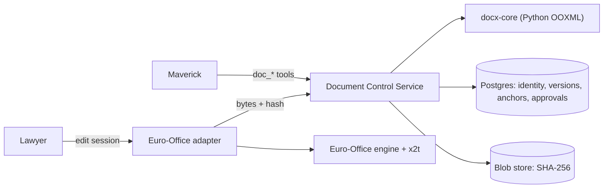
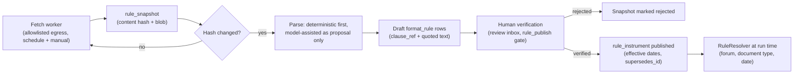

# Maverick — Data, documents and security

**Status:** current · **Date:** 2026-11-26
**This file owns:** the data architecture, the document pipeline, verification, the guideline ingestion pipeline, and the security model.

---

## 1. Data architecture

### 1.1 Principles

1. **One database, one schema, one baseline.** No per-matter database, no second store: the schema is one baseline SQL file, and before pilot data a schema change recreates the database; forward-only numbered migrations arrive with the runner (RD-4) before pilot data.
2. **The database is the authority for identity and permission.** Files are content, not records.
3. **Every legal row carries `matter_id`.** Even when it could be joined. Isolation must not depend on a join.
4. **Immutability where the law needs it.** A document version, an audit event and a published rule never change in place.
5. **JSONB only for open-ended payloads** (rule specs, step inputs, tool results, manifests) — never for fields the product queries or constrains.
6. **Derived data is rebuildable.** Full-text, embeddings and read models can be dropped and rebuilt from canonical rows and blobs.

### 1.2 Postgres layout

| Database | Contents | Backup |
|---|---|---|
| `maverick` | All legal, identity, knowledge, execution and audit tables | Daily dump + WAL |
| `maverick_system` (optional) | Execution-engine state, if DBOS is adopted | Daily dump |
| Blob root | Immutable content-addressed files | Snapshot or restic |

**Schema layout:**

| Schema | Contents |
|---|---|
| `app` | All product tables |
| `audit` | `audit_event` and the append function |
| `ref` | Seeded reference data (`document_type`, `forum`) |
| `ops` | Table ownership, health |

**Naming.** `snake_case`, singular table names, UUID keys, `*_id` foreign keys, `created_at`/`updated_at` timestamptz. A table's owning module is recorded in `ops.table_owner`.

### 1.3 What lives in Postgres and what lives in files

| Information | Where | Why |
|---|---|---|
| Legal records (matter, proceeding, fact, evidence, task, deadline, approval, gate) | Postgres | Transactions, constraints, RLS, queries |
| Document identity, version metadata, hashes, anchors | Postgres | Referential integrity and audit |
| Document bytes (DOCX, PDF, images, scans) | Blob store | Large, immutable, deduplicated |
| Extracted text and page map | Postgres (`document_text`) | Search and retrieval; rebuildable |
| Embeddings | Postgres (pgvector) | One ACL, one backup |
| Full-text index | Postgres (tsvector) | One ACL, one backup |
| Audit | Postgres (`audit_event`) | Hash chain, retention |
| Agent traces | Postgres (`agent_run`, `agent_event`) | Queryable, cost, evals |
| Templates | Blob + metadata row | DOCX fidelity |
| Backups | Encrypted files + manifest | Firm-controlled storage |

**Rule.** If it must be queried, constrained or authorised, it goes in Postgres. If it is bytes, it goes in the blob store and its hash goes in Postgres.

### 1.4 Isolation: the pattern

Every legal table gets `matter_id` and a row-level security policy.

```sql
alter table app.document enable row level security;
alter table app.document force row level security;

create policy document_matter on app.document
  for all
  using (app.has_matter_access(matter_id))
  with check (app.has_matter_access(matter_id));
```

`app.has_matter_access(matter_id)` is a `security definer` function that checks: an active `matter_member` grant for the user; and no active `ethical_wall` for the user. The application sets `app.user_id` per transaction with `set_config(..., true)`, so a pooled connection cannot leak a previous user. The application role has no `BYPASSRLS`; the table owner is forced through RLS. **Negative tests** exist for every path: API, search, embeddings, agent tool, background job, export, backup.

### 1.5 Search and retrieval

**Full text.** `document_text.search_doc` is a generated `tsvector` with a GIN index; queries join `document` for `matter_id`, apply the RLS policy, and rank with `ts_rank_cd`.

**Embeddings.**

```sql
create table app.document_chunk (
  id uuid primary key default gen_random_uuid(),
  matter_id uuid not null references app.matter(id),
  document_version_id uuid not null references app.document_version(id),
  ordinal int not null,
  text text not null,
  token_count int not null,
  embedding vector(1024),
  embedding_model text,
  created_at timestamptz not null default now(),
  unique (document_version_id, ordinal)
);

create index document_chunk_embedding on app.document_chunk
  using hnsw (embedding vector_cosine_ops);
```

**Mandatory filter.** Every query includes `where matter_id = $1`. A repository that omits it fails the type check (the function signature requires a `MatterScope`). A model change is a re-embedding job, not a silent mix.

**What is not searched.** Another matter's chunks, ever. A document version that is not committed. A soft-deleted document. An authority the firm has marked `untrusted` (still readable directly, not retrieved as support).

### 1.6 Blob storage and the matter workspace

**Layout.**

```text
data/
  blobs/
    ab/cd/abcdef...          # sha256, first 2/next 2 chars
  derived/
    <version_id>/text.txt
    <version_id>/pages.json
    <version_id>/thumb.webp
  temp/
```

**Rules.** The blob path is derived from the hash; writing the same bytes twice is a no-op. `app.blob`: `sha256` primary key, `size`, `mime`, `storage_key`, `verified_at`. A read verifies the hash on first access per process; a mismatch is a critical alert. Reference counting is derived from `document_version.blob_sha256` and `template.blob_sha256`; a GC job removes only unreferenced blobs older than 24 hours and never during a legal hold. A blob is never edited — a new version is a new blob.

**Write order (consistency).** Write the blob to a temp file, `fsync`, verify the hash, rename into place; insert `app.blob` (`on conflict do nothing`); then, in one transaction, insert `document_version`, update `document.current_version_id`, append `audit_event`. A crash never leaves a database row pointing at missing bytes.

**Matter folders.** Every matter has its own folder tree, seeded from `document_type` defaults, arranged and movable by the lawyer, one folder per document, never crossing matters (I23):

```text
M-2026-0001/
  Correspondence/
  Pleadings/
  Applications/          # one item per proceeding_application
  Evidence/
  Orders/
  Research and notes/
  Drafts/
```

The canonical bytes stay in the blob store; the folder is metadata - the arrangement in the matter's Files view and the layout every export, per-matter backup and node cache writes to disk.

**The disposable file cache.** An execution node fetches the files a run touches **on demand, by sha256**, from the api — never a managed checkout, never a synced tree. The cache is derived data: deletable, rebuildable, **never canonical and never a permission** — the server-side export is matter-grant filtered before a byte leaves. Commits from the cache return through the document control service carrying the base version hash; a moved base is `DOC_STALE_BASE` (I2 and I21 unchanged across nodes), and the per-document lease arbitrates concurrent writers wherever they run (RD-53).

---

## 2. The document pipeline

### 2.1 The document lifecycle

| Stage | What happens | Owner |
|---|---|---|
| Import | File arrives; hash computed; blob written; document + version created | Documents / Storage |
| Classify | Type proposed (pleading, order, evidence, correspondence); human confirms | Documents |
| OCR / text | Scanned pages OCR'd; text and page map stored | Worker |
| Metadata | Dates, parties, case numbers proposed with anchors | Documents |
| Version | Every edit or import creates a new immutable version | Documents |
| Comments | Annotations at anchors; resolve, never silent edit | Documents |
| Compare | Deterministic diff between versions, by anchor and word | Documents |
| Approval | Human approval bound to version hash | Approvals |
| Export | DOCX / PDF / PDF-A; derived blob | Documents |
| Filing | Filing record with items and acknowledgment | Filing |
| Archive / retention / hold | Status + policy-driven deletion; hold blocks deletion | Documents / Audit |

### 2.2 The three document layers

| Layer | Owner | May | May not |
|---|---|---|---|
| Document Control Service (server) | Maverick | Identity, revisions, anchors, permissions, approvals, commit, provenance, retention | Render or edit |
| `docx-core` (Python OOXML) | Maverick | Parse OOXML, compute anchors, read tracked changes, diff, checks | Mutate a legal document; decide legal acceptability |
| Euro-Office adapter (desktop/server) | our adapter + vendor engine | Display, human edit, convert (x2t), export PDF | Write the database, approve, own identity |

**Naming.** Euro-Office is the editor stack (VD-5, VD-16). It is behind a narrow adapter; the legal record never depends on it.



### 2.3 The document API

| Tool | Input | Output | Approval |
|---|---|---|---|
| `doc_open` | document id or version id | handle, hash, outline, read mode | no |
| `doc_describe` | handle | structure, metadata, anchors | no |
| `doc_read` | handle, mode (full/outline/range/search/context) | annotated blocks | no |
| `doc_search` | handle, phrase | block ids + snippets | no |
| `doc_get_context` | handle, anchor, window | bounded readable context | no |
| `doc_analyze` | handle, analyzer set | findings with codes | no |
| `doc_propose_edit` | handle, anchor, expected text, operation | proposal id, diff | no |
| `doc_diff` | handle, base version | change set by anchor | no |
| `doc_check` | handle | pending changes + findings | no |
| `doc_apply` | proposal id | new working state | no (tracked, reversible; batch review in the inbox; bundle policy may tighten) |
| `doc_undo` | handle, operation id | reverted state | no (if uncommitted) |
| `doc_commit` | handle, base version, approval id | new `document_version` | **yes** |

**Read budget.** A full read is allowed only under a configured token/paragraph limit; above it the tool returns an outline and requires range/search/context. This is the context-rot control applied to documents.

**Anchors and stale edits.** A block anchor is `w14:paraId` when the DOCX carries one; otherwise a deterministic id written into the document as a content control. Every edit carries the **expected text** and the **base version hash**; a moved block or base fails with `DOC_STALE_TARGET` and returns the current text. The server stores anchors per version so a citation can point to "paragraph 104 of version 12" and survive a new version by re-anchoring. A human edit is a save that returns DOCX bytes; the server computes the hash, diffs against the base, and creates a new version — or a proposal if the base moved.

**Tracked changes.** Agent edits are written as `w:ins`/`w:del` with author `maverick:agent:<run_id>`; the human author is never swapped. The lawyer accepts or rejects in Euro-Office or in the review pane. A commit records which changes were accepted, by whom, at what time, in `audit_event`. A version with pending changes is not approvable; the approval applies to the accepted state.

### 2.4 The agent's engine: the Chromium-class builder process

A managed child process runs the official sdkjs Word Document Builder from the vendored tree; DOCX↔`Editor.bin` through x2t; loopback RPC with a token; per-request timeouts and cancellation; a crash log and a restart limit; `ENGINE_STALE_TARGET` on drift; tracked revisions authored by the agent session; verification includes a **Word-open sweep with the tracked revisions intact** and unique `w:id`/`w14:paraId` values in the saved package.

**The host binary follows the deployment shape — Electron is a convenience, not a requirement.** The builder is proven in two hosts: a hidden Electron window, and headless Chromium with the same `AscBuilder` API (VD-18). The desktop uses the already-shipped Electron binary; the server uses the headless Chromium the worker already needs for court-portal automation. No browser at all (portal automation disabled): the engine reports `ENGINE_UNAVAILABLE` with the tried paths — the service still loads — and `docx-core` serves the deterministic ops it owns.

| Concern | Position |
|---|---|
| Which engine for agent edits | The builder is the **sole mutation engine**; `docx-core` is strictly read/verify — anchors, diffs, checks, pinpoints; it never mutates a legal document. The acceptance tests prove the mutation path (tracked-change round trip through Word) and the verify path (anchor and diff correctness) separately. Without a browser binary the engine reports `ENGINE_UNAVAILABLE` and agent edits pause; human edits continue |
| Known trap, adopted as a test | `replace_paragraph` on a paragraph that already carries revisions can split the range and append instead of replace. The document service decomposes such edits into insert + delete, or requires accept/reload first — and the acceptance suite proves it |
| Analyzers cross-pollinated | advdsh's finding codes map onto our checks: `CITATION_SHAPE` (Indian `SCC`/`AIR` reporter patterns) → the citation form check; `CROSS_REFERENCE_MISSING` (`Exhibit`/`Annexure`/`Schedule` with no target heading) → the cross-reference verification kind; `PLACEHOLDER_TEXT` → a pre-commit check |
| Authority | Unchanged: the builder process returns bytes through the document control service; the host owns the lease and the commit (RD-17); the human editor's author is never swapped |

### 2.5 Co-editing: what the Euro-Office server would add, and why it is not in the budget

The Euro-Office fork carries a complete co-editing stack (`server` — `DocService`, `FileConverter`, `SpellChecker`; `DocumentServer` Docker packaging; `document-server-integration` Apache-2.0 glue). Human–human concurrent editing genuinely exists in the chosen stack — it requires running that server as a separate Node service in every firm install, and **the fork carries no platform anywhere** — every collaboration surface is a host application (VD-16, VD-17).

Maverick does not run it. The packaging budget forbids another runtime (RD-51); the legal record must not depend on a second service's storage; and concurrent human edits are already sequenced safely by the single-writer commit — the second writer is handed the current text, never a silent overwrite. The upgrade path, if two lawyers in one DOCX is ever demanded: the co-edit session opens *from* a committed version and saves back *through the same commit path* via the server's callback — a new immutable version with the session's authors recorded; the document server never owns identity, approvals or readiness. It requires the packaging gate to have passed with room for the extra service **and** the AGPL licence review to be complete.

**Vendoring the editor (RD-17).** The pinned release is the **official latest Euro-Office build**, kept deliberately current through the manifest — no version-selection spike. The tree is checksummed and **byte-identical**: the Maverick plugin is loaded **by URL from Maverick resources**, never injected into the vendor tree; a CI vendor-verification test fails the build on any byte drift; vendor files are patched only as a spike-gated, documented, tested exception. The release's documented plugin API is the integration surface; the acceptance tests prove selection and tracked changes.

**Licence.** `server`, `sdkjs`, `core`, `web-apps`, `desktop-apps`, `desktop-sdk` and the mobile apps are **AGPL-3.0**; `document-server-integration`, `plugins`, `document-templates`, `document-formats` are Apache-2.0; `DesktopEditors` itself carries a custom, non-SPDX licence. Professional licence review is mandatory before firm-wide distribution — a gating fact, not a detail.

### 2.6 External storage

Google Drive, SharePoint or a firm NAS may be an **import/export integration, never the canonical store**. The document id and version hash are ours; the external file id is a source reference. An import creates a new version; a hash mismatch is flagged. The external ACL is not trusted; our matter ACL applies. Deleting the external file does not delete our record or blob. If a firm insists on an external canonical store, the document record becomes a pointer and the provenance guarantees weaken — a different product decision, not a configuration.

---

## 3. The guideline ingestion pipeline

**Scope:** Indian forums (FD-16) — the Supreme Court, the Delhi High Court, the Delhi district courts and tribunals. A second jurisdiction would be a content pack, never a code fork.

### 3.1 Sources

| Instrument class | Examples in the reference pack | Where it is fetched |
|---|---|---|
| Court rules | Supreme Court Rules; Delhi High Court (Original and Appellate Side) Rules; district court rules | Official court websites |
| Practice directions and standing orders | Bench practice directions; registry circulars | Official court websites |
| e-filing specifications | eCourts e-filing manual; High Court e-filing specs (PDF/A, bookmarks, file size, court-fee modes) | eCourts portals |
| Statutes with format duties | CPC Orders VI–VIII (pleadings), Commercial Courts Act, court-fee acts | India Code / official gazette sources |
| Tribunal rules | NCLT, CESTAT, consumer commissions | Official tribunal websites |

Every row enters `source` with `reliability = 'official'`, a URL, a retrieval time and a content hash. **No instrument is trusted from memory or from a secondary blog.** A source's status in [07-sources.md](07-sources.md) is *To be verified* until the first snapshot and human review.

### 3.2 The pipeline



| Stage | Mechanism | Owner | On failure |
|---|---|---|---|
| **Fetch** | Worker job per source URL on a weekly schedule plus a manual trigger; allowlisted hosts under `egress_policy`; polite rates | `rules` (worker) | `fetch_failed` logged; the instrument stays on its last published version |
| **Snapshot** | Bytes stored content-addressed; `rule_snapshot` row with `content_sha256` and `blob_sha256` | `rules` + `storage` | A fetch that cannot be hashed is not a snapshot |
| **Change detection** | Compare `content_sha256` with the latest snapshot for the source; unchanged is a logged no-op | `rules` | A changed hash creates a new snapshot with `diff_from_id` and enters parse |
| **Parse** | Deterministic first (PDF text layer, tables; e-filing manuals are largely tabular); model-assisted extraction as **proposal only**, each candidate carrying `clause_ref` and the quoted source text | `rules` + drafting bundle | `parse_failed` — a scanned, garbled or restructured PDF is a review item, not a silent gap |
| **Propose** | Draft `format_rule` rows on a draft instrument; conflicts against existing rules (same `rule_key`, overlapping scope, different `spec`) are flagged at proposal time | `rules` | A conflicting proposal is flagged, never silently merged |
| **Verify** | A human reads the snapshot bytes and each proposed rule side by side; accepts, edits or rejects; the review is a `rule_publish` gate | A named lawyer | An unverified proposal never becomes resolvable |
| **Publish** | Instrument `published` with `effective_from`/`effective_to`; an amendment is a **new** instrument row with `supersedes_id`; rules are never edited in place | `rules` + `approvals` | — |
| **Resolve** | `RuleResolver` at run time | drafting/verification | A stale or conflicted rule resolves `unconfirmed` |

### 3.3 The versioning model

| Concern | Rule |
|---|---|
| Identity | An instrument is one `rule_instrument` row: kind, jurisdiction/forum scope, effective dates, `source_id` |
| Amendment | A **new** row with `supersedes_id`; the old row keeps its `effective_to`; nothing is overwritten |
| One requirement | One `format_rule` row per `(instrument, rule_key, clause_ref)`; `spec` is JSONB with a declared schema per `rule_key` |
| Evidence | Every published instrument points at the `rule_snapshot` chain that produced it |
| Review currency | `verified_at` ages; a rule whose instrument is past its review window resolves `unconfirmed` until a human re-verifies against a fresh snapshot |
| Runtime pinning | A run records the `rule_set_hash` of the exact resolved set; a document's lineage names it, so a filing can always answer "checked against which rules, as of when" |

### 3.4 Precedence resolution

**Input:** `(forum, document_type, date)`. **Output:** a `ResolvedRuleSet` — rules, conflicts, provenance, hash. Two dimensions, in order: **forum specificity** (a deeper node of the forum tree beats a shallower one), then **document specificity** (exact type > category > generic). Within the same specificity class, the instrument with the later `effective_from` wins. If two rules tie on specificity with different specs, the conflict is **reported, never merged away** — the rule resolves `unconfirmed` until a human resolves the instrument conflict.

```python
def resolve(forum, doc_type, on: date) -> ResolvedRuleSet:
    chain = forum.path()                       # country → ... → bench
    instruments = [
        i for i in published_instruments()
        if i.covers_forum(chain)                # scope match on the chain
        and i.effective_window_contains(on)     # effective_from <= on < effective_to
    ]
    candidates = [
        r for i in instruments
        for r in format_rules(i)
        if r.covers(doc_type)                   # exact type > category > generic
    ]
    resolved, conflicts = {}, []
    for rule_key, group in group_by(candidates, key=lambda r: r.rule_key).items():
        group.sort(key=specificity)             # (forum depth, doc-type match, effective_from)
        top = group[-1]
        tied = [r for r in group
                if r.specificity == top.specificity and r.spec != top.spec]
        if tied:
            conflicts.append(Conflict(rule_key, top, tied))
            status = "unconfirmed"             # a conflict is a result, not a merge
        else:
            status = "unconfirmed" if top.instrument.review_overdue() else "verified"
        resolved[rule_key] = ResolvedRule(rule=top, status=status,
                                          provenance=top.provenance())
    return ResolvedRuleSet(rules=resolved, conflicts=conflicts,
                           provenance=provenance(resolved, conflicts),
                           hash=sha256(canonical(resolved)))
```

**The invariants that make this honest:** every resolved rule carries its instrument, clause reference, effective dates and source URL — a check always states its rule, its source and its date. A superseded instrument contributes nothing after its `effective_to`: "the law on the date of filing" is a query, not today's state. The resolved set is persisted with the run and with the document's lineage. Resolution is pure — same inputs, same outputs, no network, no model — and unit-tested against fixtures with deliberately overlapping scopes.

### 3.5 How rules reach the agent

Progressive disclosure, not a dump:

| Stage | What the model sees |
|---|---|
| Context package | The rule **summary** for the document type: blocking `rule_key`s with one-line meanings, plus the `rule_set_hash` |
| On demand | `rules.detail(rule_key)` returns the full spec for one rule |
| Verification | `format_check` runs against the full resolved set deterministically; the model never adjudicates format |
| Human review | Findings in the review inbox name the rule, the clause, the source and the date of every failure |

### 3.6 What is deliberately not built

| Not built | Why |
|---|---|
| Judge profiles | Forbidden entity |
| Automated publication without a verifier | A model may propose; a human verifies |
| Paywalled commentary ingestion | Licence and reliability; official sources first |
| Non-Indian packs | FD-16: Indian forums only |
| Court-specific code branches | The resolution falsifier: a rule must resolve by scope and date without a branch |

---

## 4. Verification

**Rule resolution.** Given `(forum, document_type, date)`, filter `rule_instrument` and `format_rule` by scope and effective date, order by specificity, merge, report conflicts, return a `ResolvedRuleSet` with provenance. A rule past its review date yields `unconfirmed`.

**Citation verification.** For each `citation`: the authority exists; the reporter/citation form is valid; the pinpoint exists in the authority version; the quoted text matches verbatim; the authority is in force on the relevant date; treatment is known. Result: `verified`, `failed` or `unconfirmed`, with evidence. A model may *find* a citation; only a deterministic check may *verify* it.

**Readiness.** A document becomes `ready_to_file` only when a `verification_run` exists whose `subject_hash` equals the current `document_version` hash and whose blocking checks are all `verified` or explicitly waived. A new version invalidates readiness.

**Completion contract (RD-62).** Each document type declares its required sections and fields; a deterministic `completion` check proves they exist before approval. "Complete" is a checked contract, not a feeling.

**Extraction provenance (RD-61).** Every derived extraction — facts, dates, citations proposed from document text — records the `document_text` hash it was built from. A re-OCR or text correction marks derived extractions stale into the review queue; a fact built on superseded text never shows as current.

---

## 5. Schema baseline

- There is **no data migration** from any prior product: the schema is one baseline file, [schema/0001_core.sql](schema/0001_core.sql). Before pilot data, a schema change recreates the database; the seed data (forums, document types, rule instruments) is part of the baseline or a signed content pack. The application refuses to start if the schema does not match the expected version. Before any design-partner matter enters Postgres, a numbered forward-only migration runner ships with an upgrade test and a **refusal test** — a database it cannot upgrade is refused, never half-migrated (RD-4).
- **Harness stores are separate.** `PlanStore`, `Memory` and `StepPersistence` create their own tables in an `exec` schema when configured with Postgres. They are execution state, not legal records, and can be reset without touching `app`.
- **Pydantic Validation at the boundary.** Pydantic models serve HTTP request/response (lax at the edge, then explicit normalisation), domain DTOs (strict for dates, IDs, amounts, versions), tool input/output (strict, generated JSON Schema), config (`pydantic-settings`), events (versioned, unknown fields rejected) and forms (JSON Schema generated, never hand-written). A Pydantic model is not a database model: SQLAlchemy models are separate, mapped explicitly to DTOs; Pydantic validates shape, it does not authorize.
- **The core schema appendix.** [schema/0001_core.sql](schema/0001_core.sql) covers identity, matter, proceedings, documents, knowledge, work, capabilities, execution and audit. It is an appendix, not the starting point; the domain model (02) is the source, and if they conflict, the SQL is fixed.
- **Validation performed.** The core DDL executes from empty on PostgreSQL 17 + pgvector; the isolation test [schema/0002_rls_test.sql](schema/0002_rls_test.sql) passes: probes 1–2 print 1, probe 3 raises the RLS error, probes 4–5 print 0, probe 6 prints 1, probes 7–9 raise the tree errors (23503 / 23514 / 55000), the audit chain links; **67 `app` tables, 0 without RLS, 0 `matter_id` tables without a policy**. This proves the isolation shape; the remaining negative tests (search, embeddings, exports, background jobs, agent tools) belong to the structural suite.

---

## 6. Security and access

### 6.1 Authentication

| Factor | Mechanism |
|---|---|
| First run | The installer generates a one-time setup token; the first account created with it becomes the firm admin; the token is removed afterwards |
| Password | Argon2id, per-user salt, breached-password check on set |
| Second factor | TOTP, recovery codes |
| Session | Server-side `session` row, `HttpOnly`/`Secure`/`SameSite=Lax` cookie, 8-hour idle, 30-day absolute |
| Device | Ed25519 keypair generated on first run; public key registered; used for node registration, remote mTLS and step-up |
| Step-up | Re-auth (password/TOTP or device biometric) for commit, file, send, grant, delete |
| Remote | Device certificate + short-lived ticket; app login still required |
| Optional | OIDC (Microsoft/Google/Keycloak) per firm |

### 6.2 Authorization

```text
allow = firm_role_allows(function)
        AND matter_member_allows(matter, user, action)
        AND NOT ethical_wall_blocks(matter, user)
        AND resource_policy_allows(resource, action)
        AND (for an agent) session_scope_allows(matter, capability)
```

| Layer | Grants |
|---|---|
| **Firm role** (RBAC) | `admin`, `lawyer`, `staff` — functions, not matters; a solo admin is a complete firm |
| **Matter grant** (ABAC) | `lead`, `editor`, `viewer`, `approver` — per user |
| **Ethical wall** | Explicit deny; always wins, including for a lead |
| **Resource policy** | A document can be narrowed (partner-only) but never widened beyond the matter |
| **Agent scope** | The live session plus the standing matter grant plus the selected bundles; no separate run principal and no ambient permissions |

### 6.3 Matter isolation, enforced four times

1. **UI** — routes carry the matter; a stale link returns 404, not a blank record.
2. **Service** — every method takes a `MatterScope`; a repository without one does not compile.
3. **Database** — RLS on every legal table; the app role has no `BYPASSRLS`; the table owner is forced through RLS.
4. **Retrieval** — `matter_id` is a required filter; the context manifest records every id and its matter.

### 6.4 Cross-matter access

| Situation | Rule |
|---|---|
| A related matter (appeal, consolidation) | A `matter_relation` link does **not** grant access |
| Reusing a precedent or clause | Requires a `reuse_grant`: source matter, purpose, fields, expiry, approver |
| A firm-wide knowledge library | Only explicitly published items; client data is stripped |
| An agent working across matters | Not allowed; a run has one matter |
| A report across matters | A separate, permissioned read model; no document content |

A `reuse_grant` returns redacted excerpts, records who approved it and writes an audit event. It is not a hidden similarity search.

### 6.5 Agent permissions

- A run's scope is the **live session plus the standing `matter_member` grant plus the selected bundles** — no per-run grant; RLS re-checks every tool call at the gateway.
- A capability is usable only if it is in a selected bundle and the session holds its permission.
- The agent has no database credentials, no filesystem access and no session cookie.
- Human-only operations (commit, file, send, grant, delete) are not tools; the agent can only create an approval request.
- A sub-agent's scope is the intersection with the parent's, never a superset.
- Every tool call and approval is recorded in `agent_event` and, if it changes a legal record, in `audit_event`.

### 6.6 Prompt injection and untrusted content

- Retrieved document text, web pages, emails and tool results are **data**. The system prompt says so; the harness enforces it by never treating tool output as instructions.
- A content-instruction detector flags text like "ignore previous instructions", "send this to", "approve this" in a document and raises a review item.
- The agent has no send/file/approve tool. The worst a successful injection can do is waste budget or propose a bad edit, which still needs approval.
- Tool output is truncated and labelled with its source and hash. A Tier-3 tool's result is data, never an instruction.

### 6.7 Tool trust and egress

| Tier | Examples | Execution | Database | Filesystem | Network |
|---|---|---|---|---|---|
| **1. Internal** | `doc_*`, `matter_*`, `fact_*`, `citation_*` | In-process service | Through a service | Through a service | None |
| **2. Reviewed integration** | Email, calendar, court portal, research provider | Separate worker | No | Temp dir | Allowlisted destinations |
| **3. Untrusted** | Community MCP, plugin, arbitrary fetcher | WASM or subprocess | No | No | Denied by default |

**Capability declaration.**

```yaml
id: research.search
permissions: [matter.read, research.query]
egress:
  - host: api.example-legal.com
    paths: ["/v1/search", "/v1/document/*"]
    methods: [GET]
credentials: [legal_research_api_key]   # injected by the host, never returned
side_effects: none
```

Egress is denied by default. The gateway checks the allowlist, injects the credential at the boundary, scans the request and response for secrets, and rate-limits per capability. A model provider is an egress destination, configured per firm and per matter.

### 6.8 Legal audit and execution trace

| Record | Contents | Retention | Reader |
|---|---|---|---|
| **Legal audit** (`audit_event`) | Who decided, approved, filed, changed; subject and hash; no document text | Life of matter + retention; legal hold | Lawyer, regulator, court |
| **Execution trace** (`agent_run`, `agent_event`) | Prompts, tool args/results, model, tokens, latency, errors, node | Configurable; raw prompts 90 days | Engineer, evaluator, auditor on request |

The audit is append-only and hash-chained: `hash_n = sha256(prev_hash || canonical_json(event_n))`. The app role has `INSERT` and `SELECT` only. A daily job signs the head with the installation key and writes a signed anchor. Verification is a command: `maverick audit verify --from 1 --to head`. **What a hash chain proves:** it detects tampering after the fact. It does not prove that the original event was truthful — the human decision and the source evidence are what make the record defensible.

### 6.9 Encryption, secrets and keys

| Secret | Storage |
|---|---|
| Provider API keys | Encrypted with the installation master key; never in prompts or logs |
| Master key | OS keystore (desktop) or a 0600 key file (server); optional KMS later |
| Signing key (audit roots, device certs) | Same master key; rotation recorded |
| Database credentials | Environment/secret file; not in the repo |
| Backups | Encrypted with a key derived from the master key; master key escrowed offline |

TLS is mandatory for LAN and remote. A self-signed certificate is acceptable only with client pinning; a firm certificate is preferred.

### 6.10 Backup, restore, retention and legal hold

| Item | Method | Verification |
|---|---|---|
| Database | Encrypted `pg_dump` + WAL archive optional | Restore to a scratch database; row counts + audit head |
| Blobs | Snapshot or restic to firm storage | Every referenced hash present and matching |
| Manifest | Pins database snapshot to blob set + audit head | Signed; restore refuses on mismatch |
| Restore | **Dry run by default**; apply requires approval + step-up; strict mode fails on any critical error | Per-entity report + integrity summary |
| Drill | Quarterly restore to a scratch host | Evidence recorded |

| Data | Default retention | Legal hold |
|---|---|---|
| Matter records | 7 years after closure | Blocks deletion |
| Document versions | Life of matter | Blocks deletion |
| Audit events | Life of matter + 7 years | Never deleted while hold |
| Agent traces | Life of matter; raw prompts 90 days | Configurable |
| Backups | 30 daily, 12 monthly | Hold preserves a backup |

Deletion is a workflow: request → gate/approval → tombstone → purge after holds clear. The audit records the request even if the purge is refused.

### 6.11 Threat model (top items)

| Threat | Control |
|---|---|
| Cross-matter leak | Four-layer isolation + negative tests |
| Agent tool abuse | One gateway on the live session + standing grant + RLS per call + no DB credentials + approval for writes |
| Editor compromise | Sandboxed frame, narrow adapter, server validates bytes and hash |
| Prompt injection via documents | Data-not-instructions + no human-only tools + detector |
| Stolen laptop | Device key in OS keystore + remote revocation + session expiry |
| Malicious firm admin | Audit chain + separation of duties for rule publication |
| Relay operator | End-to-end encryption; relay sees metadata only |
| Supply chain | Pinned versions, lockfiles, signed installers, SBOM |
| Secret exfiltration by a tool | Host-injected credentials + request/response leak scan + egress allowlist |

### 6.12 What is not claimed

This design does not claim compliance with any security or legal standard. It describes controls. Certification, audit and jurisdiction-specific obligations require separate evidence and professional review.

---

*Next: [05-deployment-and-testing.md](05-deployment-and-testing.md).*
