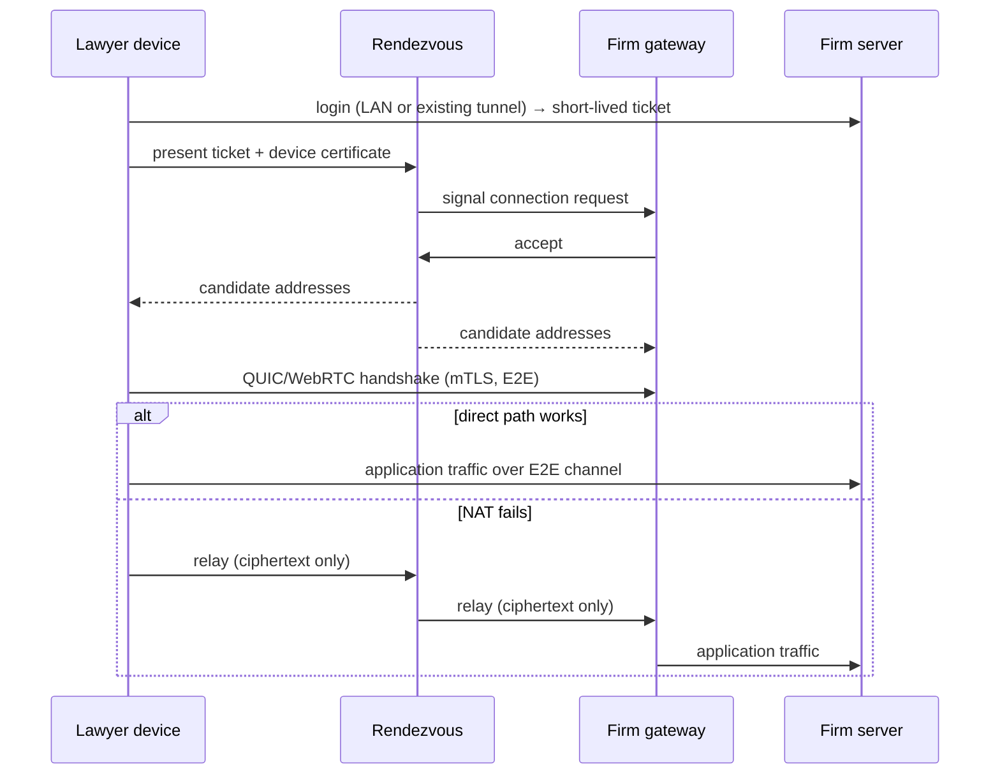

# Maverick — Deployment and testing

**Status:** current · **Date:** 2026-11-26
**This file owns:** deployment shapes, installation, the remote connection service, the test programme, the evaluation system, the verification spikes, the unverified list, the build order, and the scope boundary.

---

## 1. Deployment

### 1.1 Three shapes, one codebase

| Shape | Server | Database | Client | Use |
|---|---|---|---|---|
| **Solo** | **One local Python process** — the solo profile runs `api` + `worker` in-process (RD-51) | Bundled, pinned PostgreSQL binaries started by the installer | Electron on the same PC | One lawyer |
| **Firm LAN** | Firm machine or small server (two process roles of the same codebase) | PostgreSQL on that machine | Electron on each desk | 2–50 users |
| **Firm remote** | Firm server (LAN or rented) | PostgreSQL | Electron anywhere | Distributed firm |

There is no separate "desktop edition" and "server edition". The same server runs in all three shapes; only the installer and the network path differ. A desktop in any shape is also an **execution node** (RD-53): the solo-profile runtime pointed at the firm server — interactive runs execute locally over the live session to the one `ToolGateway`, the builder engine runs locally, files are fetched on demand into a disposable sha256 cache, agent events append directly with idempotency keys, and commits return through the api; the Postgres queue serves server jobs only.

### 1.2 Installer and updates

| Item | Approach |
|---|---|
| Desktop | Signed Windows installer; per-user install; data under `%PROGRAMDATA%\maverick`; the app starts the local server service if not running |
| Server | Signed Windows and Linux installers; bundle a pinned Python runtime and PostgreSQL binaries; create service, database, TLS certificate, first-run setup token (the account created with it becomes the firm admin), backup task |
| Docker | Optional Compose file; never required |
| Updates | Signed; the schema is one baseline — before pilot data a schema change recreates the database; a numbered forward-only migration runner with an upgrade test and a **refusal test** exists **before any design-partner matter enters Postgres** (RD-4) — the pilot precedes any firm install |
| Health | Tray/status page: database, blob store, worker, last backup, disk space |
| Uninstall | Keeps data by default; explicit "remove data" with confirmation |

**The packaging gate.** A clean Windows install under 15 minutes and under 1.5 GB is a hard gate (RD-51). If it cannot be met, change the packaging (thin client + server appliance), not the architecture.

### 1.3 Bundled PostgreSQL — how it works

| Step | Mechanism |
|---|---|
| **Ship** | Pinned PostgreSQL 17 binaries and locale files inside the install directory (~70 MB) — never an install prerequisite the lawyer meets |
| **First run** | `initdb` a data directory under the firm's data root; a generated superuser password encrypted with the installation master key; `scram-sha-256` for the app role |
| **Network** | **localhost-only in every shape** — solo, LAN and remote clients all talk to the `api` process, never to the database; a fixed high port (e.g. 5433) with fallback probing |
| **Supervision** | Started and health-checked (`pg_isready`) by the app service with restart backoff; the server shape registers an OS service; solo runs it as a supervised child |
| **Upgrades** | Within the pinned major: a binary swap with a data check. Across majors: a deliberate later decision. The baseline schema version is checked at startup — the app refuses to run against a foreign data directory |
| **Exclusivity** | Never attaches to an existing instance and never co-installs into one |
| **Backup** | `pg_dump` plus the blob manifest to the firm's chosen destination, encrypted; the quarterly restore drill proves the chain |

The trust shape is the point: the firm never installs, configures or upgrades a database — it owns a data directory and a backup, and everything above it is the application's responsibility.

### 1.4 What the firm controls

| Asset | Firm controls |
|---|---|
| Application server | Its own machine or rented infrastructure |
| PostgreSQL | Its own instance (bundled, localhost-only) |
| Documents and blobs | Its own disk or storage |
| Backups | Its own destination and encryption key |
| User accounts and permissions | Local accounts or its own OIDC |
| Agent execution records | In its own database |
| Audit history | Hash chain and signed anchors |

Maverick may operate optional services (the connection service, update metadata, a licence check). Those services must not hold legal data, must not be required for local operation, and must be replaceable by a firm-run alternative.

### 1.5 The remote connection service

A separate, Maverick-operated service with three parts:

| Part | Role | Sees |
|---|---|---|
| **Rendezvous** | Registration, presence, signaling, tickets | Installation id, device id, IP, time |
| **Relay** | Forwards encrypted packets when direct fails | Ciphertext, IPs, byte counts |
| **Console** | Abuse, revocation, metrics, support | Metadata only |

The firm's server runs `maverick-gateway`: a small outbound-only agent that keeps a connection to the rendezvous and never accepts inbound ports.



**The critical rule.** A ticket proves *the installation authorised this device to attempt a connection*. It does not prove *this user may read this matter*. Login and matter authorization still happen at the firm server.

| Party | Can read legal data? | Can authenticate a user? | Can revoke? |
|---|---|---|---|
| Lawyer device | Yes, after app login | No | No |
| Rendezvous | No | No — it validates a ticket, not a user | Installation/device block |
| Relay | No — ciphertext only | No | No |
| Firm gateway | No — it forwards | No | No |
| Firm server | Yes | **Yes — the only authority** | **Yes — device + session** |

**Revocation and failure.** The firm server marks the device revoked; the gateway closes its sessions; the rendezvous blocks the device; tickets are short-lived and single-use. If the rendezvous is down, LAN works and existing direct connections continue; no local feature depends on the service. Availability target: 99.9% for the rendezvous, best-effort for the relay. Cost: relay bandwidth only; direct P2P is preferred; a per-installation cap and alert. Abuse: registration requires a licence key; rate limits; a kill switch per installation. Privacy: metadata retained 30 days; no content; an India-region relay for firms that require it.

**Timing.** The remote service is its own component (RD-36), and the custom relay is triggered work (RD-54): a supported WireGuard/Tailscale guide serves until a distributed firm's adoption is blocked on VPNs. The trade-off — some solo lawyers will not adopt until remote works — is accepted, not rushed.

---

## 2. Testing

### 2.1 Definition of done

A capability is done when **a real lawyer completes a real task on a real matter** and the evidence is recorded. A passing test suite is necessary, not sufficient.

| Level | Evidence required |
|---|---|
| Code | Unit, integration and structural tests pass; no boundary violation; baseline schema matches |
| Security | RLS negative tests pass; no secret in logs; threat model updated |
| Product | A named lawyer completes the task without an engineer in the room |
| Quality | Deterministic checks pass on the golden set; the eval gate is green |
| Operability | Install, backup, restore rehearsed on a clean machine |
| Record | Audit chain verifies; provenance for every artefact produced |

### 2.2 The test pyramid

| Layer | What it proves | Tools | Runs |
|---|---|---|---|
| Unit | A function or model behaves | pytest, Hypothesis | Every commit |
| Scripted agent loop | A deterministic scripted model drives the real loop through the real gateway: tool selection per bundle, cross-matter refusal, abstention on missing evidence, approval interrupt/resume, mid-run crash recovery — zero network, zero cost (RD-57) | Bundle-scoped scripts; the harness verification spikes are their permanent fixtures | Every commit |
| Integration | A service + Postgres behaves | pytest + testcontainers | Every commit |
| Contract | API, tools and bundles match schemas | schemathesis, parity checks | Every commit |
| Structural | Boundaries, ownership, cycles, generated-code drift | import-linter, custom scripts | Every commit |
| Security | RLS, authz, injection, secret leakage | pytest + a negative suite | Every commit + nightly |
| Document fidelity | DOCX round trip, tracked changes, PDF/A, Word/LibreOffice | python-docx, lxml, x2t, LibreOffice, Word COM | Nightly + packaging gate |
| Workflow recovery | Crash, restart, retry, stale approval | fault injection, kill -9 | Nightly |
| Performance | The targets in §2.6 | k6/Locust + pgbench | Weekly |
| Disaster recovery | Restore to a clean host | scripts + checklist | Quarterly |
| Remote | Tunnel, direct P2P, relay fallback, revocation, AG-UI/SSE reattach | two networks, NAT simulation | Before remote access is offered |

### 2.3 The structural suite

| Check | Fails when |
|---|---|
| Import graph | A module imports another module's repository or a forbidden package |
| Table ownership | A schema change touches a table owned by another module |
| RLS coverage | A table with `matter_id` has no policy |
| Capability parity | A tool exists without a catalog entry, or a catalog entry has no tool |
| Bundle parity | A published bundle references a missing tool or a retired skill |
| Generated contracts | OpenAPI/TS client/tool docs differ from the source |
| Schema drift | The baseline differs from the models |
| Audit coverage | A writing service method does not call `audit.append` |
| Authorisation reference | An agent-generated version or a filing carries neither a task nor a decision reference (I26) |
| Extraction provenance | A derived extraction lacks the `document_text` hash it was built from (I27) |
| Secret scan | A key, token or password appears in the repo or a log fixture |

Each rule has a **negative test**: a deliberately broken fixture proves the check fails.

**Executed smoke test.** The core DDL in [schema/0001_core.sql](schema/0001_core.sql) executes from empty on PostgreSQL 17 + pgvector; the isolation test [schema/0002_rls_test.sql](schema/0002_rls_test.sql) reports: schema from empty, pass (exit 0); 67 `app` tables; 0 without RLS; 0 `matter_id` tables without a policy; user A sees own matter/document 1/1; user B's matter 0; cross-matter insert, RLS error; ethical wall hides the matter 0; nested application own-matter parent 1; cross-matter parent, error 23503; nesting deeper than 6, error 23514; re-parenting, error 55000; audit chain, 2 rows linking. This is evidence of the isolation shape, not proof of every path.

### 2.4 Document acceptance tests

1. **Edit correctness.** An agent changes one paragraph; every other paragraph is byte-identical.
2. **Conflict correctness.** The lawyer edits the same paragraph after the agent read it; the stale edit is rejected and the current text returned.
3. **Integrity.** The exported DOCX opens in Word and LibreOffice with styles, tables, numbering, headers and tracked changes intact.
4. **Tracked changes.** Agent edits appear as `w:ins`/`w:del` authored `maverick:agent:<run>`; accept/reject works through the builder process, and `docx-core` verifies the package without mutating it.
5. **PDF/A.** Export produces a valid PDF/A; text matches the DOCX.
6. **Fidelity.** Page count, page size, margins, fonts and line spacing match the template.
7. **Readiness invalidation.** Approve a document, then change one paragraph: readiness returns to false and the filing gate reopens.
8. **The tracked-paragraph trap.** A replace on a paragraph that already carries revisions decomposes into insert + delete (or requires accept/reload) — proven, not assumed.
9. **Completion contract.** Remove a required section or field from an otherwise well-formatted draft: the `completion` check fails and approval is blocked (RD-62).

### 2.5 Security tests

| Test | Passes when |
|---|---|
| Cross-matter API | User A cannot read or write matter B |
| Cross-matter search | A search never returns another matter's chunk |
| Cross-matter embeddings | A vector query is filtered by `matter_id` |
| Wall | A walled user sees nothing, including search and exports |
| Agent scope | A tool outside the run's bundle is denied |
| Approval stale | A changed subject hash rejects the approval |
| Prompt injection | A document instruction cannot call a human-only action |
| Egress | A non-allowlisted host is denied and logged |
| Secrets | A tool never receives a raw secret; a leak scan catches a fixture |
| Audit | A tampered row fails chain verification |
| Stateless execution | Two advocates' nodes on different matters: zero contention; same matter's same document: lease + `DOC_STALE_BASE` across nodes; the disposable cache verifies per-file sha256 and rejects a stale base; revocation is immediate (no local grant to outlive it); idempotent event append; server jobs unaffected (RD-53) |

### 2.6 Performance targets (reference server: 8 vCPU, 16 GB, SSD)

| Operation | Target p95 |
|---|---|
| Matter list | 150 ms |
| Document open (metadata + first page) | 400 ms |
| Full-text search within a matter | 250 ms |
| Vector search within a matter (100k chunks) | 400 ms |
| Agent tool call (excluding model) | 300 ms |
| Document commit (10 MB DOCX) | 1.5 s |
| Format check (50 pages) | 2 s |
| Citation check (50 citations, cached authorities) | 5 s |
| Backup (10 GB) | 10 min |

These are budgets, not promises. A regression beyond 20% blocks release.

### 2.7 The evaluation system

**Schema.**

```text
eval_suite     id, bundle_id, name, version, dataset_ref, thresholds, created_by
eval_case      id, suite_id, input_ref, expected_ref, rubric, tags, holdout
eval_run       id, suite_version, commit, model, bundle_hashes, started_at, status
eval_result    id, run_id, case_id, metrics jsonb, passed, judge_notes, cost_usd
eval_threshold id, suite_id, metric, min, max, blocking
```

**What is measured.**

| Area | Metric | Method | Threshold |
|---|---|---|---|
| Extraction | Field precision / recall | Golden documents with known fields | ≥ 0.95 / ≥ 0.90 |
| Chronology | Event recall, date accuracy | Golden chronology | ≥ 0.90 / ≥ 0.98 |
| Citation | Resolution rate | Deterministic lookup | 1.00 on the fixture set |
| Quote | Verbatim match | Normalised compare | 1.00 |
| Pinpoint | Exists in the source | Page/paragraph lookup | 1.00 |
| Format | Rule pass rate | Deterministic DOCX check | 1.00 on blocking rules |
| Completion | Required sections and fields present | Deterministic contract check (RD-62) | 1.00 on blocking fields |
| Drafting | Rubric score | Human-calibrated rubric + LLM judge | ≥ 0.80, human spot-check 20% |
| Trajectory | Tool recall, forbidden calls | Trace analysis | ≥ 0.95, 0 forbidden |
| Workflow | Step completion, retries, time | Run records | ≥ 0.95 completion |
| Cost | USD per task | Provider usage | ≤ bundle budget |
| Context | Utilisation, truncation | Context manifest | Truncation < 10% |

**Metrics by document type.** The reference pack is Indian, so the types below are the litigation set the Delhi trio produces. A bundle that drafts a type must pass that type's deterministic set at 1.00 and its rubric threshold; the per-type table is data in the eval suite, not code.

| Document type | Deterministic (blocking, 1.00) | Rubric (≥ 0.80) |
|---|---|---|
| Plaint / written statement | Format rules; citation resolution; quote verbatim; limitation basis; court-fee computation | Cause-of-action structure; paragraph division; completeness of the relief clause |
| Writ petition | Format incl. synopsis and list of dates; citations; reliefs numbered and prayable | Ground-wise structure; arguability of each ground |
| Interim application (bail, stay, injunction) | Format; citations; affidavit verification clause present | Proportionality narrative; facts-to-relief fit |
| Affidavit | Verification clause; format; no unverified statement marked as fact | Factual precision; no argument in an affidavit |
| Opinion / memo | Citations; pinpoint; currency of authorities on the date of advice | Reasoning quality; counter-arguments addressed |
| Notice | Format; statutory references; limitation computation | Tone; completeness of demands |

**How citation and format results feed evals.** `verification_run` rows are **inputs to evals, not just outputs of runs**: the fixture set carries known-bad documents — fabricated citations, misquoted text, wrong pinpoints, overruled authority, a margin that violates the resolved rule set — and a bundle, rule pack, template or model change must keep detecting **100%** of them; a single miss blocks publication. Every eval result carries the deterministic metrics alongside the rubric scores, with `bundle_hashes`, `rule_set_hash` and model version recorded. Deterministic results are never averaged away: the blocking gate is the `min` over blocking metrics, not the mean. A waiver in production is recorded as a review item and counted in the quality report; it never becomes a pass in the eval ledger.

**CI hooks.**

| Trigger | What runs |
|---|---|
| Change to a bundle, skill, playbook, template, prompt or model pin | The affected suites, offline, before publish; leave-one-out for the changed bundle |
| Change to a rule pack | Format fixtures for every document type in the pack's scope, plus the resolution snapshot tests |
| Nightly | Trajectory checks on the golden set; context-utilisation regression |
| Release | The full gate: deterministic 1.00 on blocking fixtures, rubric ≥ 0.80 with a 20% human spot-check, cost within budget |

**The rules.** Deterministic before model — a model is never the only reviewer of its own output. Offline — evals never run while a lawyer waits. Leave-one-out — a bundle that changes nothing is redundant; one that makes it worse is blocked. Holdout — 20% of cases are never shown to the bundle owner. Calibration — the LLM judge is calibrated against human ratings on 100 cases per document type; drift beyond 0.1 re-calibrates. Regression — a change to a bundle, skill, rule, template, model or prompt runs the suite. Provenance — every eval result records bundle hashes, model version, rule set hash and commit.

**The golden set.** 20 closed matters from the design partner, anonymised, with the final filed document and the sources; 50 synthetic edge cases (missing dates, conflicting facts, scanned pages, overruled authority, wrong format); 10 adversarial documents containing prompt-injection text. Owned by a named lawyer; stored encrypted; access logged. **Without a golden set, the product has no evidence.**

### 2.8 Harness verification spikes

| # | Spike | Pass condition |
|---|---|---|
| H1 | Version pins | `pydantic-ai-harness` pinned with `pydantic-ai`; `pydantic-ai-slim[ag-ui]` with `ag-ui-protocol >= 0.1.19` for interrupts; upgrade notes read |
| H2 | Skills | A legal `SKILL.md` library loads on demand; a disallowed skill is not visible |
| H3 | SubAgents | A child run gets the intersection of scope; cannot call `doc_commit`; the depth cap works |
| H4 | DynamicWorkflow | 50 citation checks fan out; no approval inside; the budget stops at the cap |
| H5 | Planning | A plan persists to Postgres; a resume shows the same plan; it does not clear a gate |
| H6 | Memory | A matter notebook writes/reads/searches in a matter namespace; no cross-matter read |
| H7 | Compaction | A long run compacts without losing citations, facts or approvals; context usage visible |
| H8 | StepPersistence | Kill mid-run; `continue_run` resumes; `list_unresolved_tool_effects` shows the uncertain call |
| H9 | Guardrails + Goal | A run without verified citations cannot finish; a secret is redacted |
| H10 | ApprovalReviewer | It is not registered for legal actions; a commit still goes to a human |
| H11 | Permissions | It is not used for matter access; a walled user still sees nothing |
| H12 | Harness + DBOS | A bounded run survives a restart without duplicating a side effect |
| H13 | AG-UI adapter | A scripted legal turn streams AG-UI events to a minimal consumer; an approval interrupts and resumes with a server-side approval row; a forged `resume[]` answering no pending call is rejected before any tool runs |

### 2.9 Unverified

| # | Unknown | Proven by |
|---|---|---|
| U1 | Solo install time and size | The packaging spike |
| U2 | Euro-Office tracked-change round trip | The document acceptance tests |
| U3 | Crash recovery without DBOS | The kill/restart test |
| U4 | Retrieval latency at firm scale | The retrieval benchmark |
| U5 | Sub-agent merge on real documents | The fork/merge test |
| U6 | Bundle conflicts at 10+ bundles | Adversarial bundle-pair tests |
| U7 | Cost per matter | The pilot |
| U8 | Relay behaviour on real carrier NATs | The remote field test |
| U9 | A second forum/document type without code | The reference-pack test |
| U10 | A real lawyer completes a real matter | The pilot |
| U11 | Harness 0.x API stability in the legal pack | The Harness composition spike; the pinned upgrade test |
| U12 | Dynamic Workflow fan-out on real legal data | The 50-citation test |
| U13 | AG-UI interrupt round-trip on a real matter run (approve, deny, stale subject, forged resume) | The AG-UI adapter spike (H13); the red team |
| U14 | Guideline parse quality on real Indian court PDFs | Ingestion on the first real instruments |
| U15 | Application-tree context inheritance and blocking on a real nested matter | The assembly test with an archived bail application |
| U16 | Shared-conversation delivery and presence on a real LAN | The collaboration slice, after the SSE/AG-UI spike |
| U17 | Stateless execution across nodes | The RD-53 security test (§2.5) |

### 2.10 The pilot

| Item | Plan |
|---|---|
| Firm | One small firm, 2–5 lawyers, one office |
| Matters | 3 real matters: one pleading, one appeal, one advisory |
| Users | 2 lawyers, 1 staff |
| Duration | 8 weeks |
| Measures | Time per task, checks passed, approvals, corrections, cost, satisfaction |
| Baseline | The same tasks done the firm's current way, timed |
| Success | ≥ 30% time reduction on the drafting loop with no quality regression; zero cross-matter incidents; zero fabricated citations reaching a draft |
| Failure | Any cross-matter leak, any fabricated citation approved, or install > 30 min |

The pilot is the only proof that matters. Feature count is not a metric.

---

## 3. Build order (RD-54)

**The whole system is the scope; the build order is engineering sequence, never product releases.** No version names, no MVP, no staged releases. The order:

| Order | Focus | Contents | Exit |
|---|---|---|---|
| **1. Hard gates** | De-risk the irreversible blockers | Clean Windows install < 15 min / < 1.5 GB; the DOCX tracked-change round trip on the pinned latest official Euro-Office release; the licence review; the RLS negative-test harness; the AG-UI interrupt spike; the migration runner; the scripted-model layer seeded | All gates pass |
| **2. The solo loop** | The end-to-end legal work cycle on one matter | One Delhi High Court civil matter: notes-first matter, proceeding with registry events, the application tree, documents with anchors, facts with positions, one verified reference rule pack, the drafting loop (builder as sole mutator), citation and format verification, the completion contract, hash-bound approvals, filing records, the scripted-model layer running on every commit | **A lawyer completes a real drafting-and-filing-prep loop end-to-end, without an engineer in the room** |
| **3. Firm + automation** | Multi-user collaboration and server jobs | Grants and walls UI; shared matter rooms with attributed messages; the review inbox and the submission flow; the guideline ingestion pipeline; the partitioned portal browser with the download guards | The 8-week pilot, three real matters, zero isolation or citation incidents |
| **4. Remote + resilience** | Distributed access and disaster recovery | A supported VPN guide; encrypted backups with dry-run restore drills; the durable-engine upgrade only if the crash test fails | Clean restore on a scratch host; a remote lawyer completes a matter |
| **5. Triggered work** | Only when a measured condition fires | The custom relay (when distributed firms block adoption on VPNs); co-editing (packaging headroom + licence clearance); teams (>50 users); offline op-log (a pilot requirement) | The named trigger, formally accepted |

RK-1's falsifier is wired to order 2's exit: **no breadth feature — shared rooms, portal automation, the relay — starts before the solo loop completes a real brief.** Sequencing is an engineering choice; it is not encoded as a product commitment anywhere else in the set.

## 4. Scope

**The whole system is the scope.** There are no staged releases and no minimum viable subset: the product is the Legal Factory and its record substrate, built together. The build order in §3 is engineering sequence, not a product commitment; no other document depends on it.

**Out of scope — with reasons:**

| Out of scope | Why |
|---|---|
| Time recording, billing, trust accounting, invoicing | Regulated; a separate product; refused wholesale |
| Client portal | A different security model; arrives with the remote service and audit maturity |
| Contract lifecycle | A different workflow; no court format |
| Multi-tenant SaaS | Forbidden (FD-7) |
| Mobile app | Desktop-first |
| Judge analytics / outcome prediction | Forbidden entities |
| Full email client | An integration, not the product |
| Graph database; separate search/vector store | Not needed at this scale |
| OIDC/SSO | Local accounts first; a firm can add OIDC |
| Non-Indian jurisdictions | Forbidden scope (FD-16) |
| Human–human co-editing (the Euro-Office document server) | A separate AGPL Node service against the packaging budget; the upgrade path is defined (RD-49) and requires the packaging gate plus the licence review |
| Teams and team-based grants | Grants and walls are per user; teams arrive when a firm's size demands them (RD-42) |
| Regional languages | OCR and model quality follow the English pilot |
| Portal auto-filing | High risk; filing stays human |
| Messaging channels (Slack/Teams/Telegram) | The firm's collaboration surface is the matter workspace, not a messaging platform |
| Offline agent runs with reconciliation | Execution is local, records are server transactions (OQ-8); an offline op-log design is a later revisit |
| Full DDL for every entity | The model is designed; the baseline carries the core |

---

*Next: [06-workflows-and-collaboration.md](06-workflows-and-collaboration.md).*
