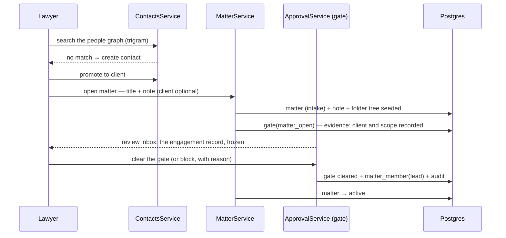

# Maverick — Workflows and collaboration

**Status:** current · **Date:** 2026-11-26
**This file owns:** the collaboration design around the Matter, hearings and preparation, and the end-to-end workflows that exercise the whole system.

---

## 1. The Matter is the shared workspace

No Project entity. No Workspace entity. No second conversation authority. No second runtime. Everything the firm shares lives in the matter; every advocate works in it with their own agent.

| The collaboration need | Where it lives |
|---|---|
| Shared Matter chat | `conversation` (one matter) + attributed `message` rows — §2 |
| Shared Matter files | `document` + `document_version` + `folder`; agents read through `doc_*` tools |
| Individual agent sessions | `agent_run` scoped to one user + one matter; executed on any node (RD-53) |
| Shared agent conversations | `conversation.visibility = 'matter'` — an agent turn is still one run under one user |
| Agent activity visibility | `agent_run` / `agent_event` + the Activity tab |
| Document and research submissions | `task` + `document_version` + `approval` + `annotation` — no new entity (§3) |
| Review and approval workflows | `approval` bound to the subject hash + the review inbox |
| Shared research and work products | Documents and research rows, committed through the same services |

**Rejected:** a Project/Workspace entity (a second container splits the confidentiality unit — the matter already carries work from first note to archive); AgenticOS-style file containers (last-write-wins is unlawful for legal drafts); AgenticOS or any external system as permission authority (ours are per-matter grants with RLS); a second conversation authority; a second agent runtime; **a conflict-check subsystem** (the matter-open gate records client and scope; screening is the firm's own professional process).

---

## 2. The shared room

A conversation is bound to **one matter and one creating user**; a cross-matter message is rejected before the model. One column extends it:

```sql
alter table app.conversation
  add column visibility text not null default 'private'
    check (visibility in ('private','matter'));
```

- `private` (default): the creating user and the runs in it.
- `matter`: every matter member may read and post; walls still deny; the creating user owns rename/archive.
- Every turn is a row in **`app.message`** (owned by `harness`; execution state, **not** a legal record — chat alone is never the record; an answer worth keeping is saved as a note, research row or memo):

```sql
create table app.message (
  id             uuid primary key default gen_random_uuid(),
  matter_id      uuid not null references app.matter(id) on delete cascade,
  conversation_id uuid not null references app.conversation(id) on delete cascade,
  seq            int not null,
  author_type    text not null check (author_type in ('user','agent')),
  author_user_id uuid references app.user(id),
  author_run_id  uuid references app.agent_run(id),
  reply_to_id    uuid references app.message(id),
  body           text not null,
  created_at     timestamptz not null default now(),
  unique (conversation_id, seq),
  check ((author_type = 'user') = (author_user_id is not null))
);
```

**Attribution.** An agent turn carries both the run and the user who launched it. The model is told the conversation may have several people, and each user turn arrives under its author's name.

**Agent scope in a shared conversation.** A run is bound to the **launching user's** grants, never the union of participants' grants and never the conversation's audience. An intern launching Maverick in the matter room gets an intern's run. Participation never confers authority.

**Delivery.** A matter-scoped SSE channel in the `api` process (the same process that serves the AG-UI relay): messages, presence heartbeats and typing indicators. No broker; LAN-only makes SSE sufficient. Presence is ephemeral state on the channel, never a table.

---

## 3. Submissions and review

The intern scenario (prepare a research memorandum, submit, advocate decides) is **not a new entity** — it is the composition we already own:

| Step | Record | The law that makes it safe |
|---|---|---|
| The advocate assigns research | `task` (assignee = intern, work_kind = research) | One accountable hand |
| The intern uploads judgments, drafts the memo | `document` + `document_version` | Versions immutable (I2) |
| The intern submits | `approval` (subject_type = document_version, subject_hash = version hash) + a notification to the assignee | The review inbox |
| The advocate accepts / rejects / returns | `approval` decision + `annotation` rows at anchors ("return with comments") | Approval binds the exact hash; a changed version goes stale |
| Acceptance never overwrites | Nothing is overwritten — acceptance moves the document's status; the next edit is a **new version** | Document ≠ version |

A rejection names its reasons; the original submission stays queryable forever. If a submission needs deterministic checks (citations, format), a `verification_run` attaches to the same hash.

**Client sign-off is optional (RD-59).** A send-to-client action exists — email a draft or advice through the firm's mail integration — as an agent action behind the send gate, never a hardcoded workflow gate. When a reply arrives, a human records the client's instruction or sign-off as a `decision` attributed to the contact (`decided_by_contact_id`). Silence is not approval, and no flow blocks waiting for it.

---

## 4. Tasks and appointments

| Behaviour | Landing place |
|---|---|
| Task with assignee, due date, status; visible on the assignee's Today page | `task` |
| **Private tasks** — creator, assignee and admins only | `task.visibility in ('matter','private')` |
| **Document attachments that never widen access** | `task_document` link, matter-scoped, RLS; reading the document still requires the matter grant and the document's own confidentiality |
| Reminders | Rows in the notifications module with offsets — not a schema change |
| Task lists assigned in one step | A `playbook` with task-creating steps — data, not tables |
| Single assignee | One accountable hand; a second assignee is a second task |
| Appointments booked on behalf of a client against a matter; quick capture creates contact + matter + appointment together | `appointment` + the notes-first matter (FD-12) |
| Appointment types as templates; up to five automated reminders | A kind vocabulary on `appointment`; notification rows |
| **Hearing dates are forum-given, never self-scheduled** | `hearing` from the cause list, `order.next_date` from directions; we schedule the *human work around* the date; the calendar is a derived view (I16) |
| Client self-booking links, video links | Out of scope until the client portal |

---

## 5. Hearings and preparation

A **hearing is forum-given** — it arrives from the cause list; the firm never self-schedules it. What the firm does around it is designed work: **hearing preparation is a capability, not an improvisation (RD-60).**

| Element | Design |
|---|---|
| Bundle | A `hearing-prep` bundle: read the proceeding, compile the record, draft the brief and chronology, index the compilation |
| Skills | Chronology from the record; list of dates from pleadings and orders; brief structure per forum; compilation indexing; oral-note outline |
| Document types | Brief, chronology, list of dates, compilation index — each with a completion contract (RD-62) and format checks |
| Retrieval order | **Matter record first:** pleadings, evidence, exhibits and orders before any external authority. A proposition in a brief links to the fact, exhibit or order it rests on; an authority is cited only through verification |
| Evidence use | The advocate marks exhibits at the hearing; the `exhibit` row records number, as-filed role and marked-on (RD-55). An order-linked event is recorded where the order is available |
| After the hearing | The order arrives through Flow B; next dates and tasks are proposals until confirmed; no preparation output becomes a filing without the normal gate |

---

## 6. What the prior art contributed

Five systems were audited against this design. None is a dependency; each changed something.

| Source | What it proved | What we took |
|---|---|---|
| **Clio** (Manage tasks, Grow matters, Clio Work) | Task privacy, attachments that never change document permissions, reminders, one-step task lists; the opportunity that converts to a matter carrying its record; a matter-aware assistant with matter/user/conversation memory that saves chat answers as documents | The task discipline (§4); confirmation that notes-first intake with in-place conversion is the right shape; the memory-split guard — **user-level memory carries style and preferences only, never matter facts across matters**; chat answers become documents (FD-10). **Billing, estimates and invoicing refused wholesale** |
| **AgenticOS** | Attributed live shared chat with presence; generic read/use/edit resource grants; a hash-chained audit; the run-path two-commit discipline; jobs queued in the request's transaction woken by `NOTIFY`; `uncertain` workflow attempts; run manifests ("cannot be reconstructed from the spec"); **project file concurrency is last-write-wins — no concurrent document editing**; no legal domain, no RLS | The queue/NOTIFY/heartbeat/manifest patterns; the hash-verified transfer job (our cache transfer); the grant vocabulary. **Rejected:** its platform, its file containers, its permission model, any wholesale reuse — the register records the full evaluation (RD-44–53) |
| **cLawyer** | Eight security and agent-runtime patterns, independently derived from the same professional duties: matter-bound conversations; duty-as-gate; citation-gated readiness with hash-bound verification; retrieval packets; WASM capability tools with host-injected credentials; deny-by-default egress; hash-chained audit (with the caveat that a chain detects tampering, it does not prove truthfulness); encrypted backups with dry-run restore | Independent confirmation that RD-24, RD-25, RD-20/21, RD-32, RD-31, RD-29 and RD-33 are the right shape. **Not taken:** its practice-management model (experimental, not production) — and per the owner, **no conflict-check subsystem** |
| **advdsh** | The full document-workspace process model: a managed builder sidecar (loopback RPC, timeouts, crash/restart, stale targets, tracked authorship), x2t per conversion, a sha-verified vendored tree rebuilt from a manifest, legal analyzers with `SCC`/`AIR` citation shapes; **the Document Builder proven in two hosts (hidden Electron and headless Chromium)** | The builder process pattern (RD-52); the cache verification pattern; the analyzers' finding codes mapped onto our verification kinds; its recorded gaps adopted as acceptance tests |
| **OpenAdvo v2** | The blueprint and its v1 codebase, spot-checked against live source (VD-20): a 3,271-line god agent file; a policy failing open to `allow`; 344 IPC channels and 93 disagreeing tools; four competing work models; two memories under one name; a court file absent; evidence axes collapsed; derived facts never invalidated by OCR correction; its doctrine (L1–L19, T-01–T-10) converging with ours on seven tenets; its plugin-by-URL, checksummed-tree editor mechanism | The stateless execution plane's "two doors, one corridor" (RD-53); the append-only positions and registry events (RD-55); the exhibit use-record; the OCR provenance rule (RD-61); the scripted-model layer (RD-57); the approval-latency metric (RK-20); the vendoring mechanism (RD-17); the build-order lesson (RD-54). **Its stack decisions are rejected for Maverick** — a different product's frozen answers |

---

## 7. Key flows

Three sequences exercise the whole design. Each ends in rows — matter, order, proceeding, filing — with hashes and audited writers.

### Flow A — onboard a client, open a matter



| Concern | Rule |
|---|---|
| Records written | `contact`, `client`, `matter`, `note`, `folder` tree, `gate`, `matter_member` |
| The gate asks for | Client and scope — never a document; the engagement record is frozen as the gate's evidence |
| If the gate blocks | The matter stays in `intake` with its notes, indefinitely — blocked, not deleted |
| Audit | `contact.create`, `client.promote`, `matter.open`, `gate.clear` |

### Flow B — an order arrives; next steps; an appeal proceeding opens

Orders arrive from portals (the worker's browser automation, allowlisted egress) or from email and paper. The flow is the same after the blob lands.

```mermaid
sequenceDiagram
  participant W as Worker (portal poll — the job carries its matter_id; no mutable global pointer; selectors from reviewed code; the response context is archived alongside the artifact)
  participant D as DocumentService
  participant P as ProceedingsService
  participant A as Maverick (live session, standing grant)
  participant L as Lawyer
  participant DB as Postgres

  W->>W: poll cause list / order status (allowlisted host)
  W->>D: import order PDF → blob + source (hash)
  D-->>L: classification proposed: type `order`, proceeding
  L->>D: confirm classification
  P->>DB: order row (proceeding, decided_on, operative text, directions[], next_date)
  Note over P: an order may exist with no hearing
  A->>DB: scoped run — read order, propose next steps
  A-->>L: proposals: tasks + deadlines with basis (order directions, limitation)
  L->>P: confirm deadlines (basis visible) → tasks assigned
  L->>DB: decision — file an appeal (options + rationale)
  P->>DB: new proceeding (status prospective, forum = appellate court, same matter)
  P->>DB: limitation deadline proposed (basis: Limitation Act) → confirmed by lawyer
  Note over P: matter ≠ proceeding — the appeal is a new proceeding,<br/>not a new engagement
  P->>DB: every write audited
```

| Concern | Rule |
|---|---|
| Records written | `blob`, `source`, `document` + version, `order`, `task`, `deadline`, `decision`, new `proceeding` |
| Proposals vs records | Next steps are **proposals** until a human confirms; a deadline without a basis is invalid (I6) |
| Same matter or new | Default: the appeal is a new proceeding on the same matter, linked to the prior order. A genuinely new engagement opens a new matter with `matter_relation` — and the relation alone grants no access |
| Audit | `document.import`, `order.record`, `deadline.confirm`, `decision.record`, `proceeding.open` |

### Flow C — draft a petition for a specific court, to a filing-ready PDF

From resolved guidelines to the bytes a human files. Delhi High Court, a writ petition, as the reference case.

```mermaid
sequenceDiagram
  participant L as Lawyer
  participant R as RunService (scope)
  participant X as RuleResolver
  participant A as Maverick (drafting bundle, on the lawyer's node)
  participant DC as Document Control Service
  participant V as Verifier (citation + format + completion)
  participant AP as LegalApproval
  participant EO as Euro-Office / x2t
  participant F as FilingService
  participant DB as Postgres

  L->>R: draft writ petition for proceeding P
  R->>DB: live session opened; context package persisted
  R->>X: resolve(forum=Delhi HC, type=writ petition, date=today)
  X-->>R: ResolvedRuleSet — blocking rules + rule_set_hash
  Note over X: margins, font, spacing, synopsis and list of dates,<br/>verification clause, court fees, PDF/A, bookmarks
  R->>A: context: matter spine + facts + research + rule summary + template
  A->>DC: doc_open(template) → propose_edit (anchor, expected text)
  DC-->>A: proposals applied as tracked changes (author: maverick:agent:run)
  AP->>L: batch review of tracked proposals, then approval card — exact operation, version hash, diff, cost
  L->>AP: approve (step-up auth) → doc_commit
  DC->>DB: new immutable version (hash, lineage: template + rule set + sources)
  A->>V: verify citations + format + completion contract
  V->>DB: verification_run (subject_hash = version hash)
  alt failures
    V-->>L: review inbox — citation failures, format defects (each names rule + source + date)
    L->>A: fix or waive with reason (a waiver is explicit, never a pass)
  end
  AP->>L: filing-ready gate — checks green or waived, hash bound
  L->>AP: clear the gate
  DC->>EO: export PDF/A → validator (text must match the DOCX)
  EO-->>DC: derived blob
  F->>DB: filing prepared (items: main + annexures + affidavit + fee receipt)
  L->>F: human files (portal or counter) → acknowledgment recorded
  F->>DB: document → filed; audit throughout
```

| Concern | Rule |
|---|---|
| Approval points | `doc_apply` writes tracked, reversible changes and gets batch review — no per-call step-up; `doc_commit` and the filing gate are hash-bound human approvals (FD-9, RD-56); the model never verifies its own output (RD-20) |
| Readiness | `ready_to_file` requires a verification run whose `subject_hash` equals the current version hash; a one-paragraph change resets it (RD-21, I21) |
| Guideline currency | The run pins `rule_set_hash`; a stale or conflicted rule resolves `unconfirmed` and blocks readiness unless waived with a reason |
| Records written | `context_package`, `agent_run`/`agent_event`, `document` + versions, `citation`, `verification_run`, `approval`, `gate`, `filing` + items |
| What the lawyer sees | The approval card shows the exact hash, the checks, the model and the cost so far; nothing files silently |

---

## 8. What these flows prove together

1. The record, not the chat, is the product: each flow ends in rows with hashes and audited writers.
2. Every AI output is traceable: run → context package → bundle hashes → rule set hash → document lineage.
3. Humans decide at the three points that are legally irreversible: open the matter, run the appeal, file the bytes.
4. The agent never reaches a legal record except through a service, and never files, sends or approves at all.

---

## 9. Testing the collaboration surface

| Test | Layer |
|---|---|
| Two authorised lawyers read and write one matter thread; both see new turns without refresh | Integration + a real SSE consumer fixture |
| A user without a grant, and a walled user, see nothing — including search and exports | RLS negative suite (per path) |
| A cross-matter message is rejected before the model | I19 extension test |
| Two agent sessions run in the same matter under different users with different scopes | Harness scope test |
| An agent in the shared room cannot read an unrelated matter | `MatterScope` + gateway negative test |
| A shared result carries run, user, bundle and context provenance | Manifest test |
| The intern submits; the advocate accepts/rejects/returns; the original survives | Submission lifecycle test; version immutability (I2) |
| A portal download binds to the job's `matter_id`; no global pointer can redirect it; a model-supplied selector is refused | RD-58 negative test |
| A hearing brief's propositions resolve to the matter record — facts, exhibits, orders — before any authority | Hearing-prep test (RD-60) |
| A client reply is recorded as a contact-attributed decision; silence blocks no flow | RD-59 test |
| Concurrent edits to one document are refused or versioned, never last-write-wins | Document acceptance test 2 |
| Every human and agent action is attributable | `audit_event` chain + `agent_event` correlation |

---

## 10. Falsifiers

1. A matter member reads a message from a matter they cannot access.
2. An agent run in a shared conversation acquires any grant its launching user does not hold.
3. A submission acceptance mutates a version in place.
4. The shared room cannot be delivered on the existing `api` process without a new broker.
5. Adding the chat tab requires a new top-level entity in the domain model.
6. A gate asks for a document instead of client and scope.

---

*Back to [00-README.md](00-README.md).*
