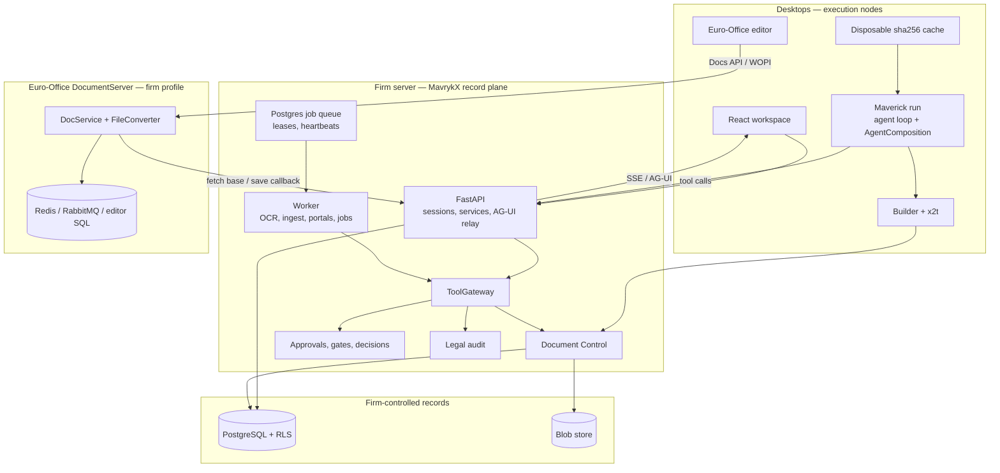

# MavrykX — Detailed architecture

**Status:** current · **Version:** v1 · **Date:** 2026-11-26

MavrykX is a self-hosted legal-work platform. **Maverick** is its one agent. The Matter is the workspace; there is no separate Workspace or Project entity.

The platform is a modular monolith with a firm server, Electron clients and authorised execution nodes. It is **not** a CRUD legal app with a chatbot, and it is **not** a multi-tenant SaaS.

---

## 1. What is fixed

- Electron desktop; React renderer; Python server.
- Pydantic for contracts; Pydantic AI for the agent; the Pydantic AI Harness for agent machinery.
- PostgreSQL as the authoritative database; content-addressed blobs for bytes.
- One agent, Maverick. Sub-agents are tools of that agent, not peer agents.
- Self-hosted per firm; one installation serves one firm.
- Human approval for commit, filing, send, grant and delete.
- DOCX/PDF is the work product; chat is not a legal record.
- Matters may start with a note alone; a client is optional at intake.
- Indian forums only.
- One application-service layer; CLI, HTTP and agent tools call it.
- No conflict-check subsystem; the matter-open gate records client and scope.

---

## 2. Deployment shapes

- **Solo.** One local Python process runs `api` + `worker`. Bundled PostgreSQL. Electron on the same machine. Vendored editor and builder; no DocumentServer.
- **Firm LAN.** Firm server runs the Python roles and the Euro-Office DocumentServer. PostgreSQL, blobs and editor session stores on the firm server. Electron on each desk.
- **Firm remote.** Same firm server behind the remote connection service. No legal data at the relay.

The solo packaging gate is under 15 minutes and under 1.5 GB. The firm profile is a separately measured appliance; it may include the DocumentServer, Redis, RabbitMQ and editor SQL as **editor-session infrastructure**, never as legal stores.

---

## 3. Runtime planes

- **Record plane:** PostgreSQL with RLS, blobs, application services, one gateway, approvals and audit.
- **Editing plane:** Euro-Office DocumentServer for human–human live editing; the builder for agent/offline DOCX work; MavrykX owns identity, versions, permissions, approvals and audit.
- **Execution plane:** stateless Maverick runs on a node. Every tool call crosses the live session to the gateway. The node has no local authority.

**The editor is not the record.** It gets no database credential and no version-creation path. It fetches a committed base by short-lived URL and returns saved bytes by callback.

---

## 4. Modules

### Matter management — the Clio-shaped substrate

- `identity` — firm, user, membership, session, device, execution node.
- `access` — matter membership, ethical wall, reuse grant, resource grant.
- `contacts` — contact, client.
- `matter` — matter, parties, relations, notes, folder metadata.
- `work` — tasks, task-document links, deadlines, appointments.
- `documents` — document identity, versions, anchors, annotations, editing sessions, proposals.
- `storage` — content-addressed blobs.
- `notifications` — notification and delivery state.

This layer works with notes alone. It does not classify, research, draft or run agents.

### Litigation and forums

- `courts` — forum directory and hierarchy.
- `forum_adapters` — cause lists, hearing dates, order downloads, case status. Technical only; not a legal rule engine.
- `proceedings` - proceeding, proceeding application tree, proceeding detail/classification, hearings, orders, registry events.
- `filing` — filing, filing items, fees, acknowledgment, response. Portal attempts and confirmation are deferred.

### Legal intelligence

- `classification` — guided matter intelligence after the Matter is opened; the advocate confirms or corrects.
- `corpus` — primary-law ingestion only: court rules, statutes, laws, regulations, notifications.
- `case_law` — judgments, authorities, citations and treatment.
- `rules` — operational format/procedural rules derived from corpus provisions.
- `research` — research queries and results.
- `research_studio` — multi-agent research projects and plans.
- `library` — firm templates, precedents, checklists and know-how; admin publishes, admin grants.
- `facts` — facts, evidence, positions, statuses, exhibits, evidence notebook.
- `drafting` — render jobs; reads library templates.
- `verification` — citation, quote, pinpoint, format, cross-reference and completion checks.
- `approvals` — approval, gate, decision.

### Agent and automation

- `capabilities` — bundle, bundle version, skill.
- `workflow` — Pydantic Graph definitions, versions, runs, steps and jobs. A playbook is a kind.
- `harness` — conversations, messages, runs, events, context packages, run-bundle provenance.
- `browser` — user browser and separate headless agent browser; explicit control handoff.
- `policy` — egress and capability policy.
- `audit` — legal audit chain.

### Interfaces

- `api` — FastAPI, sessions, SSE/AG-UI relay.
- `gateway` — one `ToolGateway`.
- `worker` — OCR, ingest, portal jobs, scheduled work.
- `cli` — Typer over application services.
- `desktop` — Electron main, preload, renderer.
- `agent` — Pydantic AI loop inside a run.
- `composition` — `AgentComposition`, the only wiring root.

---

## 5. Tech stack

Versions checked on 2026-11-26. Pin exact versions.

### Backend

- Python **3.14.10** target; Pydantic AI floor **3.11**. 3.14 is chosen for the Harness wheel and dependency set; 3.15 is not targeted.
- Pydantic **2.14.4**.
- Pydantic AI **2.75.0**.
- Pydantic AI Harness **0.75.0**.
- pydantic-graph **2.75.0**.
- FastAPI **0.165.0**.
- SQLAlchemy **2.1.9**; asyncpg **0.32.0**.
- Typer **0.29.3**.
- ag-ui-protocol **1.0.0**.
- OpenTelemetry **1.45.2**; structlog **26.1.0**.
- pytest **9.2.0**; pytest-asyncio **1.5.0**; httpx **0.28.1**.
- ruff **0.17.6**; mypy **2.4.1**; uv **0.13.10**.
- DBOS **3.7.0** optional behind `ExecutionEngine`.
- No Alembic. Schema evolution is numbered forward-only SQL.

### Data

- PostgreSQL **17.12** is the V1 baseline. PostgreSQL 19 is not targeted.
- pgvector **0.8.7**; Python client **0.5.1**.
- Blob store on the firm's disk/storage.

### Desktop

- React / React DOM **19.3.1**.
- TanStack Router **1.170.46**; TanStack Query **5.108.4**.
- Electron **45.5.0**.
- Vite **8.4.0**; TypeScript **7.0.2**.
- Tailwind CSS **4.3.5**; `@vitejs/plugin-react` **6.3.0**.
- `@ag-ui/client` **1.0.5**.
- Node **26.13.1** development/build only.

### Editor

- Euro-Office DocumentServer **9.3.8** for the firm profile.
- Docs API is the live integration. WOPI is a file-access/locking fallback; it loses plugins, JWT restriction, toolbar control and paragraph-locking.
- The solo profile uses the vendored editor and builder; no DocumentServer.

---

## 6. Layers and dependency rules

### Layers

1. **Domain** — entities, value objects, invariants and policies. Pure Python. No FastAPI, SQLAlchemy, Pydantic AI, Electron, filesystem or network.
2. **Application services** — use cases, transactions, authorisation, audit. Depends on domain and ports.
3. **Infrastructure** — PostgreSQL repositories, blob store, browser, Euro-Office, model providers, court adapters. No business authority.
4. **Interfaces** — FastAPI, Typer, Pydantic AI tools, Electron IPC/renderer. Thin.
5. **Agent composition** — `AgentComposition` and legal pack. Wires Harness capabilities and tools to services through the gateway.
6. **Composition root** — the only place that constructs infrastructure.

### Rules

- Domain imports domain only.
- Application services import public service contracts, never another module’s repository, models, migrations or `internal/`.
- Infrastructure imports domain and ports; only the composition root constructs it.
- Interfaces import application services, never repositories.
- Agent tools call the gateway; the gateway calls services; no direct DB or filesystem.
- CLI commands call services; no business logic, no SQLAlchemy.
- Electron renderer imports the preload API only; no Node, database, filesystem or secrets.
- Electron main owns OS integration and the device key; not legal records.
- No module writes another module’s tables.
- No cycles. No global orchestrator. No god file.
- Court-specific code lives only in `forum_adapters` or corpus data.

### Public and private

- Public per module: `api.py`, `contracts.py`, `service.py`, shared DTOs.
- Private: `models.py`, `repository.py`, `mappers.py`, `internal/`, migrations, SQL and tests.
- The table-ownership manifest names one owner per table.

### CI enforcement

- `import-linter` layers and independence contracts.
- `ruff` banned imports for wrong-layer FastAPI/SQLAlchemy/Pydantic AI/Electron use.
- `mypy --strict` on domain and application services.
- Table ownership: every table has exactly one owner.
- Schema drift: SQLAlchemy models match the baseline.
- Tool/catalog parity.
- CLI/route/tool parity.
- No cycles.
- Renderer boundary.
- No-god-file check.
- No court-specific code in domain or application services.

### Database, filesystem and Electron

- **Database:** only infrastructure repositories. Application services use ports. No route, CLI command, tool, renderer, domain object or agent touches SQLAlchemy.
- **Filesystem:** storage adapter, builder, OCR/worker, x2t subprocess and Electron main. Renderer has none.
- **Electron:** main and preload only. Renderer uses `contextBridge` with `contextIsolation: true`, `nodeIntegration: false`, `sandbox: true`.
- **Agent:** no database, no filesystem, no Electron.

---

## 7. Editor and document authority

- Human–human co-editing uses the Euro-Office DocumentServer in the firm profile.
- Docs API is the live path; WOPI is a constrained fallback.
- One active `editing_session` per document. It fences out-of-session commits with `DOC_SESSION_ACTIVE`.
- Agents submit base-bound `document_proposal` rows; they do not join a live session.
- The session save creates an immutable `document_version`. A checkpoint is derived; a crash can promote the last checkpoint to an unapproved `editor_recovery` version.
- The builder is the sole agent/offline DOCX mutator; `docx-core` is read/verify only.
- The editor gets no database credential; the host owns identity, versions, permissions, approvals and audit.

---

## 8. Deployment and operations

- Signed Windows installer for the desktop; signed Windows/Linux server installer; optional Docker.
- Bundled PostgreSQL, localhost-only; clients talk to the API, never the database.
- Blobs content-addressed; backup manifest pins DB snapshot, blobs and audit head.
- Encrypted backups; dry-run restore; quarterly drill.
- Remote connection service: rendezvous + E2E relay; the firm server still authenticates and authorises.
- Observability: OpenTelemetry spans for model and tool calls; legal audit is separate from the execution trace.

---

## 9. Build order

This is engineering sequence, not product releases.

1. **Hard gates.** Solo install time/size; DOCX tracked-change round trip; two-user live co-editing spike; firm-profile measurement; licence review; RLS negative tests; AG-UI interrupt; V1 schema/resource-grant delta; dependency checks; migration runner; scripted-model layer.
2. **Solo loop.** One Delhi High Court civil Matter: notes-first, proceeding, documents with anchors, facts, one verified rule set, drafting, verification, completion contract, hash-bound approval, filing record. Classification and forum adapters are not required here.
3. **Firm and legal intelligence.** Grants/walls; shared conversations; live sessions; classification; corpus; case law; library; Research Studio; forum adapters; browser; Pydantic Graph workflow creator; portal browser with download guards.
4. **Remote and resilience.** VPN guide; backups and restore drills; node leases and revocation; durable engine only if the crash test fails.
5. **Triggered work.** Custom relay; live agent editor participation; filing portal attempts/confirmation; teams; offline op-log.

**Do not start breadth before the solo loop completes.** A lawyer must finish a real brief on the loop without an engineer in the room.

---

## 10. Acceptance gates

- Two users edit one DOCX in one live session with comments, track changes and correct authorship.
- An agent proposal against a stale base is detected and never overwrites the session.
- A matter with an ambiguous “Supreme Court case” folder does not become an SLP.
- A primary-law instrument has a source, snapshot, version and reviewer; a stale rule is `unconfirmed`.
- A case-law quote and pinpoint are verified deterministically.
- A library item is admin-published and invisible without a grant.
- A user browser and agent browser are separate; a handoff is visible and revocable.
- A workflow run pins its definition version; a legal gate cannot be cleared by the graph.
- Import layers, table ownership, renderer isolation and no-god-file checks fail a broken fixture.

**Schema smoke test (executed).** On PostgreSQL 17.12 + pgvector, `0001_core.sql` runs from empty and `0002_rls_test.sql` passes: 97 `app` tables, 0 without RLS, 0 `matter_id` tables without a policy; the isolation, wall, application-tree and audit-chain probes pass.

---

## 11. Deferred

- Filing portal attempt/confirmation.
- Live agent participation inside the editor.
- Email as a first-class communication record.
- External counsel guest accounts.
- Firm-scoped Research Studio.

No architecture-level open decisions remain. Forum adapter protocol, source list, sync cadence, browser handoff, licensing, library audience, Research Studio scope, workflow spec format, audit retention and source ownership are implementation-spec decisions; they do not reopen the architecture.

The domain model is in [02-domain-model.md](02-domain-model.md). Application, agent and data are in [03-application-agent-and-data.md](03-application-agent-and-data.md). Shared collaboration is in [04-shared-workspaces-and-collaboration.md](04-shared-workspaces-and-collaboration.md). The product surface is in [05-product-experience.md](05-product-experience.md).
