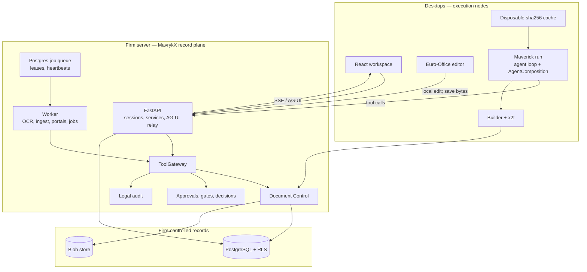

# MavrykX — Detailed architecture

**Status:** current · **Version:** v1 · **Date:** 2026-11-28

MavrykX is a self-hosted legal-work platform. **Maverick** is its one agent. The Matter is the workspace; there is no separate Workspace or Project entity.

The product is built in two stages: the legal CRM and shared Matter workspace first, Maverick's AI Legal Harness second. The CRM is a complete multi-user product before the agent is wired in.

The platform is a modular monolith with a firm server, Electron clients and authorised execution nodes. It is **not** a CRUD legal app with a chatbot, and it is **not** a multi-tenant SaaS.

---

## 1. What is fixed

- Electron desktop; React renderer; Python server.
- Pydantic for contracts; Pydantic AI for the agent; the Pydantic AI Harness for agent machinery.
- PostgreSQL as the authoritative database; content-addressed blobs for bytes.
- One agent, Maverick. Sub-agents are tools of that agent, not peer agents.
- CRM foundations first; the AI legal harness second.
- One firm with multiple users; a client may have many Matters.
- One shared Matter workspace; sequential document editing. No real-time co-editing in V1.
- A firm admin is a lawyer, has access to every Matter and assigns Matter access to lawyers, staff and interns.
- No ethical walls, no conflict-check subsystem and no private-resource rule. The matter-open gate records client and scope. Matter resources are Matter-wide; restricted documents need a resource grant, except for the firm admin.
- Self-hosted per firm; one installation serves one firm.
- Human approval for commit, filing, send, grant and delete.
- DOCX/PDF is the work product; chat is not a legal record.
- Matters may start with a note alone; a client is optional at intake.
- Indian forums only.
- One application-service layer; CLI, HTTP and agent tools call it.

---

## 2. Deployment shapes

Installed and running are different facts. In the target install, every client installs the local editor;
the server pack is installed but is not started in V1.

- **Local.** One local Python process runs `api` + `worker`. Bundled PostgreSQL. Electron on the same machine. The Euro-Office frontend and `x2t` are installed; no `DocService` process runs.
- **Firm LAN.** Firm server runs the Python roles. PostgreSQL and blobs live on the firm server. Electron on each desk; document editing is local and saves through the API.
- **Firm remote.** Same firm server behind the remote connection service. No legal data at the relay.
- **Shared live session — deferred.** For a future live co-editing decision, the server pack could run `DocService`, `FileConverter` and the PostgreSQL queue on the firm server or a sharing client on the LAN. That is not a hosted DocumentServer service. It is not part of V1, not started by the CRM, and not required for multi-user collaboration.

The target installer is the shared-capable app: under 15 minutes and under 3.5 GB installed. A local-only
target build without the server pack stays under 1.5 GB. Redis is not used; the queue is PostgreSQL.
Editor session stores are editor-session infrastructure, never legal stores. V1 has no Docker dependency.

---

## 3. Runtime planes

- **Record plane:** PostgreSQL with RLS, blobs, application services, one gateway, approvals and audit.
- **Editing plane:** the Windows-native Euro-Office editor on the desktop, `x2t` for conversion and the builder for agent/offline DOCX work. MavrykX owns identity, versions, permissions, approvals and audit. No DocumentServer process is part of V1.
- **Execution plane:** stateless Maverick runs on a node. Every tool call crosses the authenticated API session to the gateway. The node has no local authority.

**The editor is not the record.** It gets no database credential and no version-creation path. It opens a committed base under an edit lease and returns saved bytes to the API; only the holder of the lease may save, and only against that base.

---

## 4. Modules

### Matter management — the Clio-shaped substrate

- `identity` — firm, user, membership, session, device, execution node, delegation.
- `access` — matter membership, reuse grant, restricted-document resource grant, the one Matter access policy.
- `contacts` — contact, client.
- `matter` — matter, parties, relations, notes.
- `work` — tasks, assignments, task-document links, deadlines, appointments.
- `documents` — sections/folders, document identity, versions, anchors, annotations, edit leases, proposals, compare and restore.
- `storage` — content-addressed blobs.
- `notifications` — notification and delivery state.

This layer works with notes alone. It does not classify, research, draft or run agents. Steps 1–6 of the build order deliver this layer; the agent modules are wired in step 7.

### Litigation and forums

- `courts` — forum directory and hierarchy.
- `forum_adapters` — cause lists, hearing dates, order downloads, case status. Technical only; not a legal rule engine.
- `proceedings` — proceeding, proceeding application tree, proceeding detail/classification, hearings, orders, registry events.
- `filing` — filing, filing items, fees, acknowledgment, response. Portal attempts and confirmation are deferred.

### Legal intelligence

- `classification` — guided matter intelligence after the Matter is opened; the advocate confirms or corrects.
- `corpus` — primary-law ingestion only: court rules, statutes, laws, regulations, notifications.
- `case_law` — judgments, authorities and treatment. `verification` owns the citation records.
- `rules` — operational format/procedural rules derived from corpus provisions.
- `research` — research queries and results.
- `research_studio` — multi-step research projects and plans, executed by Maverick and its sub-agent tools.
- `library` — firm templates, precedents, checklists and know-how; admin publishes, admin grants.
- `facts` — facts, evidence, positions, statuses and the evidence notebook. `proceedings` owns the exhibit record.
- `analysis` — issues, arguments and argument authorities.
- `drafting` — render jobs; reads library templates. Owns no table.
- `verification` — citation, quote, pinpoint, format, cross-reference and completion checks.
- `approvals` — approval, gate, decision and the review queue read model.

### Agent and automation

- `capabilities` — bundle, bundle version, skill.
- `workflow` — Pydantic Graph definitions, versions, runs, steps and jobs. A playbook is a kind.
- `harness` — conversations and messages from step 5; runs, events, context packages and run-bundle provenance from step 7.
- `browser` — user browser and separate headless agent browser; explicit control handoff.
- `policy` — egress and capability policy.
- `audit` — legal audit chain.

### Interfaces

- `api` — FastAPI, sessions, SSE/AG-UI relay.
- `gateway` — one `ToolGateway`.
- `worker` — OCR, ingest, portal jobs, scheduled work.
- `cli` — Typer over application services.
- `desktop` — Electron main, preload, renderer.
- `agent` — Pydantic AI loop inside a run.
- `composition` — `AgentComposition`, the only wiring root.

---

## 5. Tech stack

The exact pins, the pairs that move together and the lockfile rules are in
[`docs/implementation/repo-scaffold.md`](../implementation/repo-scaffold.md) §1. The lockfiles are the
evidence. This section records the architecture-level choices; it does not repeat the pin table.

- Python **3.14**; FastAPI; Pydantic at the boundaries; SQLAlchemy and asyncpg for persistence; Alembic
  forward-only.
- Pydantic AI for the run loop; the Pydantic AI Harness for capabilities. `pydantic-ai-harness==0.75.0`
  pins `pydantic-ai-slim==2.75.0`; do not declare `pydantic-ai` or `pydantic-graph` separately.
- PostgreSQL **17.12** with pgvector; content-addressed blobs; the queue is PostgreSQL.
- React 19 and Electron **45.5.0**; Electron carries Node **24.22.3**, the native-module ABI, which is
  not the build Node. TypeScript **6.0.3**, not 7.0.2: `typescript-eslint` 8.74 supports `<6.1.0`.
  Vite; TanStack Router and Query; Zustand for UI state only.
- One OpenAPI source: FastAPI emits it; `openapi-typescript` generates the client. No hand-written
  request types; no Zod in the renderer.
- Euro-Office **9.3.8** local editor and `x2t`; no `DocService` process in V1. The server pack is
  installed but not started.
- `lxml` reads OOXML for verification; the builder is the only writer; `python-docx` is optional for
  simple extraction; `pypdf` extracts PDF text.
- OCR is local; Tesseract 5.x with English and Indic language data is pinned with the installer.
- `ruff`, `mypy --strict`, `import-linter`, ESLint, `tsc`, `dependency-cruiser`, `pytest`, `hypothesis`,
  `pip-audit` and `npm audit` are the quality tools.
- `alembic check` is the intended model-drift gate once SQLAlchemy models exist. Today
  `tools/schema.py` checks the baseline digest, migration head and RLS. `downgrade` is not implemented.

---

## 6. Layers and dependency rules

### Layers

1. **Domain** — entities, value objects, invariants and policies. Pure Python. No FastAPI, SQLAlchemy, Pydantic AI, Electron, filesystem or network.
2. **Application services** — use cases, transactions, authorisation, audit. Depends on domain and ports.
3. **Infrastructure** — PostgreSQL repositories, blob store, browser, Euro-Office, model providers, court adapters. No business authority.
4. **Interfaces** — FastAPI, Typer, Pydantic AI tools, Electron IPC/renderer. Thin.
5. **Agent composition** — `AgentComposition` and legal pack. Wires Harness capabilities and tools to services through the gateway.
6. **Composition root** — the only place that constructs infrastructure.

### Rules

- Domain imports domain only.
- Application services import public service contracts, never another module’s repository, models, migrations or `internal/`.
- Infrastructure imports domain and ports; only the composition root constructs it.
- Interfaces import application services, never repositories.
- Agent tools call the gateway; the gateway calls services; no direct DB or filesystem.
- CLI commands call services; no business logic, no SQLAlchemy.
- Electron renderer imports the preload API only; no Node, database, filesystem or secrets.
- Electron main owns OS integration and the device key; not legal records.
- No module writes another module’s tables.
- No cycles. No global orchestrator. No god file.
- Court-specific code lives only in `forum_adapters` or corpus data.

### Public and private

- Public per module: `api.py`, `contracts.py`, `service.py`, shared DTOs.
- Private: `models.py`, `repository.py`, `mappers.py`, `internal/`, migrations, SQL and tests.
- The `ops.table_owner` manifest names one owner per table.

### Required boundary checks

The enforcement plan owns the rule catalogue and records which checks are wired. The required rules:

- `import-linter` layers and independence contracts; `mypy --strict` on domain and application services.
- Table ownership: the `ops.table_owner` manifest in the baseline; `tools/ownership.py` is the planned check.
- Schema: baseline digest, migration head and RLS in `tools/schema.py`; `alembic check` once SQLAlchemy models exist.
- Tool/catalog parity and CLI/route/tool parity in `tools/operations.py`.
- No cycles: import-linter and dependency-cruiser.
- Renderer boundary: dependency-cruiser.
- No-god-file check: planned.
- No court-specific code in domain or application services: `tools/court_leak.py` is planned.
- A rule is not enforced until its negative fixture fails for the right reason.

### Database, filesystem and Electron

- **Database:** only infrastructure repositories. Application services use ports. No route, CLI command, tool, renderer, domain object or agent touches SQLAlchemy.
- **Filesystem:** storage adapter, builder, OCR/worker, x2t subprocess and Electron main. Renderer has none.
- **Electron:** main and preload only. Renderer uses `contextBridge` with `contextIsolation: true`, `nodeIntegration: false`, `sandbox: true`.
- **Agent:** no database, no filesystem, no Electron.

---

## 7. Editor and document authority

- V1 uses the embedded Windows-native Euro-Office editor and `x2t`; there is no shared live session, no
  `DocService` process and no Docker dependency.
- One active `editing_session` is the edit lease. Only its holder may save; another user reads the latest
  committed version. The full contract, error names and conflict rules are owned by
  [04-shared-workspaces-and-collaboration.md](04-shared-workspaces-and-collaboration.md) §6.
- A save is base-version and base-hash bound; it creates an immutable `document_version` and moves the
  current pointer. A moved base or lost lease is refused. There is no silent overwrite.
- Agents submit base-bound `document_proposal` rows; they do not hold the human lease and cannot apply
  while it is active.
- There is no server checkpoint and no `editor_recovery` version in V1. A restore creates a new version
  from an old blob and resets approval.
- The builder is the sole agent/offline DOCX mutator; `lxml` reads the OOXML package for verification.
  The editor gets no database credential and no version-creation path.
- A future live co-editing decision may implement the same edit-lease and save seam. V1 does not add
  CRDT, OT, cursors or a second document authority.

---

## 8. Deployment and operations

- Target packaging: a signed Windows installer for the desktop and a signed Windows/Linux server installer. No Docker dependency; a development machine may use a disposable PostgreSQL container for tests, never the product.
- Bundled PostgreSQL, localhost-only; clients talk to the API, never the database.
- No data migration from a prior product. The baseline is the first schema; later changes are
  forward-only numbered migrations before pilot data.
- Blobs content-addressed; backup manifest pins DB snapshot, blobs and audit head.
- Encrypted backups; dry-run restore; quarterly drill.
- Remote connection service: rendezvous + E2E relay; the firm server still authenticates and authorises.
- Observability: OpenTelemetry spans for model and tool calls; legal audit is separate from the execution trace.

---

## 9. Build order

This is engineering sequence, not product releases. Steps 1–6 are the legal CRM and shared Matter workspace. Step 7 is Maverick's AI Legal Harness. Step 8 is the first end-to-end legal workflow.

This is the product build order. The verification-spine order is in
[`repo-scaffold.md`](../implementation/repo-scaffold.md) §6, the enforcement rollout in
[`enforcement-audit-plan.md`](../implementation/enforcement-audit-plan.md) §13, and the document-step
order in [`eurooffice-integration-plan.md`](../implementation/eurooffice-integration-plan.md) §12.
Those are sub-orders, not alternative product sequences.

**Step 0 — verification spine (exists).** The scaffold, operation registry, boundary checks, baseline schema, RLS probes and `tools.verify` gate. Every later step keeps them green.

1. **Firm, users, memberships and roles.** Firm bootstrap, admin/lawyer/staff/intern membership, sessions, devices, delegation and the audit actor. Gate: a firm admin reads every Matter by role; a non-member reads none; a delegate cannot promote an admin and never gains wider access.
2. **Clients, contacts and Matters.** Contact deduplication, client with many Matters, Matter open/close, the matter-open gate, parties and notes-first intake. Gate: a client with two Matters is isolated; a Matter can exist with a note and no client.
3. **Shared Matter workspace and resource permissions.** Firm-admin Matter access, Matter `edit`/`view` grants, sections, restricted-document grants, the one access policy, the workspace change feed and cross-resource audit. Gate: a firm admin sees every Matter; a non-member sees no Matter; cross-Matter and grant negative tests pass for sections and the shared policy; each resource added in steps 4–5 extends the same fixtures before its surface ships.
4. **Documents, Euro-Office, versions and audit.** Upload, local editor, edit lease, base-bound save, immutable versions, compare, restore, tracked changes, proposals and hash-bound approval. Gate: two users edit sequentially with no silent overwrite; a stale save is refused; restricted-document grants hold for versions, text, anchors, annotations, relations and chunks.
5. **Notes, tasks, assignments, events and conversations.** Notes with headings, tasks and assignments, deadlines, appointments/hearings, Matter-wide conversations and messages, and research submissions as task + version + approval. Gate: every resource is attributed and audited; a Matter member reads every Matter resource, and a non-member reads none.
6. **Review and approval workflows.** Submission, supervisor review, approve/return, notifications, the review inbox and the document status transitions. Gate: an intern submits, a supervisor returns, a new version is submitted and approved; the original survives.
7. **Maverick AI Legal Harness on the completed CRM.** Tool catalog, gateway, bundles, context assembly, runs, proposals, approvals and the agent UI. The harness calls the CRM services; it adds no legal authority and no second data path. Gate: an intern's agent reads only the intern's resources and cannot approve.
8. **First end-to-end legal workflow.** Pleading ingestion → fact extraction → legal research → memo drafting → lawyer review. This is the first legal-intelligence proof, not the first build step. Gate: a lawyer completes the workflow on a real Matter, every citation is verified or `unconfirmed`, and the memo is approved by a human.

**Do not start step 7 before steps 1–6 pass their gates.** The CRM is not a demo for the agent; the agent is a later participant in a working firm product. A lawyer must be able to run a Matter with documents, notes, tasks, events, conversations and review without a model in the room.

---

## 10. Acceptance gates

These are the product acceptance gates. Component acceptance is in
[03-application-agent-and-data.md](03-application-agent-and-data.md) §11 and
[04-shared-workspaces-and-collaboration.md](04-shared-workspaces-and-collaboration.md) §13; the domain
invariants are in [02-domain-model.md](02-domain-model.md) §5.

**CRM and shared workspace.**

- A firm has an admin, at least two lawyers and a staff/intern; the admin is a lawyer; roles and Matter access are enforced; a firm admin reads every Matter; a non-member reads none. A delegate cannot promote an admin and never gains wider access.
- A client holds two Matters; documents, notes, tasks, events, conversations and approvals never cross the Matter boundary.
- Two lawyers and an intern work in one Matter. Each sees the latest saved shared state and the attribution for every change.
- One user holds the document edit lease; another reads the latest version; a stale save is refused; the next save creates one immutable version.
- A lease expires or is revoked; the next user can edit; an old save does not overwrite the new version.
- Version comparison is read-only; restoring an old version creates a new version and resets approval.
- A Matter member reads every note, task and conversation in the Matter; a non-member reads none. A restricted document needs a resource grant, except for the firm admin; its version, text, anchors, annotations, relations and chunks follow the same grant.
- An intern submits; the supervisor returns and later approves; the original version survives; every step is audited.
- An agent proposal against a stale base is detected; it never overwrites a human save or the current version.
- Every workspace resource write has an audit event; a missing event fails a fixture.
- A document can be worked without a model, a run or a bundle. The CRM is complete before step 7.

**Legal intelligence and agent.**

- A matter with an ambiguous “Supreme Court case” folder does not become an SLP.
- A primary-law instrument has a source, snapshot, version and reviewer; a stale rule is `unconfirmed`.
- A case-law quote and pinpoint are verified deterministically.
- A library item is admin-published and invisible without a grant.
- A user browser and agent browser are separate; a handoff is visible and revocable.
- A workflow run pins its definition version; a legal gate cannot be cleared by the graph.
- An intern's agent inherits the intern's grants, cannot read a restricted document and cannot approve.
- Import layers and renderer isolation fail a broken fixture now. Table-ownership and no-god-file checks
  are required before step 1; their negative fixtures do not exist yet.

**Schema smoke test.** The baseline is `0001_core.sql` with `0002_rls_test.sql`. CI has run the baseline
on `pgvector/pgvector:pg17` (PostgreSQL 17.12) and the previous revision passed. Re-run it for the
current revision before step 1. The baseline has 95 `app` tables, 0 without RLS, and 0 `matter_id` tables
without a policy. pgvector 0.8.7 is the product target; the CI image tag does not assert that patch. The
workspace step adds no table for a section; it uses `folder`.

---

## 11. Deferred

- Real-time co-editing, shared cursors, presence and simultaneous editing.
- DocumentServer shared sessions and peer-hosted editor services.
- Filing portal attempt/confirmation.
- Live agent participation inside the editor.
- Email as a first-class communication record.
- External counsel guest accounts.
- Firm-scoped Research Studio.
- Teams, billing, time recording and a client portal.

The CRM and workspace decisions are closed for V1. The live co-editing option is explicitly deferred; the edit-lease and save seam remains so it can be revisited without a second document authority. Implementation details — forum adapter protocol, source list, sync cadence, browser handoff, licensing, workflow spec format, source ownership — are recorded in `docs/implementation/` and the owning module; they do not reopen the architecture.

The domain model is in [02-domain-model.md](02-domain-model.md). Application, agent and data are in [03-application-agent-and-data.md](03-application-agent-and-data.md). Shared collaboration is in [04-shared-workspaces-and-collaboration.md](04-shared-workspaces-and-collaboration.md). The product surface is in [05-product-experience.md](05-product-experience.md).
