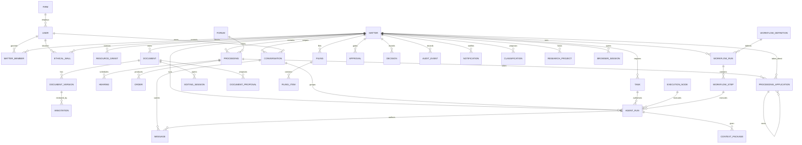

# MavrykX — Domain model

**Status:** current · **Version:** v1 · **Date:** 2026-11-26

MavrykX records legal work, not conversation. The Matter is the unit of confidentiality and the workspace. A Matter may start with a note alone.

The domain separates four layers:

- **Matter management** — the Clio-shaped substrate: firm, people, clients, Matters, parties, tasks, dates, notes, documents and access.
- **Litigation management** — Proceedings, applications, hearings, orders, forum adapters and filings.
- **Legal intelligence** — classification, primary-law corpus, case law, library, research, evidence, drafting and verification.
- **Agent and automation** — runs, tools, browser and workflows.

A Matter is complete without litigation management or legal intelligence.

---

## 1. Definitions

**Matter** — the engagement. The unit of confidentiality and work. Title and note are enough to open it; the client is optional at intake.

**Proceeding** — one legal process before one forum: suit, appeal, SLP, writ, bail, execution, tribunal. A Matter can have several.

**ProceedingApplication** — an application nesting inside a Matter, a Proceeding or another application. It is not a Proceeding and not a sub-matter.

**Forum** — a court, tribunal, authority or arbitral seat. Hierarchical.

**Jurisdiction** — the legal basis on which a forum hears: Article 136, Article 226/227, statutory appeal, revision, supervisory, original, execution, tribunal.

**Practice area** — civil, criminal, constitutional, commercial, tax, tribunal.

**Legal subject** — what the dispute is about, independent of the proceeding type.

**Nature of proceeding** — original, appellate, revisional, supervisory, execution, contempt, interim, review.

**Proceeding type** — SLP(C), SLP(Cr), writ, civil appeal, criminal appeal, suit, bail, quashing, revision, review, execution, arbitration petition, tribunal.

**Relief** — the remedy sought.

**Impugned decision** — the judgment, order, act or decision challenged, with forum, case number, date, outcome and certified copy.

**Procedural posture** — what has happened so far.

**Procedural stage** — the current stage.

**Governing date** — the date that selects the applicable law or rule.

**Classification proposal** — a per-field proposal with evidence, status, conflict and confirmation state. It is not a Matter or Proceeding until the advocate confirms it.

**Corpus** — authoritative text and versions of court rules, statutes, laws, regulations and notifications. Case law is not in the corpus.

**Case law** — judgments and authorities, with citations and treatment.

**Library** — firm templates, precedents, checklists and know-how. Admin publishes; admin grants access.

**Research Studio** — a workspace for a multi-agent research project and plan. Not the Matter chat.

**Workflow** — a Pydantic Graph definition and its runs. Deterministic orchestration, not an agent.

**Playbook** — a kind of workflow definition for a legal process. Not a second runtime.

**Agent** — Maverick. One agent configuration; runs are its executions.

**AgentComposition** — the composition root that builds the Pydantic AI `Agent` from Harness capabilities and the legal pack.

**Harness capability** — a Pydantic AI composable unit: `Skills`, `Memory`, `AskUser`, `SubAgents`, `StepPersistence`, `ToolSearch`, `Compaction`.

**Tool** — one typed callable in the tool catalog.

**Bundle** — the versioned selection of tools, instructions, sub-agent tools, permissions, budget and evals.

**Workspace** — a Pydantic AI execution environment. Never the Matter.

**Memory** — the Harness notebook. Not evidence.

**Note** — a Matter-scoped legal record. Not Harness memory.

**Run** — one agent execution.

**Approval** — human permission for one operation on one artefact/version, bound to a hash.

**Gate** — a block on a state transition until a duty is discharged.

**Decision** — a human legal choice with options and rationale.

---

## 2. Entities by owner

### Identity and access

- `firm` — the installation's organisation. Owner: identity.
- `user` — human login and audit actor. Owner: identity.
- `membership` — firm role. Owner: identity.
- `session` — server-side login session. Owner: identity.
- `device` — registered desktop. Owner: identity.
- `execution_node` — desktop, server worker or shared node. Owner: identity.
- `matter_member` — baseline Matter grant. Owner: access.
- `ethical_wall` — explicit deny; always wins. Owner: access.
- `reuse_grant` — cross-Matter reuse. Owner: access.
- `resource_grant` — narrows a document, conversation or task inside a Matter. Owner: access.

### People

- `contact` — one deduplicated person or organisation. Owner: contacts.
- `client` — a contact in the client role. Owner: contacts.
- `matter_party` — a contact/client in a role within a Matter. Owner: matter.

### Matter and litigation

- `matter` — the engagement. Owner: matter.
- `matter_relation` — Matter-to-Matter link. Owner: matter.
- `note` — Matter-scoped note. Owner: matter.
- `proceeding` — one legal process. Owner: proceedings. Its classification/detail fields carry the impugned order, originating proceeding, jurisdiction basis, governing date and a composable `detail` JSONB. There is no proceeding-relation table and no connected-proceeding graph.
- `registry_event` — registered, transferred, renumbered, bench changed. Owner: proceedings.
- `hearing` — dated occurrence. Owner: proceedings.
- `order` — written or dictated result. Owner: proceedings.
- `forum` — court/tribunal directory. Owner: courts.
- `forum_adapter` — technical adapter for cause lists, hearing dates, orders and case status. Owner: forum_adapters.
- `classification` — one composable classification record: subject, `schema_key`/`schema_version`, JSONB fields, evidence, status and confirmation. Owner: classification.
- `filing` — submission to a forum. Owner: filing.
- `filing_item` — document version inside a filing. Owner: filing.

### Work

- `task` — assignable work. Owner: work.
- `task_document` — attachment that never widens document access. Owner: work.
- `deadline` — legal time limit with a basis. Owner: work.
- `appointment` — meeting/call/conference. Owner: work.

### Documents

- `folder` — Matter folder metadata. Owner: documents.
- `document` — legal identity of a work product. Owner: documents.
- `document_version` — immutable version. Owner: documents.
- `document_anchor` — stable location inside a version. Owner: documents.
- `document_text` — derived text/page map; rebuildable. Owner: documents.
- `document_relation` — exhibit, annexure, attachment, supersedes, translation. Owner: documents.
- `annotation` — comment at an anchor. Owner: documents.
- `editing_session` — one live editor session from a base version. Owner: documents.
- `editing_session_participant` — who joined. Owner: documents.
- `document_proposal` — base-bound proposed change. Owner: documents.
- `blob` — content-addressed bytes. Owner: storage.
- `template` — firm DOCX template. Owner: library.
- `library_item` — template, precedent, checklist or guidance. Owner: library.
- `library_version` — version of a library item. Owner: library.
- `library_grant` — admin-granted access to a library item. Owner: library.

### Law, research and evidence

- `source` — where a legal artefact came from: URL, publisher, retrieval time, hash, licence. Owner: corpus (source registry).
- `legal_instrument` — statute, court rules, regulation, notification. Owner: corpus.
- `instrument_version` — version with effective dates. Owner: corpus.
- `instrument_snapshot` — fetched, hash-addressed source. Owner: corpus.
- `provision` — addressable provision inside an instrument version. Owner: corpus.
- `judgment` — case-law authority. Owner: case_law.
- `judgment_version` — version with text hash and treatment. Owner: case_law.
- `judgment_snapshot` — fetched, hash-addressed source. Owner: case_law.
- `citation` — use of an authority in a document version: pinpoint, quote, verification. Owner: verification.
- `treatment` — later judicial treatment. Owner: case_law.
- `research_query` — research question. Owner: research.
- `research_result` — candidate authority. Owner: research.
- `research_project` — Research Studio project. Owner: research_studio.
- `research_plan` — versioned plan. Owner: research_studio.
- `retrieval_packet` — signed scoped context bundle for an external recipient. Owner: research.
- `fact` — asserted proposition. Owner: facts.
- `fact_position` — append-only attributed position. Owner: facts.
- `evidence` — thing offered to prove a fact. Owner: facts.
- `evidence_status` — authenticity, admissibility, inclusion events. Owner: facts.
- `exhibit` — use of evidence in a proceeding. Owner: proceedings.
- `fact_evidence` — support/contradict/context link. Owner: facts.
- `issue` — question the Matter must answer. Owner: analysis.
- `argument` — proposition on an issue. Owner: analysis.
- `argument_authority` — authority used by an argument. Owner: analysis.

### Rules and workflows

- `format_rule` — one operational format/procedural requirement derived from a provision. Owner: rules.
- `skill` — named know-how; versioned rows. Owner: capabilities.
- `bundle` — capability package identity. Owner: capabilities.
- `bundle_version` — instructions, tools, sub-agent tools, evals, hash. Owner: capabilities.
- `workflow_definition` — Pydantic Graph definition; a playbook is a kind. Owner: workflow.
- `workflow_version` — version. Owner: workflow.
- `workflow_run` — one execution on a Matter. Owner: workflow.
- `workflow_step` — one node in a run. Owner: workflow.
- `job` — durable queue item. Owner: workflow.

### Execution and collaboration

- `conversation` — private, shared or Matter-wide room. Owner: harness.
- `message` — attributed turn. Owner: harness.
- `agent_run` — one Maverick execution. Owner: harness.
- `agent_event` — one step in a run. Owner: harness.
- `context_package` — exact context given to a run. Owner: harness.
- `run_bundle` — bundle versions selected. Owner: harness.
- `browser_session` — user or headless agent session. Owner: browser.
- `browser_control_lease` — explicit, revocable agent control of the user browser. Owner: browser.

### Approvals, verification and audit

- `approval` — permission for one operation on one artefact/version. Owner: approvals.
- `gate` — block until a duty is discharged. Owner: approvals.
- `decision` — human legal choice. Owner: approvals.
- `verification_run` — deterministic checks against one subject hash. Owner: verification.
- `audit_event` — append-only legal/security event. Owner: audit.
- `notification` — user-facing notification. Owner: notifications.
- `notification_delivery` — delivery state. Owner: notifications.
- `egress_policy` — allowlisted destinations. Owner: policy.

---

## 3. Relationships

---

## 4. Lifecycles

**Matter:** intake → gate pending → active → on hold → closed → archived. A Matter may stay in intake with notes. Active requires a cleared `matter_open` gate; the gate asks for client and scope, not a document.

**Proceeding:** prospective → filed → pending → reserved → disposed → appealed. A transfer or renumbering is a `registry_event`, not a new Proceeding.

**ProceedingApplication:** contemplated → filed → decided/withdrawn → archived. Archived leaves the active spine but remains queryable.

**Document:** draft → in review → approved → filed → superseded/archived. Approval requires an approval row whose subject hash equals the version hash. A new version resets approval.

**Approval:** pending → approved/rejected/expired/stale. A subject change makes it stale.

**Gate:** open → cleared/waived/blocked/expired. Changed evidence reopens a new gate.

**Workflow run:** pending → running → waiting human/external → completed/failed/cancelled.

**Agent run:** queued → leased → running → waiting approval → suspended → completed/failed/cancelled.

---

## 5. Invariants

- Every legal row carries `matter_id` and has an RLS policy.
- A document version is immutable; an edit creates a new version.
- A citation points to a document version + anchor and an authority version.
- An approval’s subject hash equals the subject’s current hash.
- A filed document has an approved version and a filing record.
- A deadline has a basis or is `manual` with a reason.
- A Proceeding belongs to one Matter and one Forum.
- A hearing/order belongs to a Proceeding.
- Fact/evidence links never cross Matters.
- Cross-Matter reuse requires a `reuse_grant`.
- A rule has a source, effective date and verifier; stale = `unconfirmed`.
- A skill/bundle version hash matches its content.
- No hard delete while a legal hold exists.
- A calendar is derived; no table owns a date twice.
- A conversation has one Matter and one owner; a cross-Matter message is rejected.
- A gated transition is refused while a gate is open or its snapshot is stale.
- `ready_to_file` requires a verification run on the current version.
- Egress is denied unless allowlisted.
- A document sits only in a folder of its own Matter.
- An application parent is same-Matter, shallower than 6, immutable after insert.
- A context package records every inclusion/exclusion with a reason.
- Every agent-generated version and filing names the task or decision that authorised it.
- A derived extraction pins the `document_text` hash; a re-run marks it stale.
- An exhibit’s evidence and Proceeding belong to the same Matter.
- A private conversation and private trace are not readable by another Matter member.
- A resource grant never widens beyond the Matter or overrides a wall.
- A restricted document needs a grant; a Matter document is member-readable.
- An agent run uses only the launching user’s grants, intersected with the bundle.
- One active editing session per document; out-of-session commit is refused.
- A proposal is base-hash-bound; a moved base makes it stale; apply is idempotent.
- A run is leased to one node; a stale run is suspended; an uncertain effect is marked.
- A classification proposal does not change the canonical Matter/Proceeding until confirmed.
- A primary-law instrument has source, snapshot, version, effective date and reviewer.
- A judgment and citation have source and version; citation verification is deterministic.
- A library item is admin-published and readable only with a grant.
- User and agent browser sessions are separate; a handoff is explicit, leased and audited.
- A workflow run pins one definition version; a legal gate cannot be cleared by the graph.

---

## 6. What is not an entity

- Workspace / Project / Space — the Matter is the workspace.
- Thread — a conversation or a message reply chain.
- Submission — task + document version + approval + annotation + notification.
- Review — the human decision on the approval plus annotations.
- Agent — one agent configuration; runs are the identity.
- Document operation log — the editor owns live operations; MavrykX owns proposals and versions.
- Assignments — task + workflow step cover it.
- Case / sub-matter — the application tree covers nesting.
- Litigation family — a read model over `matter_relation`.
- Calendar — a derived view.
- Conflict-check subsystem — the matter-open gate records client and scope; screening is the firm’s process.
- Teams, billing, time recording, client portal — out of scope for V1.

---

## 7. Matter intelligence plan

This is a later design task, not implementation. Run it in two stages.

**Stage 2a — ontology and classification contract.** After the design set is accepted, before matter intake and the first reference pack.

- Use one Delhi High Court civil Matter.
- Define the ontology: Matter, Proceeding, ProceedingApplication, Forum, Jurisdiction, Practice area, Legal subject, Nature, Proceeding type, Relief, Impugned decision, Stage, Governing date.
- Decide what belongs to the Matter and what belongs to each Proceeding.
- Add proceeding detail/classification fields: impugned order, originating proceeding, jurisdiction basis, governing date and a composable detail payload. Do not add a proceeding-relation table.
- Define per-field classification proposals: evidence, status, conflict, missing information, confirmation, reclassification history. Store them in one composable `classification` record with `schema_key`/`schema_version`, not a hardcoded field set.
- Ensure an unknown proceeding cannot select an SLP workflow.
- Ensure a judgment mentioning a writ does not create a writ; an SLP instruction alone does not create an SLP.

**Stage 3a — full design.** After the solo loop, document pipeline and corpus pipeline are proven, and a real second-forum need exists.

- Add corpus applicability, procedural obligations, limitation and filing requirements.
- Add case-law research and library integration.
- Add the Research Studio and forum adapters.
- Use SLP only as a second-pack test, never the default.
- Keep the output to one concise design note; no A–J package, no ten scenarios, no wireframes.

**Must pass:** unknown stays unknown; confirmed classification is not silently changed; stale rule is not current; limitation is not confirmed without a basis; conflict is shown; one Matter holds several Proceedings; a new court/proceeding is addable without a core code branch.

---

## 8. SQL appendix

`docs/v1/schema/0001_core.sql` is the baseline DDL appendix. It is deliberately smaller than the model and is not the starting point. If the domain model and SQL conflict, fix the SQL. The RLS test is `0002_rls_test.sql`.

The V1 baseline now includes the classification record, forum adapter, browser session/control lease, corpus instruments/versions/snapshots/provisions, judgments/versions/snapshots, library item/version/grant, research project/plan, workflow definition/version/run/step, resource grant, message, task visibility, task_document, notifications, jobs, editing session/proposal and execution node. Proceeding appeal/SLP detail is on `proceeding`, not a separate relation table. The baseline is the schema appendix; any later change is a numbered migration.

Legacy tables `authority`, `authority_version`, `rule_instrument`, `rule_snapshot`, `playbook`, `playbook_run` and `step_run` remain in the baseline for continuity. V1 modules do not write them; `corpus`, `case_law`, `rules` and `workflow_*` are the live path. A later cleanup migration may drop them once no old reader remains.
