# MavrykX — Domain model

**Status:** current · **Version:** v1 · **Date:** 2026-11-28

MavrykX records legal work, not conversation. The Matter is the unit of confidentiality and the workspace. A Matter may start with a note alone.

The first product is the legal CRM and shared Matter workspace. Maverick and the legal-intelligence layer follow on the same services; the domain does not shrink to document sharing while that happens.

The domain separates four layers:

- **Matter management** — the Clio-shaped substrate: firm, people, clients, Matters, parties, tasks, dates, notes, documents and access.
- **Litigation management** — Proceedings, applications, hearings, orders, forum adapters and filings.
- **Legal intelligence** — classification, primary-law corpus, case law, library, research, evidence, drafting and verification.
- **Agent and automation** — runs, tools, browser and workflows.

A Matter is complete without litigation management or legal intelligence.

---

## 1. Definitions

**Firm** — the organisation served by one installation. One firm per installation; not a tenant in a multi-tenant SaaS.

**User** — one human login and audit actor.

**Membership** — a user's firm role: `admin`, `lawyer`, `staff` or `intern`. A firm admin is a lawyer and
has access to every Matter. The admin may delegate duties except promoting an admin; delegation never
widens access.

**Contact** — one deduplicated person or organisation.

**Client** — a contact in the client role. A client may have many Matters; a Matter has zero or one client at intake.

**Matter** — the engagement. The unit of confidentiality, work and the shared workspace. Title and note are enough to open it; the client is optional at intake.

**Responsible lawyer** — the lawyer named on the Matter. The lawyer is a Matter `edit` member. The name is not a separate permission role; the firm admin assigns it.

**Matter member** — a user's grant inside one Matter: `edit` or `view`. A firm admin or an authorised delegate assigns the grant. An intern is a firm `intern` with `edit` or `view` access. A supervising lawyer is a firm `lawyer` with `edit` access.

**Section (workspace section)** — a named, ordered arrangement of documents inside one Matter. Its name is its heading. It is not a Workspace, not a Project and not a permission boundary. The baseline table is `folder`.

**Heading** — the title of a section, or a heading inside a note or document. It is content or arrangement, not a separate record.

**Assignment** — a task with an assignee and a due date. The assignor or a Matter `edit` member owns the due date; the assignee updates status and comments. It is not a separate entity.

**Event** — a meeting, hearing or deadline as scheduled. The calendar is a derived view; it does not own a second date.

**Proceeding** — one legal process before one forum: suit, appeal, SLP, writ, bail, execution, tribunal. A Matter can have several.

**ProceedingApplication** — an application nesting inside a Matter, a Proceeding or another application. It is not a Proceeding and not a sub-matter.

**Forum** — a court, tribunal, authority or arbitral seat. Hierarchical.

**Jurisdiction** — the legal basis on which a forum hears: Article 136, Article 226/227, statutory appeal, revision, supervisory, original, execution, tribunal.

**Practice area** — civil, criminal, constitutional, commercial, tax, tribunal.

**Legal subject** — what the dispute is about, independent of the proceeding type.

**Nature of proceeding** — original, appellate, revisional, supervisory, execution, contempt, interim, review.

**Proceeding type** — SLP(C), SLP(Cr), writ, civil appeal, criminal appeal, suit, bail, quashing, revision, review, execution, arbitration petition, tribunal.

**Relief** — the remedy sought.

**Impugned decision** — the judgment, order, act or decision challenged, with forum, case number, date, outcome and certified copy.

**Procedural posture** — what has happened so far.

**Procedural stage** — the current stage.

**Governing date** — the date that selects the applicable law or rule.

**Classification proposal** — a per-field proposal with evidence, status, conflict and confirmation state. It is not a Matter or Proceeding until the advocate confirms it.

**Corpus** — authoritative text and versions of court rules, statutes, laws, regulations and notifications. Case law is not in the corpus.

**Case law** — judgments and authorities, with citations and treatment.

**Cited source** — the thing a citation relies on: a judgment version, an instrument version or
provision, a document version and anchor, or an external `source` record. A cited source is owned by the
module that owns the thing. It is not a citation.

**Citation** — a use of a cited source at a specific anchor in a document version, where one exists:
target kind, pinpoint, quote, verification state and checker. It is not the source and not a provider
message citation.

**Provider citation** — the Pydantic AI `Citation` attached to a model text part. It is transport and
display metadata, never the legal record.

**Library** — firm templates, precedents, checklists and know-how. Admin publishes; admin grants access.

**Research Studio** — a Matter-scoped research project with a plan executed by Maverick and its
sub-agent tools. Not the Matter chat and not a Pydantic AI Workspace.

**Workflow** — a Pydantic Graph definition and its runs. Deterministic orchestration, not an agent.

**Playbook** — a kind of workflow definition for a legal process. Not a second runtime.

**Agent** — Maverick. One agent configuration; runs are its executions.

**AgentComposition** — the composition root that builds the Pydantic AI `Agent` from Harness capabilities and the legal pack.

**Harness capability** — a composable unit from the Pydantic AI Harness: `Skills`, `Memory`, `AskUser`,
`SubAgents`, `StepPersistence`, `Planning`, `DynamicWorkflow`, `Goal`. Pydantic AI core capabilities such
as `ToolSearch`, `Thinking`, `WebSearch`, `MCP` and `LocalWorkspace` are not Harness capabilities.

**Tool** — one typed callable in the tool catalog.

**Bundle** — the versioned selection of tools, instructions, sub-agent tools, permissions, budget and evals.

**Workspace** — a Pydantic AI execution environment. Never the Matter.

**Memory** — the Harness notebook. Not evidence.

**Note** — a Matter-scoped working record. Its heading is content. Not Harness memory.

**Edit lease** — the one active `editing_session` on a document. Its holder is the only user who may save; the base version is fixed when it opens. It is not a live co-editing room.

**Submission** — a request for review. It composes a task, a submitted document version, an approval, annotations and a notification; it is not an entity.

**Review** — a firm admin's or supervising lawyer's human decision on a submission, recorded through the approval and its annotations. It is not an entity.

**Run** — one agent execution.

**Approval** — human permission for one operation on one artefact/version, bound to a hash.

**Gate** — a block on a state transition until a duty is discharged.

**Decision** — a human legal choice with options and rationale.

---

## 2. Entities by owner

This is the canonical owner map for domain entities and tables. `ops.table_owner` in the baseline is the
executable table manifest; the two must agree for every baseline table. If they disagree, fix the SQL.
`issue`, `argument`, `argument_authority` and `editing_session_participant` are designed but not baseline
tables; add them with their owning module. `treatment` is a column on `judgment_version`, not a separate
table.

### Identity and access

- `firm` — the installation's organisation. Owner: identity.
- `user` — human login and audit actor. Owner: identity.
- `membership` — firm role. Owner: identity.
- `session` — server-side login session. Owner: identity.
- `device` — registered desktop. Owner: identity.
- `execution_node` — desktop, server worker or shared node. Owner: identity.
- `user_credential` — password hash and TOTP secret; no app-role read. Owner: identity.
- `matter_member` — Matter grant: `edit` or `view`. Owner: access.
- `reuse_grant` — cross-Matter reuse. Owner: access.
- `resource_grant` — grants a restricted document inside a Matter. Owner: access.
- `delegation` — a scoped, audited grant of an admin's duties to another user; it never includes promoting an admin. Owner: identity.

### People

- `contact` — one deduplicated person or organisation. Owner: contacts.
- `client` — a contact in the client role. Owner: contacts.
- `matter_party` — a contact/client in a role within a Matter. Owner: matter.

### Matter and litigation

- `matter` — the engagement. Owner: matter.
- `matter_close` — close disposition for one Matter: what happened to open tasks, proceedings and reviews. Owner: matter.
- `matter_relation` — Matter-to-Matter link. Owner: matter.
- `note` — Matter-scoped note, readable by every Matter member. Owner: matter.
- `proceeding` — one legal process. Owner: proceedings. Its classification/detail fields carry the impugned order, originating proceeding, jurisdiction basis, governing date and a composable `detail` JSONB. There is no proceeding-relation table and no connected-proceeding graph.
- `proceeding_application` — an application nesting inside a Matter, Proceeding or another application. Owner: proceedings. It is not a Proceeding and not a sub-matter; the parent is same-Matter, the tree is depth-capped at 6 and the parent is immutable after insert.
- `registry_event` — registered, transferred, renumbered, bench changed. Owner: proceedings.
- `hearing` — dated occurrence. Owner: proceedings.
- `order` — written or dictated result. Owner: proceedings.
- `forum` — court/tribunal directory. Owner: courts.
- `forum_adapter` — technical adapter for cause lists, hearing dates, orders and case status. Owner: forum_adapters.
- `classification` — one composable classification record: subject, `schema_key`/`schema_version`, JSONB fields, evidence, status and confirmation. Owner: classification.
- `filing` — submission to a forum. Owner: filing.
- `filing_item` — document version inside a filing. Owner: filing.

### Work

- `task` — assignable work; an assignment is its assignee and due date. Owner: work.
- `task_document` — attachment that never widens document access. Owner: work.
- `deadline` — legal time limit with a basis. Owner: work.
- `appointment` — meeting/call/conference; an event in the calendar view. Owner: work.

### Documents

- `folder` — Matter section: named document arrangement and heading. Owner: documents.
- `document` — legal identity of a work product. Owner: documents.
- `document_version` — immutable version. Owner: documents.
- `document_anchor` — stable location inside a version. Owner: documents.
- `document_text` — derived text/page map; rebuildable. Owner: documents.
- `document_chunk` — derived chunk and embedding of a document version; rebuildable. Owner: documents.
- `document_relation` — exhibit, annexure, attachment, supersedes, translation. Owner: documents.
- `annotation` — comment at an anchor. Owner: documents.
- `editing_session` — the exclusive edit lease from a base version. Owner: documents.
- `editing_session_participant` — who held or joined the lease. Owner: documents.
- `document_proposal` — base-bound proposed change. Owner: documents.
- `blob` — content-addressed bytes. Owner: storage.
- `template` — firm DOCX template. Owner: library.
- `library_item` — template, precedent, checklist or guidance. Owner: library.
- `library_version` — version of a library item. Owner: library.
- `library_grant` — admin-granted access to a library item. Owner: library.

### Law, research and evidence

- `source` — where a legal artefact came from: URL, publisher, retrieval time, hash, licence. Owner: corpus (source registry).
- `legal_instrument` — statute, court rules, regulation, notification. Owner: corpus.
- `instrument_version` — version with effective dates. Owner: corpus.
- `instrument_snapshot` — fetched, hash-addressed source. Owner: corpus.
- `provision` — addressable provision inside an instrument version. Owner: corpus.
- `judgment` — case-law authority: case number, neutral citation, forum and year. Owner: case_law.
- `judgment_version` — version with text hash and treatment. Owner: case_law.
- `judgment_snapshot` — fetched, hash-addressed source. Owner: case_law.
- `citation` — use of a cited source in a document version: polymorphic target, pinpoint, quote, verification. Owner: verification.
- `treatment` — later judicial treatment. Owner: case_law.
- `research_query` — research question. Owner: research.
- `research_result` — candidate authority. Owner: research.
- `research_project` — Research Studio project. Owner: research_studio.
- `research_plan` — versioned plan. Owner: research_studio.
- `retrieval_packet` — signed scoped context bundle for an external recipient. Owner: research.
- `fact` — asserted proposition. Owner: facts.
- `fact_position` — append-only attributed position. Owner: facts.
- `evidence` — thing offered to prove a fact. Owner: facts.
- `evidence_status` — authenticity, admissibility, inclusion events. Owner: facts.
- `exhibit` — use of evidence in a proceeding. Owner: proceedings.
- `fact_evidence` — support/contradict/context link. Owner: facts.
- `issue` — question the Matter must answer. Owner: analysis.
- `argument` — proposition on an issue. Owner: analysis.
- `argument_authority` — authority used by an argument. Owner: analysis.

### Rules and workflows

- `format_rule` — one operational format/procedural requirement derived from a provision. Owner: rules.
- `skill` — named know-how; versioned rows. Owner: capabilities.
- `bundle` — capability package identity. Owner: capabilities.
- `bundle_version` — instructions, tools, sub-agent tools, evals, hash. Owner: capabilities.
- `workflow_definition` — Pydantic Graph definition; a playbook is a kind. Owner: workflow.
- `workflow_version` — version. Owner: workflow.
- `workflow_run` — one execution on a Matter. Owner: workflow.
- `workflow_step` — one node in a run. Owner: workflow.
- `job` — durable queue item. Owner: workflow.

### Execution and collaboration

- `conversation` — Matter-wide room. Owner: harness.
- `message` — attributed turn. Owner: harness.
- `agent_run` — one Maverick execution. Owner: harness.
- `agent_event` — one step in a run. Owner: harness.
- `context_package` — exact context given to a run. Owner: harness.
- `run_bundle` — bundle versions selected. Owner: harness.
- `browser_session` — user or headless agent session. Owner: browser.
- `browser_control_lease` — explicit, revocable agent control of the user browser. Owner: browser.

### Approvals, verification and audit

- `approval` — permission for one operation on one artefact/version. Owner: approvals.
- `gate` — block until a duty is discharged. Owner: approvals.
- `decision` — human legal choice. Owner: approvals.
- `verification_run` — deterministic checks against one subject hash. Owner: verification.
- `audit_event` — append-only legal/security event. Owner: audit.
- `notification` — user-facing notification. Owner: notifications.
- `notification_delivery` — delivery state. Owner: notifications.
- `egress_policy` — allowlisted destinations. Owner: policy.

---

## 3. Relationships

```mermaid
erDiagram
  FIRM ||--o{ USER : employs
  FIRM ||--o{ CLIENT : has
  CLIENT ||--o{ MATTER : instructs
  USER ||--o{ MATTER_MEMBER : granted
  MATTER ||--o{ MATTER_MEMBER : controls
  MATTER ||--o{ RESOURCE_GRANT : narrows

  MATTER ||--o{ PROCEEDING : contains
  FORUM ||--o{ PROCEEDING : hears
  PROCEEDING ||--o{ PROCEEDING_APPLICATION : takes
  MATTER ||--o{ PROCEEDING_APPLICATION : takes_direct
  PROCEEDING_APPLICATION ||--o{ PROCEEDING_APPLICATION : nests
  PROCEEDING ||--o{ HEARING : schedules
  PROCEEDING ||--o{ ORDER : produces

  MATTER ||--o{ FOLDER : arranges
  FOLDER ||--o{ DOCUMENT : contains
  MATTER ||--o{ NOTE : holds
  MATTER ||--o{ TASK : requires
  MATTER ||--o{ APPOINTMENT : schedules
  MATTER ||--o{ DEADLINE : schedules
  MATTER ||--o{ DOCUMENT : owns
  DOCUMENT ||--o{ DOCUMENT_VERSION : has
  DOCUMENT ||--o{ EDITING_SESSION : leases
  DOCUMENT ||--o{ DOCUMENT_PROPOSAL : proposes
  DOCUMENT_VERSION ||--o{ ANNOTATION : reviewed_by
  DOCUMENT_VERSION ||--o{ APPROVAL : approves
  MATTER ||--o{ FILING : files
  FILING ||--o{ FILING_ITEM : contains

  MATTER ||--o{ CONVERSATION : scopes
  CONVERSATION ||--o{ MESSAGE : carries
  USER ||--o{ CONVERSATION : owns
  AGENT_RUN ||--o{ MESSAGE : authors
  MATTER ||--o{ AGENT_RUN : runs
  CONVERSATION ||--o{ AGENT_RUN : groups
  TASK ||--o{ AGENT_RUN : authorises
  AGENT_RUN ||--o{ CONTEXT_PACKAGE : given
  EXECUTION_NODE ||--o{ AGENT_RUN : executes

  MATTER ||--o{ WORKFLOW_RUN : runs
  WORKFLOW_DEFINITION ||--o{ WORKFLOW_RUN : defines
  WORKFLOW_RUN ||--o{ WORKFLOW_STEP : contains
  WORKFLOW_STEP ||--o{ AGENT_RUN : executes

  MATTER ||--o{ APPROVAL : gates
  MATTER ||--o{ DECISION : records
  MATTER ||--o{ AUDIT_EVENT : records
  MATTER ||--o{ NOTIFICATION : notifies
  MATTER ||--o{ CLASSIFICATION : proposes
  MATTER ||--o{ RESEARCH_PROJECT : hosts
  MATTER ||--o{ BROWSER_SESSION : opens
```

---

## 4. Lifecycles

**Matter:** intake → gate pending → active → on hold → closed → archived. A Matter may stay in intake with notes. Active requires a cleared `matter_open` gate; the gate asks for client and scope, not a document. Closing is a transaction that records the disposition of open tasks, proceedings and reviews; it never silently deletes a child record, and reopening reverses only reversible effects.

**Client:** prospect → active → inactive → closed. A client may hold several Matters; closing a client does not close its Matters.

**Matter member:** granted → active → revoked. Revocation takes effect on the next operation.

**Section:** created → renamed/moved → deleted when empty. A section with documents or child sections is emptied or moved first; deletion is audited.

**Note:** created → edited → deleted. Deletion is audited and blocked by a legal hold; every Matter member reads the note. There is no formal review state on the note itself.

**Task:** open → in_progress → blocked → done or cancelled. An assignment is the task's assignee and due date; the assignor or a Matter `edit` member changes the due date, not the assignee. A task under review stays in progress until the review is decided.

**Event:** scheduled → held or cancelled. A deadline is proposed → confirmed → met, missed or waived; a hearing follows its proceeding. The calendar is derived.

**Edit lease:** idle → opening → active → closing → closed, failed, revoked or expired. One lease per document; an expiry is audited. A save is accepted only while the lease is active and the base still matches.

**Submission and review:** requested → in review → approved or returned. A submission is the task + submitted version + approval + annotations + notification; a return rejects the approval and reopens the task. The version survives.

**Proceeding:** prospective → filed → pending → reserved → disposed → appealed. A transfer or renumbering is a `registry_event`, not a new Proceeding.

**ProceedingApplication:** contemplated → filed → decided/withdrawn → archived. Archived leaves the active spine but remains queryable.

**Document:** draft → in review → approved → filed → superseded/archived. A save under the edit lease creates an immutable version; approval requires an approval row whose subject hash equals the current version hash. A new version resets approval. Restoring an old version creates a new version and resets approval. A document with versions is archived, never hard-deleted.

**Approval:** pending → approved/rejected/expired/stale. A subject change makes it stale.

**Gate:** open → cleared/waived/blocked/expired. Changed evidence reopens a new gate.

**Workflow run:** pending → running → waiting human/external → completed/failed/cancelled.

**Agent run:** queued → leased → running → waiting approval → suspended → completed/failed/cancelled.

---

## 5. Invariants

These are the domain invariants. Service contracts in
[03-application-agent-and-data.md](03-application-agent-and-data.md) and the access and edit-lease rules
in [04-shared-workspaces-and-collaboration.md](04-shared-workspaces-and-collaboration.md) must satisfy
them.

- Every Matter-bound legal row carries `matter_id` and has an RLS policy. Firm, identity, reference and
  corpus tables are scoped by firm or corpus; every `app` table has RLS.
- Every workspace resource carries one `matter_id` and one owning module.
- A document version is immutable; a save creates a new version and a restore creates a new version.
- A citation belongs to one citing document version (and an anchor where one exists) and points to exactly
  one cited source target: a judgment version, an instrument version or provision, a cited document
  version and anchor, or an external source. A citation is not a source.
- An approval’s subject hash equals the subject’s current hash.
- A filed document has an approved version and a filing record.
- Closing a Matter records the disposition of its open work and never cascade-deletes a legal or workspace record.
- A deadline has a basis or is `manual` with a reason.
- A Proceeding belongs to one Matter and one Forum.
- A hearing/order belongs to a Proceeding.
- Fact/evidence links never cross Matters.
- Cross-Matter reuse requires a `reuse_grant`.
- A rule has a source, effective date and verifier; stale = `unconfirmed`.
- A skill/bundle version hash matches its content.
- No hard delete while a legal hold exists. A Matter, a document with versions and an application are
  archived, not hard-deleted.
- A calendar is derived; no table owns a date twice.
- A conversation has one Matter and one owner; a cross-Matter message is rejected.
- A gated transition is refused while a gate is open or its snapshot is stale.
- `ready_to_file` requires a verification run on the current version.
- Egress is denied unless allowlisted.
- A document sits only in a section of its own Matter.
- An application parent is same-Matter, shallower than 6, immutable after insert.
- A context package records every inclusion/exclusion with a reason.
- Every agent-generated version and filing names the task or decision that authorised it.
- A derived extraction pins the `document_text` hash; a re-run marks it stale.
- An exhibit’s evidence and Proceeding belong to the same Matter.
- Positions, evidence assessments, exhibit numbers and registry identity are append-only attributed
  records; a status column is a derived projection, never the record.
- A firm admin is a lawyer and reads every Matter. A non-member reads no Matter content. A delegated act
  records the delegate and the delegator; only an admin promotes an admin; delegation never widens access.
- Every Matter member reads every note, task, conversation and message in the Matter. There is no private resource.
- A resource grant never widens beyond the Matter.
- A restricted document needs a grant; a Matter document is member-readable. The firm admin does not need the grant.
- A section never changes the access of the documents in it; deleting a section never deletes a document.
- An agent run uses only the launching user’s grants, intersected with the bundle.
- One active edit lease per document; only the holder may save; a save from a lost lease is refused.
- A save is base-version and base-hash bound; a moved base is `DOC_STALE_BASE`; a retry is idempotent.
- Every mutable workspace resource exposes a revision token; a write against an old revision is `RESOURCE_STALE`.
- A proposal is base-hash-bound; a moved base makes it stale; apply is idempotent.
- Every create, edit, submit, review, approve, archive and delete emits one audit event with the actor and subject.
- A submission is bound to the submitted version hash; a new version makes the review stale.
- A review is decided by a firm admin, a lawyer with Matter `edit` access, or a delegate who is a lawyer with Matter `edit` access; where another eligible reviewer exists, the author does not decide their own submission. A one-person firm may self-approve, marked as a self-review.
- An agent cannot approve its own work, clear a legal gate or delete a resource.
- A run is leased to one node; a stale run is suspended; an uncertain effect is marked.
- A classification proposal does not change the canonical Matter/Proceeding until confirmed.
- A primary-law instrument has source, snapshot, version, effective date and reviewer.
- A judgment and citation have source and version; citation verification is deterministic.
- A library item is admin-published and readable only with a grant.
- User and agent browser sessions are separate; a handoff is explicit, leased and audited.
- A workflow run pins one definition version; a legal gate cannot be cleared by the graph.

---

## 6. What is not an entity

- Workspace / Project / Space — the Matter is the workspace. A section is an arrangement of documents inside the Matter, not a Workspace.
- Thread — a conversation or a message reply chain.
- Submission — task + document version + approval + annotation + notification.
- Review — the human decision on the approval plus annotations.
- Agent — one agent configuration; runs are the identity.
- Document operation log — there is no live operation log in V1; MavrykX owns proposals and immutable versions.
- Assignment — the task's assignee and due date, not a separate record.
- Event — an appointment, hearing or deadline; the calendar is derived.
- Heading — a section title or content inside a note/document, not a record.
- Case / sub-matter — the application tree covers nesting.
- Litigation family — a read model over `matter_relation`.
- Calendar — a derived view.
- Conflict-check subsystem — the matter-open gate records client and scope; screening is the firm’s process.
- Teams, billing, time recording, client portal — out of scope for V1.

---

## 7. Matter intelligence plan

This is a later design task, not implementation. Run it in two stages.

**Stage 2a — ontology and classification contract.** After the CRM substrate is accepted, before the first legal-intelligence reference pack.

- Use one Delhi High Court civil Matter.
- Define the ontology: Matter, Proceeding, ProceedingApplication, Forum, Jurisdiction, Practice area, Legal subject, Nature, Proceeding type, Relief, Impugned decision, Stage, Governing date.
- Decide what belongs to the Matter and what belongs to each Proceeding.
- Add proceeding detail/classification fields: impugned order, originating proceeding, jurisdiction basis, governing date and a composable detail payload. Do not add a proceeding-relation table.
- Define per-field classification proposals: evidence, status, conflict, missing information, confirmation, reclassification history. Store them in one composable `classification` record with `schema_key`/`schema_version`, not a hardcoded field set.
- Ensure an unknown proceeding cannot select an SLP workflow.
- Ensure a judgment mentioning a writ does not create a writ; an SLP instruction alone does not create an SLP.

**Stage 3a — full design.** After the CRM, shared workspace, document pipeline and first end-to-end legal workflow are proven, and a real second-forum need exists.

- Add corpus applicability, procedural obligations, limitation and filing requirements.
- Add case-law research and library integration.
- Add the Research Studio and forum adapters.
- Use SLP only as a second-pack test, never the default.
- Keep the output to one concise design note; no A–J package, no ten scenarios, no wireframes.

**Must pass:** unknown stays unknown; confirmed classification is not silently changed; stale rule is not current; limitation is not confirmed without a basis; conflict is shown; one Matter holds several Proceedings; a new court/proceeding is addable without a core code branch.

---

## 8. SQL appendix

[`0001_core.sql`](schema/0001_core.sql) is the baseline DDL appendix. It is deliberately smaller than the model and is not the starting point. If the domain model and SQL conflict, fix the SQL. The RLS test is [`0002_rls_test.sql`](schema/0002_rls_test.sql).

The baseline includes the classification record, forum adapter, browser session/control lease, corpus instruments/versions/snapshots/provisions, judgments/versions/snapshots, citation/verification, proceeding application, document chunk, library item/version/grant, research project/plan, workflow definition/version/run/step, resource grant, message, task_document, notifications, jobs, editing session/proposal, execution node, user credential, delegation and matter close. Proceeding appeal/SLP detail is on `proceeding`, not a separate relation table. The baseline is the working schema appendix; edit it with the schema, code and tests together.

The CRM substrate is in the baseline: `firm`, `user`, `membership`, `contact`, `client`, `matter`, `matter_member` with `edit`/`view`, `note`, `task` with assignee and work kind, `appointment` with a required Matter, `folder`, `document` and `document_version`, `conversation`, `message`, `resource_grant` for restricted documents, `editing_session`, `approval` and the audit chain. A **section** is a `folder` row; there is no second container table.

The baseline's RLS policies define the simplified Matter access model. The probes in `0002_rls_test.sql`
cover it, including delegated access and the view-member write refusal. A firm admin is a lawyer and
reads every Matter. A non-member reads no Matter. A Matter member reads every Matter resource; there are
no private notes, private tasks, private conversations or private traces. Restricted-document grants
cover `document`, `document_version`, `document_text`, `document_anchor`, `annotation`,
`document_relation` and `document_chunk` through `has_document_access`,
`has_document_version_access` and `has_document_relation_access`.

The edit lease has `opening`, `active`, `closing`, `closed`, `failed`, `revoked` and `expired`, a save idempotency key on `document_version`, and takeover-request/approval fields. There is no checkpoint and no `editor_recovery` source. The audit event has four actor types, trigger, run, initiating user, approval status and approver as columns.

Legacy tables `authority`, `authority_version`, `rule_instrument`, `rule_snapshot`, `playbook`, `playbook_run` and `step_run` remain in the baseline for continuity. They are not the live path; `source`, `legal_instrument*`, `provision`, `judgment*`, `format_rule` and `workflow_*` are. Do not add a new reader. `citation` now carries the explicit cited-source columns and the one-target check; `authority` is legacy and nullable. The remaining live-to-legacy edges (`research_result`, `format_rule`, `agent_run.step_run_id`) are cut when their modules ship. Dropping a legacy table requires a baseline edit or a forward-only revision.
